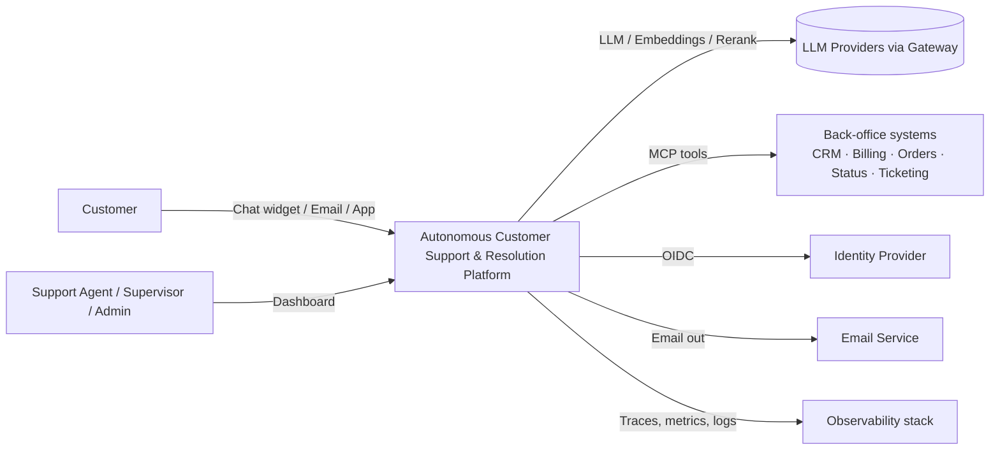
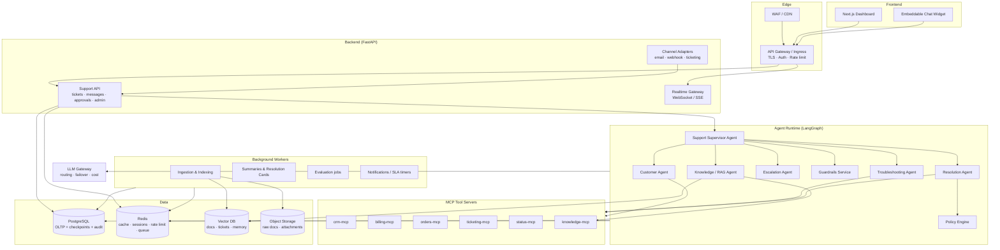
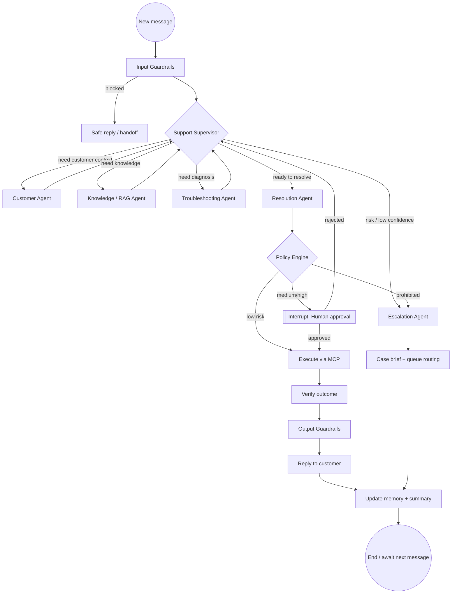
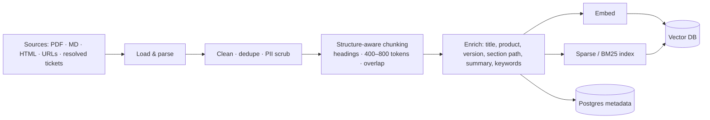
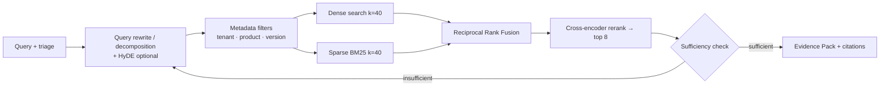
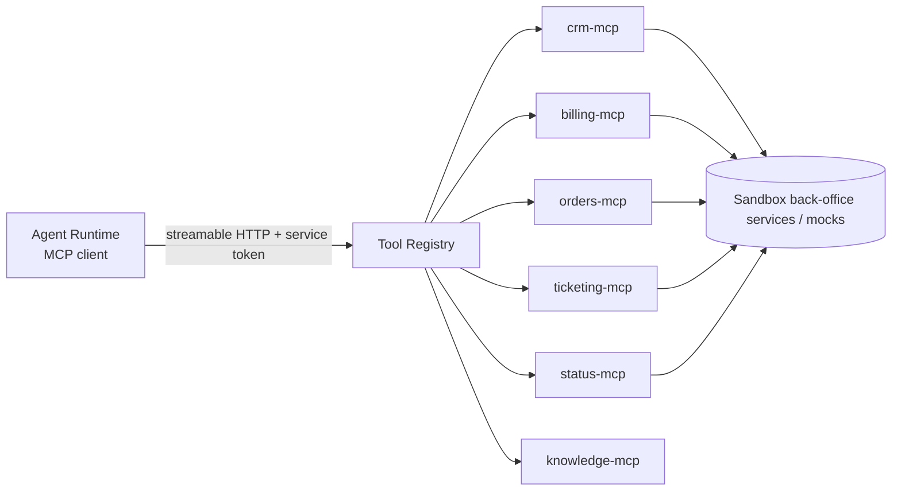
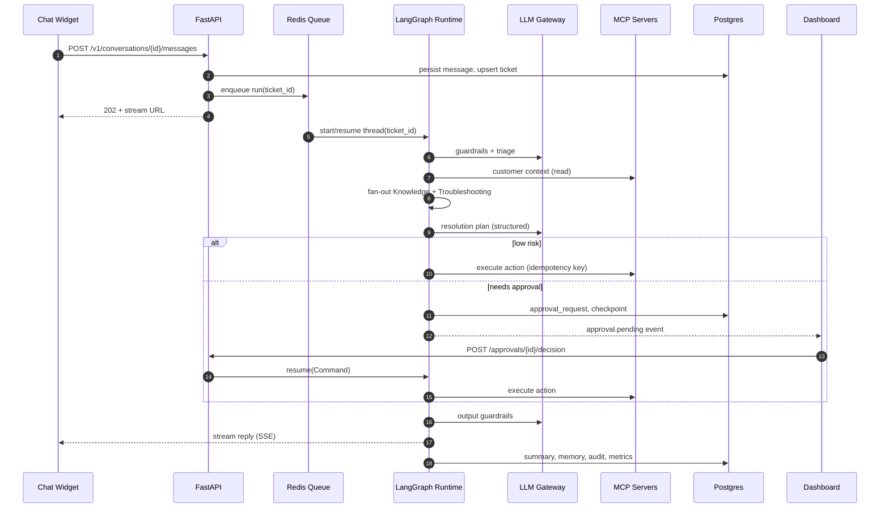
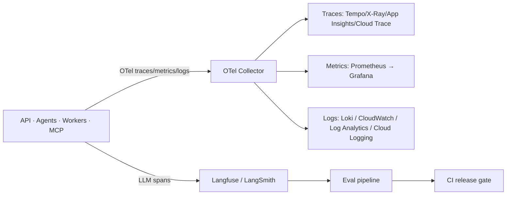
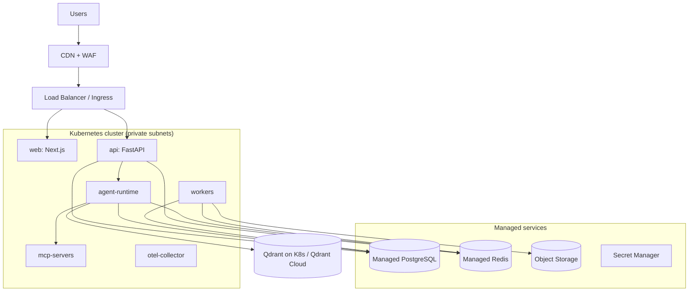

# High-Level Design (HLD)
## Autonomous Customer Support & Resolution Platform (ACSRP)

| Field | Value |
|---|---|
| Version | 1.0 (Draft) |
| Date | 31 October 2026 |
| Owner | Anu — OrionVexa |
| Inputs | `01_PRD_BRD_Autonomous_Customer_Support_Platform.md` |
| Next | `03_LLD_Autonomous_Customer_Support_Platform.md` |

---

## 1. Architecture Goals

| Goal | Design response |
|---|---|
| Act, not just answer | Agents call governed tools via MCP; policy engine + HITL decides what runs |
| Safe autonomy | Risk tiers, approval interrupts, guardrails at input/output/action layers |
| Grounded answers | Hybrid retrieval + reranking + citation-enforced generation |
| Durable long-running workflows | LangGraph with Postgres checkpointer; background workers |
| Cloud portability | Containers + Terraform; cloud specifics behind adapter interfaces |
| Observable & evaluable | OpenTelemetry + LLM tracing + eval pipeline wired into CI |
| Cost aware | Model routing, caching, token budgets |

---

## 2. System Context

---

## 3. Logical Architecture

### 3.1 Component Responsibilities

| Component | Responsibility | Tech |
|---|---|---|
| Next.js Dashboard | Inbox, ticket view, approvals, escalations, analytics, admin | Next.js 15 (App Router), TypeScript, Tailwind, shadcn/ui, TanStack Query |
| Chat Widget | Customer chat, streaming replies, attachments | React web component, SSE/WebSocket |
| API Gateway / Ingress | TLS, JWT validation, coarse rate limits, routing | Cloud API gateway / NGINX ingress |
| Support API | REST endpoints, validation, RBAC, orchestration trigger | FastAPI, Pydantic v2, SQLAlchemy 2 (async) |
| Realtime Gateway | Push ticket/agent events to UI | FastAPI WebSockets + Redis Pub/Sub |
| Channel Adapters | Normalise email/webhook/ticketing input | FastAPI routers + workers |
| Agent Runtime | Multi-agent graph execution, checkpoints, interrupts | LangGraph, LangChain core |
| Guardrails Service | Input/output checks (injection, PII, toxicity, groundedness) | Python module + small LLM + Presidio |
| Policy Engine | Risk-tier decisions for actions | Rules in YAML/OPA-style evaluator |
| MCP Tool Servers | Typed, permissioned access to back-office systems | MCP Python SDK (streamable HTTP) |
| LLM Gateway | Provider abstraction, routing, retries, failover, cost tracking | LiteLLM (or VexaRoute) |
| Background Workers | Ingestion, indexing, summaries, evals, SLA timers | Celery / arq on Redis |
| PostgreSQL | System of record, LangGraph checkpoints, audit, BM25 (optional) | PostgreSQL 16 (+ pgvector option) |
| Redis | Cache, sessions, rate limiting, queues, short-term memory | Redis 7 |
| Vector DB | Dense vectors for docs, tickets, resolution cards, memory | Qdrant (default) — pgvector as low-ops option |
| Object Storage | Raw documents, attachments, exports | S3 / Blob / GCS |

---

## 4. Multi-Agent Architecture

### 4.1 Pattern
**Supervisor (hierarchical) graph** with specialist agents as sub-graphs. The supervisor owns the ticket state and routes; specialists return structured results. Shared state is a typed `TicketState`.

### 4.2 Agent Responsibilities

| Agent | Purpose | Inputs | Outputs | Tools |
|---|---|---|---|---|
| **Support Supervisor** | Understand, classify, plan route, decide when done | Message, ticket state | `Triage` (intent, category, severity, sentiment, entities), next route | None (LLM only) |
| **Customer Agent** | Build customer context | Customer ID / email | `CustomerContext` (profile, plan, orders, invoices, open tickets, memory) | crm, billing, orders, ticketing, memory |
| **Knowledge / RAG Agent** | Retrieve grounded evidence | Query, triage, context | `EvidencePack` (chunks, scores, citations, sufficiency) | knowledge-mcp, vector DB |
| **Troubleshooting Agent** | Hypothesise and diagnose | Triage, evidence, context | `Diagnosis` (hypotheses, checks, findings, root cause, confidence) | status, orders, crm (read-only diagnostics) |
| **Resolution Agent** | Plan resolution, draft reply, request actions | Diagnosis, evidence, policy | `ResolutionPlan` (steps, actions, risk, reply draft) | Write tools (via policy) |
| **Escalation Agent** | Hand off safely | Full state, reason | `EscalationBrief` (summary, evidence, owner queue, urgency) | ticketing, notifications |

### 4.3 Routing Rules (Supervisor)
1. Always run Customer Agent first if customer is identified and context is stale (> 5 min).
2. P1, security, legal, fraud, self-harm, or explicit "talk to a human" → Escalation directly.
3. Informational intent → Knowledge → Resolution (reply only).
4. Problem intent → Knowledge + Troubleshooting (parallel fan-out) → Resolution.
5. Confidence < 0.6 after 2 investigation cycles or `max_steps` reached → Escalation.

---

## 5. Knowledge & Retrieval Design

### 5.1 Ingestion Pipeline

### 5.2 Retrieval Pipeline (Advanced + Agentic RAG)

Collections: `kb_docs`, `resolved_tickets`, `resolution_cards`, `customer_memory` (per-tenant payload filtering).

---

## 6. Memory Architecture

| Layer | Scope | Store | TTL | Contents |
|---|---|---|---|---|
| Working memory | One graph run | LangGraph state | Run | Messages, triage, evidence, plan |
| Conversation memory | Ticket thread | Postgres checkpoints + Redis cache | Ticket lifetime | Full thread, summarised beyond N turns |
| Customer long-term memory | Customer | Postgres (facts) + Vector DB (semantic) | Until erased | Preferences, environment, past issues, commitments |
| Organisational memory | Tenant | Vector DB (`resolution_cards`) | Versioned | Distilled successful resolutions |

Memory writes happen at the end of a run via a **memory extraction step** with structured output and confidence; low-confidence facts are discarded.

---

## 7. Human-in-the-Loop & Policy

- Resolution Agent emits proposed `ActionRequest`s; nothing executes directly from the LLM.
- Policy Engine evaluates `(tenant, action, args, customer tier, amount, history)` → `low | medium | high | prohibited`.
- Medium/high → LangGraph `interrupt()`; state persisted; `approval_requests` row created; dashboard notified.
- Approver decision resumes the graph via `Command(resume=...)`.
- Timeouts → auto-escalate; all decisions written to `audit_log`.

---

## 8. Integration via MCP

- Each MCP server declares tools with JSON schemas, a `risk_tier` default and `read_only` flag.
- Per-agent allow-lists: only Resolution Agent may call write tools.
- Service-to-service auth: short-lived JWT (client credentials) + mTLS within cluster.

---

## 9. Key Sequence — Chat Message to Resolution

---

## 10. Security Architecture

| Layer | Control |
|---|---|
| Identity | OIDC (Auth0/Keycloak/Entra ID/Cognito/Identity Platform); JWT access tokens; customers via widget session token |
| Authorisation | RBAC: `customer`, `agent`, `supervisor`, `admin`, `platform_engineer`, `service`; tenant scoping on every query (row-level security) |
| API security | Input validation (Pydantic), CORS allow-list, CSRF for cookie flows, request size limits, OWASP API Top 10 |
| Rate limiting | Edge (gateway) + app-level token-bucket in Redis per tenant/user/IP; LLM token budgets |
| Secrets | AWS Secrets Manager / Azure Key Vault / GCP Secret Manager via workload identity |
| Data | TLS everywhere, encryption at rest (KMS), PII redaction in logs/traces |
| AI security | Injection classifier, content isolation (untrusted text never treated as instructions), tool allow-lists, arg validation, policy engine |
| Supply chain | Image scanning (Trivy), SBOM, dependency pinning, signed images |
| Audit | Append-only audit log for decisions, actions, approvals, admin changes |

---

## 11. Observability & Evaluation

- Correlation: `ticket_id`, `run_id`, `trace_id` on every log line and span.
- Golden signals + AI signals: autonomous rate, escalation rate, groundedness, tool error rate, tokens/cost per ticket, approval latency.
- Offline evals (golden dataset) in CI; online evals sample 5–10% of traffic with LLM-as-judge + human QA.

---

## 12. Deployment Architecture

### 12.1 Runtime Topology (per cloud)

Deployment units are identical containers; Kubernetes is the default target for parity. A lighter "serverless containers" profile (ECS Fargate / Azure Container Apps / Cloud Run) is also defined.

### 12.2 Cloud Service Mapping

| Capability | AWS | Azure | GCP |
|---|---|---|---|
| Containers (K8s) | EKS | AKS | GKE |
| Containers (serverless) | ECS Fargate / App Runner | Azure Container Apps | Cloud Run |
| Container registry | ECR | ACR | Artifact Registry |
| PostgreSQL | RDS / Aurora PostgreSQL | Azure Database for PostgreSQL Flexible Server | Cloud SQL for PostgreSQL / AlloyDB |
| Redis | ElastiCache for Redis | Azure Cache for Redis / Azure Managed Redis | Memorystore for Redis |
| Vector DB | Qdrant on EKS · OpenSearch · pgvector | Qdrant on AKS · Azure AI Search · pgvector | Qdrant on GKE · Vertex AI Vector Search · pgvector |
| Object storage | S3 | Blob Storage | Cloud Storage |
| LLM (managed) | Bedrock | Azure OpenAI / AI Foundry | Vertex AI |
| Secrets | Secrets Manager | Key Vault | Secret Manager |
| Identity (workload) | IRSA / EKS Pod Identity | Workload Identity | Workload Identity |
| Identity (users) | Cognito | Entra ID | Identity Platform |
| API gateway / LB | API Gateway / ALB | API Management / App Gateway | API Gateway / Cloud Load Balancing |
| WAF / CDN | AWS WAF + CloudFront | Front Door + WAF | Cloud Armor + Cloud CDN |
| Queue (optional) | SQS | Service Bus | Pub/Sub |
| Email | SES | Azure Communication Services | SendGrid (marketplace) |
| Logs / metrics | CloudWatch | Azure Monitor / Log Analytics | Cloud Logging / Monitoring |
| Tracing | X-Ray (via OTel) | Application Insights | Cloud Trace |
| IaC state | S3 + DynamoDB lock | Storage Account | GCS bucket |
| DNS / TLS | Route 53 + ACM | Azure DNS + Key Vault certs | Cloud DNS + Certificate Manager |

### 12.3 Environments
`local` (Docker Compose) → `dev` → `staging` → `prod` per cloud. Promotion by Git tag; same image digest across clouds.

### 12.4 CI/CD

```mermaid
flowchart LR
    PR[Pull request] --> LINT[Lint · type-check · unit tests]
    LINT --> INT[Integration tests<br/>Compose services]
    INT --> EVAL[Agent & RAG eval gate]
    EVAL --> SEC[SAST · dep scan · image scan]
    SEC --> BUILD[Build & sign images]
    BUILD --> PUSH[Push to ECR · ACR · Artifact Registry]
    PUSH --> TF[Terraform plan/apply per cloud]
    TF --> DEP[Helm deploy → dev]
    DEP --> SMOKE[Smoke + synthetic tickets]
    SMOKE --> PROMO[Manual approval → staging → prod]
```

---

## 13. Scalability & Resilience

| Concern | Approach |
|---|---|
| Burst traffic | API stateless, HPA on CPU/RPS; agent runs queued in Redis; workers scale on queue depth (KEDA) |
| Long-running runs | Checkpointed graphs; resumable after pod restarts |
| LLM latency | Streaming, parallel fan-out, small models for triage, semantic cache for FAQs |
| Provider failure | Gateway failover chain; circuit breaker; degrade to human handoff |
| DB load | Read replicas for analytics; connection pooling (PgBouncer) |
| Vector DB | Sharded/replicated collections; payload index on `tenant_id` |
| DR | PITR backups for Postgres; vector index rebuildable from Postgres + object storage; RPO 15 min / RTO 1 h |

---

## 14. Key Architecture Decisions (summary)

| ADR | Decision | Rationale |
|---|---|---|
| ADR-01 | LangGraph supervisor pattern | Explicit control flow, checkpoints, interrupts for HITL |
| ADR-02 | MCP for all tool access | Standard, typed, permissioned; reusable across agents/apps |
| ADR-03 | Qdrant default, pgvector option | Native hybrid (dense+sparse), payload filters; pgvector for minimal ops |
| ADR-04 | Postgres as checkpointer and audit store | One durable system of record |
| ADR-05 | LLM gateway in front of providers | Multi-cloud model portability, failover, cost tracking |
| ADR-06 | Kubernetes as parity target | Same Helm chart on EKS/AKS/GKE |
| ADR-07 | Policy engine outside the LLM | Deterministic, auditable risk decisions |
| ADR-08 | Redis queue for runs (cloud queues optional) | Portable; same behaviour on all clouds |
