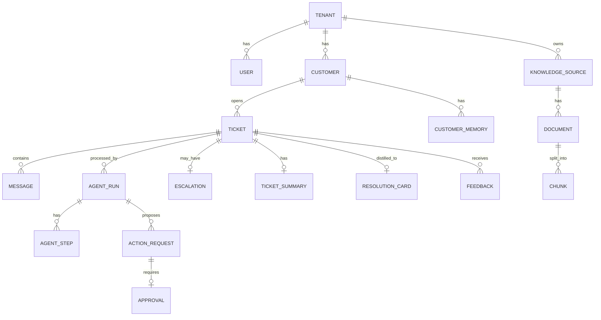

# Low-Level Design (LLD)
## Autonomous Customer Support & Resolution Platform (ACSRP)

| Field | Value |
|---|---|
| Version | 1.0 (Draft) |
| Date | 31 October 2026 |
| Owner | Anu — OrionVexa |
| Inputs | PRD/BRD (`01_…`), HLD (`02_…`) |

---

## 1. Technology Stack (pinned baselines)

| Layer | Choice |
|---|---|
| Language | Python 3.12 (backend), TypeScript 5.x (frontend) |
| Backend | FastAPI, Uvicorn, Pydantic v2, SQLAlchemy 2.x (async) + asyncpg, Alembic |
| Agents | LangGraph (+ `langgraph-checkpoint-postgres`), langchain-core |
| MCP | `mcp` Python SDK (FastMCP, streamable HTTP transport) |
| LLM gateway | LiteLLM (proxy or SDK) — swappable for VexaRoute |
| Vector DB | Qdrant (dense + sparse vectors); pgvector adapter |
| Embeddings / rerank | Configurable: `text-embedding-3-large` / `bge-m3`; reranker `bge-reranker-v2-m3` or Cohere Rerank |
| Guardrails | Presidio (PII), custom injection classifier (small LLM + heuristics), output groundedness judge |
| Workers | arq (async Redis queue) — Celery alternative |
| Cache / limits | Redis 7 |
| Auth | OIDC + JWT (python-jose / authlib), Keycloak for local |
| Frontend | Next.js 15 App Router, Tailwind, shadcn/ui, TanStack Query, Zustand, next-auth |
| Observability | OpenTelemetry SDK, Langfuse, Prometheus client, structlog |
| Testing | pytest, pytest-asyncio, httpx, testcontainers, Playwright, RAGAS/DeepEval-style evals |
| Packaging | uv, Docker multi-stage, Helm, Terraform ≥ 1.8 |

---

## 2. Repository Structure (monorepo)

```
acsrp/
├── apps/
│   ├── api/                      # FastAPI service
│   │   ├── app/
│   │   │   ├── main.py
│   │   │   ├── core/             # config, security, logging, telemetry, errors
│   │   │   ├── db/               # session, models, repositories
│   │   │   ├── api/v1/           # routers: tickets, messages, approvals, admin, auth, analytics, widget
│   │   │   ├── services/         # ticket_service, approval_service, memory_service, ...
│   │   │   ├── channels/         # email, webhook, ticketing adapters
│   │   │   ├── realtime/         # ws/sse manager
│   │   │   └── schemas/          # Pydantic DTOs
│   │   └── alembic/
│   ├── agents/                   # LangGraph runtime (worker process)
│   │   ├── graph/
│   │   │   ├── state.py
│   │   │   ├── builder.py
│   │   │   ├── nodes/            # supervisor, customer, knowledge, troubleshoot, resolution, escalation, memory
│   │   │   └── routing.py
│   │   ├── prompts/              # versioned prompt templates (.md + metadata)
│   │   ├── guardrails/
│   │   ├── policy/               # engine + policies/*.yaml
│   │   ├── retrieval/            # hybrid, rerank, rewriting, sufficiency
│   │   ├── memory/
│   │   ├── llm/                  # gateway client, model routing, cost
│   │   └── mcp_client/
│   ├── workers/                  # ingestion, summaries, evals, sla timers
│   ├── mcp-servers/
│   │   ├── crm/  billing/  orders/  ticketing/  status/  knowledge/
│   └── web/                      # Next.js dashboard + widget
├── packages/
│   ├── shared-schemas/           # Pydantic models shared (agents ⇄ api)
│   └── ui/                       # shared React components
├── evals/                        # golden datasets, red-team sets, runners
├── infra/
│   ├── docker/                   # compose.yaml, compose.observability.yaml
│   ├── helm/acsrp/
│   └── terraform/
│       ├── modules/{network,k8s,postgres,redis,storage,secrets,registry,observability}/{aws,azure,gcp}
│       └── envs/{aws,azure,gcp}/{dev,staging,prod}
├── .github/workflows/
└── docs/  (PRD, HLD, LLD, ADRs, runbooks)
```

---

## 3. Data Design

### 3.1 Entity Relationship (core)



### 3.2 PostgreSQL DDL (key tables)

```sql
CREATE EXTENSION IF NOT EXISTS "pgcrypto";

CREATE TABLE tenants (
  id            UUID PRIMARY KEY DEFAULT gen_random_uuid(),
  name          TEXT NOT NULL,
  autonomy_mode TEXT NOT NULL DEFAULT 'supervised'
                CHECK (autonomy_mode IN ('copilot','supervised','autonomous')),
  settings      JSONB NOT NULL DEFAULT '{}',
  created_at    TIMESTAMPTZ NOT NULL DEFAULT now()
);

CREATE TABLE users (
  id          UUID PRIMARY KEY DEFAULT gen_random_uuid(),
  tenant_id   UUID NOT NULL REFERENCES tenants(id),
  external_id TEXT NOT NULL,              -- OIDC sub
  email       CITEXT NOT NULL,
  display_name TEXT,
  role        TEXT NOT NULL CHECK (role IN ('agent','supervisor','admin','platform_engineer')),
  is_active   BOOLEAN NOT NULL DEFAULT true,
  created_at  TIMESTAMPTZ NOT NULL DEFAULT now(),
  UNIQUE (tenant_id, external_id)
);

CREATE TABLE customers (
  id            UUID PRIMARY KEY DEFAULT gen_random_uuid(),
  tenant_id     UUID NOT NULL REFERENCES tenants(id),
  external_ref  TEXT,                     -- CRM id
  email         CITEXT,
  name          TEXT,
  tier          TEXT DEFAULT 'standard',  -- standard | premium | enterprise
  locale        TEXT DEFAULT 'en',
  created_at    TIMESTAMPTZ NOT NULL DEFAULT now(),
  UNIQUE (tenant_id, email)
);

CREATE TYPE ticket_status AS ENUM ('new','in_progress','awaiting_customer','awaiting_approval',
                                   'escalated','resolved','closed');
CREATE TYPE severity AS ENUM ('P1','P2','P3','P4');

CREATE TABLE tickets (
  id              UUID PRIMARY KEY DEFAULT gen_random_uuid(),
  tenant_id       UUID NOT NULL REFERENCES tenants(id),
  customer_id     UUID REFERENCES customers(id),
  channel         TEXT NOT NULL CHECK (channel IN ('chat','email','api','ticketing')),
  external_ref    TEXT,
  subject         TEXT,
  status          ticket_status NOT NULL DEFAULT 'new',
  severity        severity,
  category        TEXT,
  subcategory     TEXT,
  sentiment       REAL,                    -- -1..1
  assignee_id     UUID REFERENCES users(id),
  ai_handled      BOOLEAN NOT NULL DEFAULT true,
  sla_due_at      TIMESTAMPTZ,
  resolved_at     TIMESTAMPTZ,
  created_at      TIMESTAMPTZ NOT NULL DEFAULT now(),
  updated_at      TIMESTAMPTZ NOT NULL DEFAULT now()
);
CREATE INDEX ix_tickets_tenant_status ON tickets (tenant_id, status, severity);
CREATE INDEX ix_tickets_customer ON tickets (customer_id, created_at DESC);

CREATE TABLE messages (
  id           UUID PRIMARY KEY DEFAULT gen_random_uuid(),
  tenant_id    UUID NOT NULL,
  ticket_id    UUID NOT NULL REFERENCES tickets(id) ON DELETE CASCADE,
  author_type  TEXT NOT NULL CHECK (author_type IN ('customer','ai','agent','system')),
  author_id    UUID,
  body         TEXT NOT NULL,
  body_redacted TEXT,                      -- PII-redacted copy for logs/analytics
  citations    JSONB DEFAULT '[]',
  attachments  JSONB DEFAULT '[]',
  created_at   TIMESTAMPTZ NOT NULL DEFAULT now()
);
CREATE INDEX ix_messages_ticket ON messages (ticket_id, created_at);

CREATE TABLE agent_runs (
  id            UUID PRIMARY KEY DEFAULT gen_random_uuid(),
  tenant_id     UUID NOT NULL,
  ticket_id     UUID NOT NULL REFERENCES tickets(id),
  thread_id     TEXT NOT NULL,             -- LangGraph thread id (= ticket_id)
  status        TEXT NOT NULL CHECK (status IN ('running','interrupted','completed','failed','escalated')),
  outcome       TEXT,                      -- resolved_auto | resolved_hitl | escalated | clarification
  confidence    REAL,
  total_tokens  INT DEFAULT 0,
  cost_usd      NUMERIC(10,5) DEFAULT 0,
  trace_id      TEXT,
  prompt_versions JSONB DEFAULT '{}',
  started_at    TIMESTAMPTZ NOT NULL DEFAULT now(),
  finished_at   TIMESTAMPTZ
);

CREATE TABLE agent_steps (
  id          BIGSERIAL PRIMARY KEY,
  run_id      UUID NOT NULL REFERENCES agent_runs(id) ON DELETE CASCADE,
  node        TEXT NOT NULL,
  input_ref   JSONB,
  output      JSONB,                       -- structured output (redacted)
  model       TEXT,
  tokens_in   INT, tokens_out INT,
  latency_ms  INT,
  error       TEXT,
  created_at  TIMESTAMPTZ NOT NULL DEFAULT now()
);

CREATE TABLE action_requests (
  id              UUID PRIMARY KEY DEFAULT gen_random_uuid(),
  tenant_id       UUID NOT NULL,
  run_id          UUID NOT NULL REFERENCES agent_runs(id),
  ticket_id       UUID NOT NULL REFERENCES tickets(id),
  tool_name       TEXT NOT NULL,           -- e.g. billing.refund
  arguments       JSONB NOT NULL,
  risk_tier       TEXT NOT NULL CHECK (risk_tier IN ('low','medium','high','prohibited')),
  policy_reasons  JSONB DEFAULT '[]',
  status          TEXT NOT NULL CHECK (status IN ('proposed','pending_approval','approved','rejected',
                                                  'executing','succeeded','failed','expired')),
  idempotency_key TEXT NOT NULL UNIQUE,
  result          JSONB,
  created_at      TIMESTAMPTZ NOT NULL DEFAULT now(),
  executed_at     TIMESTAMPTZ
);

CREATE TABLE approvals (
  id               UUID PRIMARY KEY DEFAULT gen_random_uuid(),
  action_request_id UUID NOT NULL UNIQUE REFERENCES action_requests(id),
  required_role    TEXT NOT NULL,          -- agent | supervisor
  decision         TEXT CHECK (decision IN ('approved','rejected','edited')),
  edited_arguments JSONB,
  decided_by       UUID REFERENCES users(id),
  comment          TEXT,
  expires_at       TIMESTAMPTZ NOT NULL,
  decided_at       TIMESTAMPTZ
);

CREATE TABLE escalations (
  id          UUID PRIMARY KEY DEFAULT gen_random_uuid(),
  ticket_id   UUID NOT NULL REFERENCES tickets(id),
  reason_code TEXT NOT NULL,               -- low_confidence | p1 | security | legal | fraud | customer_request | repeated_failure | policy
  queue       TEXT NOT NULL,               -- l2 | billing | security | engineering
  brief       JSONB NOT NULL,
  status      TEXT NOT NULL DEFAULT 'open',
  created_at  TIMESTAMPTZ NOT NULL DEFAULT now()
);

CREATE TABLE customer_memory (
  id           UUID PRIMARY KEY DEFAULT gen_random_uuid(),
  tenant_id    UUID NOT NULL,
  customer_id  UUID NOT NULL REFERENCES customers(id) ON DELETE CASCADE,
  kind         TEXT NOT NULL CHECK (kind IN ('preference','environment','issue_history','commitment','fact')),
  content      TEXT NOT NULL,
  source_ticket_id UUID,
  confidence   REAL NOT NULL,
  vector_id    TEXT,                       -- Qdrant point id
  expires_at   TIMESTAMPTZ,
  created_at   TIMESTAMPTZ NOT NULL DEFAULT now()
);

CREATE TABLE ticket_summaries (
  ticket_id   UUID PRIMARY KEY REFERENCES tickets(id),
  summary     TEXT NOT NULL,
  root_cause  TEXT,
  resolution  TEXT,
  structured  JSONB,
  updated_at  TIMESTAMPTZ NOT NULL DEFAULT now()
);

CREATE TABLE knowledge_sources (
  id          UUID PRIMARY KEY DEFAULT gen_random_uuid(),
  tenant_id   UUID NOT NULL,
  type        TEXT NOT NULL CHECK (type IN ('upload','url','sitemap','tickets')),
  config      JSONB NOT NULL,
  schedule    TEXT,                        -- cron
  status      TEXT NOT NULL DEFAULT 'active',
  last_indexed_at TIMESTAMPTZ
);

CREATE TABLE documents (
  id          UUID PRIMARY KEY DEFAULT gen_random_uuid(),
  tenant_id   UUID NOT NULL,
  source_id   UUID NOT NULL REFERENCES knowledge_sources(id),
  uri         TEXT NOT NULL,
  title       TEXT,
  product     TEXT,
  version     TEXT,
  content_hash TEXT NOT NULL,
  object_key  TEXT,                        -- raw file in object storage
  indexed_at  TIMESTAMPTZ,
  UNIQUE (tenant_id, uri, content_hash)
);

CREATE TABLE chunks (
  id          UUID PRIMARY KEY DEFAULT gen_random_uuid(),
  tenant_id   UUID NOT NULL,
  document_id UUID NOT NULL REFERENCES documents(id) ON DELETE CASCADE,
  ord         INT NOT NULL,
  section_path TEXT,
  text        TEXT NOT NULL,
  token_count INT,
  metadata    JSONB
);

CREATE TABLE resolution_cards (
  id          UUID PRIMARY KEY DEFAULT gen_random_uuid(),
  tenant_id   UUID NOT NULL,
  ticket_id   UUID NOT NULL REFERENCES tickets(id),
  problem     TEXT NOT NULL,
  symptoms    TEXT[],
  root_cause  TEXT,
  steps       JSONB NOT NULL,
  status      TEXT NOT NULL DEFAULT 'draft' CHECK (status IN ('draft','approved','retired')),
  reviewed_by UUID REFERENCES users(id),
  created_at  TIMESTAMPTZ NOT NULL DEFAULT now()
);

CREATE TABLE feedback (
  id         BIGSERIAL PRIMARY KEY,
  ticket_id  UUID NOT NULL REFERENCES tickets(id),
  source     TEXT NOT NULL CHECK (source IN ('customer','agent')),
  rating     SMALLINT,                     -- 1..5
  labels     TEXT[],                       -- wrong_answer, unsafe, great, ...
  comment    TEXT,
  run_id     UUID,
  created_at TIMESTAMPTZ NOT NULL DEFAULT now()
);

CREATE TABLE audit_log (
  id          BIGSERIAL PRIMARY KEY,
  tenant_id   UUID NOT NULL,
  actor_type  TEXT NOT NULL,               -- user | ai | service
  actor_id    TEXT NOT NULL,
  action      TEXT NOT NULL,               -- tool.execute, approval.decide, policy.update, memory.delete ...
  target      TEXT,
  details     JSONB,
  trace_id    TEXT,
  created_at  TIMESTAMPTZ NOT NULL DEFAULT now()
);
-- append-only: revoke UPDATE/DELETE from app role
```

**Row-Level Security:** enable RLS on all tenant tables with `USING (tenant_id = current_setting('app.tenant_id')::uuid)`; the API sets `SET LOCAL app.tenant_id` per transaction.

LangGraph checkpoints use the library-managed tables (`checkpoints`, `checkpoint_writes`, `checkpoint_blobs`) in a dedicated `langgraph` schema.

### 3.3 Vector DB Collections (Qdrant)

| Collection | Vectors | Payload (indexed) |
|---|---|---|
| `kb_docs` | `dense` (1024/3072), `sparse` (BM25/SPLADE) | tenant_id, document_id, product, version, section_path, updated_at |
| `resolved_tickets` | dense, sparse | tenant_id, ticket_id, category, severity, resolved_at, csat |
| `resolution_cards` | dense, sparse | tenant_id, card_id, category, status=approved |
| `customer_memory` | dense | tenant_id, customer_id, kind |

Point ID = chunk/card/memory UUID → Postgres row is the source of truth; index is rebuildable.

### 3.4 Redis Key Design

| Key | Type | TTL | Purpose |
|---|---|---|---|
| `rl:{tenant}:{user\|ip}:{route}` | string/counter | window | Token-bucket rate limiting |
| `tok:{tenant}:{yyyymmdd}` | hash | 48 h | LLM token/cost budget |
| `sess:widget:{sid}` | hash | 24 h | Widget session → customer/ticket |
| `ctx:customer:{tenant}:{cid}` | JSON | 5 min | Customer context cache |
| `sem:faq:{tenant}:{hash}` | JSON | 1 h | Semantic answer cache (low-risk informational only) |
| `emb:{model}:{sha}` | bytes | 7 d | Embedding cache |
| `lock:run:{ticket_id}` | string | 120 s | One active graph run per ticket |
| `arq:queue:*` | – | – | Background jobs |
| `pub:ticket:{id}` / `pub:tenant:{id}` | pub/sub | – | Realtime events |

---

## 4. API Design (FastAPI, `/api/v1`)

All responses JSON; errors use RFC 9457 Problem Details. Every request carries `X-Request-ID`; responses include `traceparent`.

### 4.1 Endpoints

| Method | Path | Roles | Description |
|---|---|---|---|
| POST | `/widget/sessions` | public (site key) | Create widget session → short-lived customer token |
| POST | `/conversations` | customer, agent | Create ticket + first message |
| POST | `/conversations/{ticket_id}/messages` | customer, agent | Add message; triggers agent run (202) |
| GET | `/conversations/{ticket_id}/stream` | customer, agent | SSE stream of AI tokens/events |
| GET | `/tickets` | agent+ | List/filter tickets (cursor pagination) |
| GET | `/tickets/{id}` | agent+ | Ticket detail incl. messages, summary |
| GET | `/tickets/{id}/runs` | agent+ | Agent runs + steps timeline |
| PATCH | `/tickets/{id}` | agent+ | Update status/assignee/severity |
| POST | `/tickets/{id}/handoff` | agent+ | Take over from AI |
| GET | `/approvals?status=pending` | agent, supervisor | Approval queue (filtered by required_role) |
| POST | `/approvals/{id}/decision` | agent, supervisor | Approve / reject / edit |
| GET | `/escalations` | agent+ | Escalation queue |
| POST | `/tickets/{id}/feedback` | customer, agent | CSAT / labels |
| GET | `/customers/{id}/memory` | supervisor+ | View memory |
| DELETE | `/customers/{id}/memory` | admin, customer(self) | Erase memory |
| POST | `/admin/knowledge-sources` | admin | Add source |
| POST | `/admin/knowledge-sources/{id}/reindex` | admin | Trigger reindex job |
| GET/PUT | `/admin/policies` | admin | View/update action policies (versioned) |
| GET/PUT | `/admin/tools` | admin | Tool registry, allow-lists |
| GET/PUT | `/admin/tenant` | admin | Autonomy mode, thresholds |
| GET | `/analytics/overview` | supervisor+ | KPIs |
| POST | `/channels/email/inbound` | service (HMAC) | Inbound email webhook |
| POST | `/channels/ticketing/webhook` | service (HMAC) | Ticketing system webhook |
| GET | `/healthz`, `/readyz` | public | Probes |
| WS | `/ws` | agent+ | Dashboard realtime events |

### 4.2 Example Contracts

```python
# schemas/conversation.py
class MessageCreate(BaseModel):
    body: str = Field(min_length=1, max_length=8000)
    attachments: list[AttachmentRef] = []
    client_message_id: str | None = None   # idempotency from client

class MessageAccepted(BaseModel):
    ticket_id: UUID
    message_id: UUID
    run_id: UUID
    stream_url: str

class ApprovalDecision(BaseModel):
    decision: Literal["approved", "rejected", "edited"]
    edited_arguments: dict[str, Any] | None = None
    comment: str | None = Field(default=None, max_length=1000)

    @model_validator(mode="after")
    def edited_needs_args(self):
        if self.decision == "edited" and not self.edited_arguments:
            raise ValueError("edited_arguments required when decision='edited'")
        return self
```

### 4.3 SSE Event Types
`run.started`, `node.started` (`{node}`), `token` (`{text}`), `citation`, `action.proposed`, `approval.pending`, `action.executed`, `escalated`, `message.final`, `run.completed`, `error`.

---

## 5. Authentication & Authorisation

### 5.1 Flows
- **Staff (dashboard):** OIDC Authorization Code + PKCE via next-auth → access token (JWT, 15 min) sent as Bearer to API; refresh handled by next-auth.
- **Customers (widget):** site key + origin check → `POST /widget/sessions` → signed customer JWT (scope `customer`, `tid`, `cid`, 24 h). Optional verified identity via HMAC of user id from the host app.
- **Services / MCP:** OAuth2 client credentials → JWT with `aud=mcp:{server}` and `scope=tools:read|tools:write`.

### 5.2 RBAC Matrix

| Permission | customer | agent | supervisor | admin | platform_engineer |
|---|:-:|:-:|:-:|:-:|:-:|
| ticket:create (own) | ✔ | ✔ | ✔ | ✔ | |
| ticket:read (own) | ✔ | | | | |
| ticket:read (tenant) | | ✔ | ✔ | ✔ | |
| approval:decide:medium | | ✔ | ✔ | ✔ | |
| approval:decide:high | | | ✔ | ✔ | |
| escalation:manage | | ✔ | ✔ | ✔ | |
| memory:read | | | ✔ | ✔ | |
| memory:delete | self | | | ✔ | |
| knowledge:manage | | | | ✔ | |
| policy:manage | | | | ✔ | |
| analytics:read | | | ✔ | ✔ | ✔ |
| ops:traces | | | | | ✔ |

```python
# core/security.py
def require(permission: str):
    async def dep(principal: Principal = Depends(get_principal)) -> Principal:
        if permission not in ROLE_PERMISSIONS[principal.role]:
            raise HTTPException(403, "forbidden")
        return principal
    return dep

@router.post("/approvals/{approval_id}/decision")
async def decide(approval_id: UUID, body: ApprovalDecision,
                 p: Principal = Depends(require("approval:decide:medium")),
                 svc: ApprovalService = Depends()):
    return await svc.decide(approval_id, body, p)   # service re-checks high-tier permission
```

---

## 6. Rate Limiting & Budgets

- **Algorithm:** token bucket in Redis via atomic Lua script.
- **Defaults (configurable per tenant):**

| Scope | Limit |
|---|---|
| Widget per IP | 30 req/min |
| Customer messages per ticket | 10 msg/min |
| Staff API per user | 600 req/min |
| Admin reindex | 5/hour |
| LLM tokens per tenant | daily budget (e.g. 5M) with 80% alert, 100% → copilot-only mode |

```python
class RateLimitMiddleware:
    async def __call__(self, scope, receive, send):
        key = build_key(scope)                       # tenant + principal/ip + route group
        allowed, retry_after = await bucket.take(key, cost=1)
        if not allowed:
            return await problem(429, "rate_limited", headers={"Retry-After": str(retry_after)})
        ...
```

---

## 7. Agent Runtime (LangGraph)

### 7.1 State

```python
# agents/graph/state.py
class Triage(BaseModel):
    intent: Literal["question","problem","request_action","complaint","other"]
    category: str
    subcategory: str | None
    severity: Literal["P1","P2","P3","P4"]
    sentiment: float = Field(ge=-1, le=1)
    language: str
    entities: dict[str, str] = {}
    risk_flags: list[Literal["security","legal","fraud","self_harm","churn","outage"]] = []
    needs_clarification: bool = False
    clarifying_question: str | None = None
    confidence: float = Field(ge=0, le=1)

class Citation(BaseModel):
    source_type: Literal["kb","ticket","card"]
    source_id: str
    chunk_id: str
    title: str
    score: float

class EvidencePack(BaseModel):
    queries: list[str]
    citations: list[Citation]
    context: list[str]
    sufficient: bool
    gaps: list[str] = []

class Diagnosis(BaseModel):
    hypotheses: list[str]
    checks: list[dict]          # {tool, args, result_summary}
    root_cause: str | None
    confidence: float

class ActionProposal(BaseModel):
    tool: str                   # "billing.refund"
    arguments: dict[str, Any]
    rationale: str
    expected_outcome: str

class ResolutionPlan(BaseModel):
    summary: str
    steps: list[str]
    actions: list[ActionProposal] = []
    reply_draft: str
    cited_ids: list[str]
    confidence: float

class EscalationBrief(BaseModel):
    reason_code: str
    queue: str
    urgency: Literal["low","normal","high","critical"]
    summary: str
    attempted: list[str]
    recommended_next_step: str

class TicketState(TypedDict):
    tenant_id: str
    ticket_id: str
    run_id: str
    customer_id: str | None
    messages: Annotated[list[AnyMessage], add_messages]
    triage: Triage | None
    customer_ctx: dict | None
    evidence: EvidencePack | None
    diagnosis: Diagnosis | None
    plan: ResolutionPlan | None
    action_results: Annotated[list[dict], operator.add]
    escalation: EscalationBrief | None
    route_history: Annotated[list[str], operator.add]
    step_count: int
    guardrail_flags: Annotated[list[str], operator.add]
    final_reply: str | None
```

### 7.2 Graph Construction

```python
# agents/graph/builder.py
def build_graph(checkpointer) -> CompiledGraph:
    g = StateGraph(TicketState)

    g.add_node("input_guard", input_guardrails_node)
    g.add_node("supervisor", supervisor_node)
    g.add_node("customer", customer_agent_node)
    g.add_node("investigate", investigate_node)        # parallel Knowledge + Troubleshooting via Send
    g.add_node("knowledge", knowledge_agent_node)
    g.add_node("troubleshoot", troubleshooting_agent_node)
    g.add_node("resolution", resolution_agent_node)
    g.add_node("policy_gate", policy_gate_node)        # may interrupt()
    g.add_node("execute", execute_actions_node)
    g.add_node("output_guard", output_guardrails_node)
    g.add_node("respond", respond_node)
    g.add_node("escalation", escalation_agent_node)
    g.add_node("clarify", clarify_node)
    g.add_node("memory", memory_writeback_node)

    g.add_edge(START, "input_guard")
    g.add_conditional_edges("input_guard", route_after_input_guard,
                            {"ok": "supervisor", "block": "respond", "escalate": "escalation"})
    g.add_conditional_edges("supervisor", supervisor_router, {
        "customer": "customer", "investigate": "investigate", "knowledge": "knowledge",
        "resolution": "resolution", "escalation": "escalation", "clarify": "clarify"})
    for n in ("customer", "knowledge", "troubleshoot"):
        g.add_edge(n, "supervisor")
    g.add_conditional_edges("investigate", fan_out_investigation, ["knowledge", "troubleshoot"])
    g.add_edge("resolution", "policy_gate")
    g.add_conditional_edges("policy_gate", route_after_policy,
                            {"execute": "execute", "reply_only": "output_guard",
                             "replan": "supervisor", "escalate": "escalation"})
    g.add_edge("execute", "output_guard")
    g.add_conditional_edges("output_guard", route_after_output_guard,
                            {"ok": "respond", "revise": "resolution", "escalate": "escalation"})
    g.add_edge("clarify", "memory")
    g.add_edge("respond", "memory")
    g.add_edge("escalation", "memory")
    g.add_edge("memory", END)

    return g.compile(checkpointer=checkpointer)
```

Checkpointer: `AsyncPostgresSaver` with `thread_id = ticket_id`. Each new customer message resumes the same thread.

### 7.3 Supervisor Router (deterministic + LLM)

```python
MAX_STEPS = 12
CONF_ESCALATE = 0.6

def supervisor_router(s: TicketState) -> str:
    t = s["triage"]
    if s["step_count"] >= MAX_STEPS:
        return "escalation"
    if t.risk_flags and set(t.risk_flags) & {"security","legal","fraud","self_harm"}:
        return "escalation"
    if t.severity == "P1":
        return "escalation"
    if t.needs_clarification and count_clarifications(s) < 2:
        return "clarify"
    if s["customer_id"] and not s["customer_ctx"]:
        return "customer"
    if t.intent == "question" and not s["evidence"]:
        return "knowledge"
    if t.intent in ("problem","request_action","complaint") and not (s["evidence"] and s["diagnosis"]):
        return "investigate"
    conf = min(x for x in [t.confidence,
                           s["diagnosis"].confidence if s["diagnosis"] else 1.0] )
    if conf < CONF_ESCALATE and s["route_history"].count("investigate") >= 2:
        return "escalation"
    return "resolution"
```

The `supervisor_node` itself calls the triage model once per new customer message (small model, structured output), increments `step_count`, and appends to `route_history`.

### 7.4 Node Contracts

| Node | Model tier | Structured output | Timeout | Retries |
|---|---|---|---|---|
| input_guard | small | `GuardResult` | 3 s | 1 |
| supervisor (triage) | small | `Triage` | 5 s | 2 (repair) |
| customer | none / small | `CustomerContext` | 5 s | 2 |
| knowledge | small (rewrite) + rerank | `EvidencePack` | 6 s | 1 |
| troubleshoot | large | `Diagnosis` | 20 s | 1 |
| resolution | large | `ResolutionPlan` | 20 s | 2 (repair) |
| policy_gate | none (rules) | `PolicyDecision` | 100 ms | 0 |
| execute | none | `ActionResult` | per tool | tool-specific |
| output_guard | small | `GuardResult` | 4 s | 1 |
| escalation | medium | `EscalationBrief` | 10 s | 1 |
| memory | small | `list[MemoryFact]` + summary | async | 2 |

Structured output helper:

```python
async def structured(llm_tier: str, schema: type[T], messages, *, retries=2) -> T:
    for attempt in range(retries + 1):
        raw = await gateway.chat(tier=llm_tier, messages=messages,
                                 response_format=schema.model_json_schema(), temperature=0.1)
        try:
            return schema.model_validate_json(raw.content)
        except ValidationError as e:
            messages = messages + [repair_message(raw.content, e)]
    raise StructuredOutputError(schema.__name__)
```

### 7.5 Knowledge / RAG Agent

```python
async def knowledge_agent_node(s: TicketState) -> dict:
    q = build_query(s)                                        # latest msg + triage + entities
    queries = await rewrite(q, s["triage"])                   # 1–3 sub-queries
    filters = {"tenant_id": s["tenant_id"], "product": s["triage"].entities.get("product")}
    hits = []
    for col in ("kb_docs", "resolution_cards", "resolved_tickets"):
        hits += await hybrid_search(col, queries, filters, k_dense=40, k_sparse=40)
    fused = rrf(hits, k=60)
    top = await rerank(q, fused[:50], top_n=8)
    sufficient, gaps = await sufficiency_check(q, top)        # small LLM judge
    if not sufficient and s["route_history"].count("knowledge") < 2:
        # agentic loop: one more retrieval with gap-driven queries
        more = await hybrid_search("kb_docs", gaps, filters)
        top = await rerank(q, rrf(top + more)[:50], top_n=8)
        sufficient, gaps = await sufficiency_check(q, top)
    return {"evidence": EvidencePack(queries=queries, citations=to_citations(top),
                                     context=[h.text for h in top],
                                     sufficient=sufficient, gaps=gaps),
            "route_history": ["knowledge"]}
```

- **Chunking:** Markdown/HTML heading-aware splitter, target 600 tokens, 80 overlap; tables kept whole; each chunk prefixed with `title > section path` (contextual header).
- **Hybrid:** Qdrant `query_points` with prefetch (dense + sparse) and RRF fusion server-side; client-side RRF fallback for pgvector (`tsvector` + `vector`).
- **Rerank:** cross-encoder; drop below score 0.2.
- **Freshness boost:** `score *= 1 + 0.05 * recency_bucket` for tickets/cards.

### 7.6 Troubleshooting Agent
ReAct-style loop limited to **5 tool calls**, read-only tools only (`status.get_incidents`, `orders.get_order`, `crm.get_devices`, `billing.list_charges`, …). Each observation summarised into `Diagnosis.checks`. Stops when root cause confidence ≥ 0.75 or budget exhausted.

### 7.7 Resolution Agent
Inputs: triage, customer context, evidence, diagnosis, tenant tone guide, allowed tools (schemas). Prompt enforces:
- only cite provided `chunk_id`s;
- never promise outside policy;
- propose actions as `ActionProposal` rather than describe them as done.

### 7.8 Policy Engine

```yaml
# agents/policy/policies/billing.yaml
tool: billing.refund
default_tier: medium
rules:
  - when: "args.amount <= 50 and customer.tier in ['standard','premium'] and history.refunds_90d < 2"
    tier: low
  - when: "args.amount > 50 and args.amount <= 300"
    tier: medium
  - when: "args.amount > 300"
    tier: high
  - when: "history.refunds_90d >= 3"
    tier: high
    reason: "refund frequency"
  - when: "customer.flags contains 'fraud_review'"
    tier: prohibited
---
tool: crm.close_account
default_tier: prohibited
---
tool: orders.reship
default_tier: medium
rules:
  - when: "args.order_value <= 75 and order.status == 'lost_in_transit'"
    tier: low
---
tool: crm.reset_password_link
default_tier: low
```

Evaluation uses a safe expression evaluator (e.g. `simpleeval` with whitelisted names). Tenant `autonomy_mode` overrides: `copilot` → every action `pending_approval`(and never auto-send replies); `supervised` → `low` becomes `medium`.

```python
async def policy_gate_node(s: TicketState) -> Command | dict:
    decisions = [await policy.evaluate(s["tenant_id"], a, s) for a in s["plan"].actions]
    if any(d.tier == "prohibited" for d in decisions):
        return {"escalation_reason": "policy_prohibited"}             # router → escalate
    pending = [d for d in decisions if d.tier in ("medium", "high")]
    if pending:
        reqs = await actions_repo.create_pending(s, pending)          # action_requests + approvals
        await events.publish_approval_pending(s["tenant_id"], reqs)
        resume = interrupt({"approval_ids": [r.approval_id for r in reqs]})   # graph pauses
        apply_decisions(s, resume)                                    # approved/edited/rejected
    return {"approved_actions": approved_actions(s, decisions)}
```

Resume path (API):

```python
await graph.ainvoke(Command(resume={"decisions": decisions}),
                    config={"configurable": {"thread_id": str(ticket_id)}})
```

### 7.9 Action Execution

```python
async def execute_actions_node(s: TicketState) -> dict:
    results = []
    for a in s["approved_actions"]:
        key = f"{s['ticket_id']}:{a.tool}:{stable_hash(a.arguments)}"
        if prior := await actions_repo.get_by_key(key):               # idempotent
            results.append(prior.result); continue
        tool = registry.get(a.tool, agent="resolution")                # allow-list check
        args = tool.input_model.model_validate(a.arguments)           # schema validation
        await actions_repo.mark_executing(key)
        try:
            res = await mcp.call(tool.server, tool.name, args.model_dump(), idempotency_key=key)
            verified = await verify(tool, args, res)                  # read-back check
            await actions_repo.succeed(key, res, verified)
        except ToolError as e:
            await actions_repo.fail(key, str(e))
            res = {"error": e.code}
        await audit.log("tool.execute", actor="ai", target=a.tool, details={"key": key})
        results.append(res)
    return {"action_results": results}
```

### 7.10 Escalation Agent
- Produces `EscalationBrief`, sets ticket `status=escalated`, `ai_handled=false`.
- Queue routing table: `security → security`, `billing & amount>300 → billing`, `outage → engineering`, default `l2`.
- Sends holding reply to customer (template, no speculative content) + SLA timer job.

### 7.11 Memory Write-back
1. Summarise thread → `ticket_summaries` (on resolve/escalate).
2. Extract `MemoryFact[]` (kind, content, confidence); keep confidence ≥ 0.7; skip blocked PII categories (payment data, government IDs, health).
3. Upsert into `customer_memory` + embed into Qdrant `customer_memory`.
4. If resolved with CSAT ≥ 4 or agent-labelled "good", enqueue `distil_resolution_card` job (card created as `draft`, needs admin approval before indexing).

---

## 8. MCP Tool Servers

### 8.1 Tool Catalogue

| Server | Tool | Mode | Default tier |
|---|---|---|---|
| crm | `get_customer`, `get_devices`, `list_notes` | read | – |
| crm | `update_contact`, `reset_password_link` | write | low |
| crm | `close_account` | write | prohibited |
| billing | `list_invoices`, `list_charges` | read | – |
| billing | `refund`, `apply_credit` | write | policy |
| orders | `get_order`, `track_shipment` | read | – |
| orders | `reship`, `cancel_order` | write | medium |
| ticketing | `create_ticket`, `add_internal_note`, `assign_queue` | write | low |
| status | `get_incidents`, `get_service_health` | read | – |
| knowledge | `search_docs`, `get_document` | read | – |

### 8.2 Example Server

```python
# mcp-servers/billing/server.py
from mcp.server.fastmcp import FastMCP
mcp = FastMCP("billing")

class RefundIn(BaseModel):
    invoice_id: str = Field(pattern=r"^INV-\d{6,}$")
    charge_id: str
    amount: condecimal(gt=0, max_digits=10, decimal_places=2)
    currency: Literal["USD","CAD","EUR"]
    reason: Literal["duplicate_charge","service_issue","goodwill","other"]

@mcp.tool(annotations={"readOnlyHint": False, "destructiveHint": False, "idempotentHint": True})
async def refund(args: RefundIn, ctx: Context) -> dict:
    """Refund a captured charge. Requires idempotency key in request metadata."""
    caller = authorize(ctx, scope="tools:write")              # verify service JWT
    key = ctx.request_context.meta.get("idempotency_key")
    return await billing_backend.refund(args, idempotency_key=key, tenant=caller.tenant_id)
```

Transport: streamable HTTP behind cluster-internal service; NetworkPolicy allows only `agent-runtime` pods.

---

## 9. Guardrails

| Stage | Checks | Action on fail |
|---|---|---|
| Input | Size limits; injection/jailbreak classifier; PII detection (redact for logs, keep for processing where allowed); toxicity; self-harm/legal/security detectors | Block → safe reply; flag → escalate |
| Retrieved content | Strip instructions from docs/emails ("content isolation" wrapper: `<untrusted>…</untrusted>`), injection scan on chunks | Drop chunk |
| Tool args | JSON schema + Pydantic validation; values must originate from customer context/tool results, not free text from untrusted content (provenance check on IDs/amounts) | Reject → replan |
| Output | Groundedness (each claim ↔ cited chunk, judge score ≥ 0.8); policy compliance (no unapproved promises/discounts); PII leakage of other customers; tone | Revise (max 1) → escalate |

```python
class GuardResult(BaseModel):
    allowed: bool
    flags: list[str]
    reason: str | None
    redacted_text: str | None
```

---

## 10. LLM Gateway & Model Routing

```yaml
# config/models.yaml
tiers:
  small:  { primary: "openai/gpt-4.1-mini", fallbacks: ["anthropic/claude-haiku", "vertex/gemini-flash"] }
  medium: { primary: "anthropic/claude-sonnet", fallbacks: ["azure/gpt-4.1"] }
  large:  { primary: "anthropic/claude-sonnet", fallbacks: ["openai/gpt-4.1", "bedrock/claude-sonnet"] }
embedding: { model: "openai/text-embedding-3-large", dims: 3072 }
rerank:    { model: "bge-reranker-v2-m3", endpoint: "http://reranker:8080" }
limits: { request_timeout_s: 30, max_retries: 2, circuit_breaker: { failures: 5, window_s: 60 } }
```
(Model names are placeholders; set per cloud — e.g. Bedrock on AWS, Azure OpenAI on Azure, Vertex on GCP.)

Every call records `tenant_id, run_id, node, model, tokens_in/out, latency, cost` → `agent_steps` + Langfuse + Redis budget.

---

## 11. Background Workers

| Job | Trigger | Description |
|---|---|---|
| `run_ticket_graph` | message accepted | Acquire `lock:run:{ticket}`; start/resume graph; stream events |
| `ingest_source` | admin / cron | Fetch → parse → chunk → embed → upsert; diff by `content_hash` |
| `index_resolved_ticket` | ticket closed | Embed summary into `resolved_tickets` |
| `distil_resolution_card` | positive outcome | LLM distils card (draft) |
| `approval_timeout` | delayed job at `expires_at` | Expire approval, escalate |
| `sla_monitor` | every minute | Breach warnings, auto-escalate |
| `online_eval_sample` | run completed (5–10%) | LLM-judge faithfulness/helpfulness → Langfuse scores |
| `memory_ttl_sweep` | daily | Purge expired memory, retention enforcement |

Jobs are idempotent; retries with exponential backoff (max 5); dead-letter list `arq:dlq` with alert.

---

## 12. Frontend (Next.js)

### 12.1 Routes
```
/login
/inbox                         ticket list + filters
/tickets/[id]                  conversation | AI timeline | evidence | plan | actions
/approvals                     pending approvals (diff view of args, risk reasons)
/escalations
/analytics
/admin/knowledge               sources, ingestion jobs, documents
/admin/policies                YAML editor + test console
/admin/tools                   MCP registry, allow-lists
/admin/users
/admin/tenant                  autonomy mode, thresholds
```

### 12.2 Key Components
`TicketTimeline` (node-by-node steps with latency/tokens), `EvidencePanel` (citations → source preview), `ActionCard` (proposed/approved/executed states), `ApprovalDiff`, `RiskBadge`, `KPIStatCards`, `ChatWidget` (Web Component built from React, Shadow DOM, SSE).

### 12.3 State & Data
- TanStack Query for server state; WS events invalidate query keys (`['ticket', id]`, `['approvals']`).
- Optimistic updates on approval decisions with rollback.
- Role-aware UI via session claims; server is still the authority.

---

## 13. Observability

- **Tracing:** OTel auto-instrumentation (FastAPI, SQLAlchemy, Redis, httpx) + manual spans per graph node (`agent.node`, attributes: `ticket.id`, `run.id`, `node`, `model`, `tokens`). Context propagated API → queue (trace headers in job payload) → agents → MCP.
- **LLM tracing:** Langfuse trace per run; spans per node; scores from evals and feedback.
- **Logging:** structlog JSON, fields `ts, level, msg, tenant_id, ticket_id, run_id, trace_id, span_id`; PII redaction processor.
- **Metrics (Prometheus):**

| Metric | Type |
|---|---|
| `acsrp_runs_total{outcome}` | counter |
| `acsrp_node_latency_seconds{node}` | histogram |
| `acsrp_llm_tokens_total{model,tier,direction}` | counter |
| `acsrp_llm_cost_usd_total{tenant}` | counter |
| `acsrp_tool_calls_total{tool,status}` | counter |
| `acsrp_approvals_pending` | gauge |
| `acsrp_escalations_total{reason}` | counter |
| `acsrp_guardrail_blocks_total{stage,flag}` | counter |
| `acsrp_retrieval_latency_seconds` | histogram |

- **Alerts:** error rate > 2% (5 min), P95 run latency > 30 s, tool failure rate > 5%, LLM provider circuit open, approvals pending > 30 min, budget 80%, DLQ non-empty, groundedness online score < 0.85 (1 h).

---

## 14. Evaluation & Testing

### 14.1 Test Pyramid
| Level | Scope | Tooling |
|---|---|---|
| Unit | services, policy rules, routers, chunker, RRF, schemas | pytest |
| Contract | MCP tool schemas, API OpenAPI snapshot | schemathesis, pytest |
| Integration | API + Postgres + Redis + Qdrant + mock LLM | testcontainers |
| Graph tests | Deterministic runs with scripted fake LLM | LangGraph + FakeListChatModel |
| E2E | Widget → resolution; approval flow | Playwright |
| Load | 1k concurrent chats | k6 / Locust |

### 14.2 AI Evaluation Datasets (`evals/`)
| Dataset | Size | Measures |
|---|---|---|
| `triage_golden.jsonl` | 500 | category/severity/intent accuracy |
| `retrieval_golden.jsonl` | 300 queries + relevant chunk ids | Recall@10, nDCG@5, MRR |
| `resolution_golden.jsonl` | 200 end-to-end scenarios | correct tool/args, faithfulness, answer relevance, resolution correctness |
| `escalation_cases.jsonl` | 150 | escalation precision/recall |
| `redteam_injection.jsonl` | 200 | injection-to-action success = 0, data leakage = 0 |

CI gate (fail build if): triage acc < 0.90, Recall@10 < 0.90, faithfulness < 0.92, tool-call correctness < 0.95, escalation recall < 0.98, any red-team success.

---

## 15. Configuration

12-factor; `pydantic-settings` with env prefix `ACSRP_`.

```python
class Settings(BaseSettings):
    env: Literal["local","dev","staging","prod"]
    cloud: Literal["local","aws","azure","gcp"]
    database_url: PostgresDsn
    redis_url: RedisDsn
    qdrant_url: AnyUrl
    object_store: Literal["s3","azure_blob","gcs","minio"]
    object_bucket: str
    oidc_issuer: AnyUrl
    oidc_audience: str
    llm_gateway_url: AnyUrl
    models_config_path: str = "/config/models.yaml"
    langfuse_host: AnyUrl | None = None
    otel_exporter_otlp_endpoint: AnyUrl
    max_graph_steps: int = 12
    escalate_confidence: float = 0.6
    model_config = SettingsConfigDict(env_prefix="ACSRP_")
```

Cloud adapters (`ObjectStore`, `SecretProvider`, `EmailSender`) selected by `cloud` setting; secrets mounted via CSI driver / workload identity, never baked into images.

---

## 16. Containerisation

### 16.1 Images
| Image | Base | Port |
|---|---|---|
| `acsrp-api` | python:3.12-slim (multi-stage, uv) | 8000 |
| `acsrp-agents` | same | – (worker) + 9100 metrics |
| `acsrp-workers` | same | – |
| `acsrp-mcp-{name}` | same | 8100+ |
| `acsrp-web` | node:22-alpine → standalone output | 3000 |
| `reranker` | text-embeddings-inference | 8080 |

Non-root user, read-only root FS, health checks, SBOM via Syft, scanned with Trivy, signed with Cosign.

### 16.2 Local Compose (excerpt)

```yaml
services:
  postgres: { image: postgres:16, environment: { POSTGRES_PASSWORD: dev }, ports: ["5432:5432"] }
  redis:    { image: redis:7, ports: ["6379:6379"] }
  qdrant:   { image: qdrant/qdrant:latest, ports: ["6333:6333"] }
  keycloak: { image: quay.io/keycloak/keycloak:latest, command: start-dev --import-realm }
  minio:    { image: minio/minio, command: server /data }
  litellm:  { image: ghcr.io/berriai/litellm:main-latest, volumes: ["./models.yaml:/app/config.yaml"] }
  langfuse: { image: langfuse/langfuse:latest }
  api:      { build: ../../apps/api, depends_on: [postgres, redis, qdrant], env_file: .env }
  agents:   { build: ../../apps/agents, depends_on: [api, litellm] }
  workers:  { build: ../../apps/workers }
  mcp-billing: { build: ../../apps/mcp-servers/billing }
  web:      { build: ../../apps/web, ports: ["3000:3000"] }
```
(Pin image tags in real use.)

---

## 17. Infrastructure as Code (Terraform)

### 17.1 Module Interface (same inputs/outputs on every cloud)

```hcl
module "platform" {
  source        = "../../modules/platform/${var.cloud}"   # aws | azure | gcp
  name          = "acsrp-${var.env}"
  region        = var.region
  k8s_version   = "1.31"
  node_pools    = { system = { size = "medium", min = 2, max = 4 },
                    apps   = { size = "large",  min = 2, max = 10 } }
  postgres      = { version = "16", tier = "small", ha = var.env == "prod", backup_days = 14 }
  redis         = { tier = "standard", memory_gb = 2 }
  buckets       = ["documents", "attachments", "exports"]
  secrets       = ["llm-keys", "oidc-client", "mcp-signing-key"]
}
output "kubeconfig"        { value = module.platform.kubeconfig  sensitive = true }
output "postgres_dsn"      { value = module.platform.postgres_dsn sensitive = true }
output "redis_url"         { value = module.platform.redis_url  sensitive = true }
output "registry_url"      { value = module.platform.registry_url }
```

### 17.2 Per-cloud Implementations

| Module piece | AWS | Azure | GCP |
|---|---|---|---|
| network | VPC, 3 private + 3 public subnets, NAT | VNet, subnets, NAT Gateway | VPC, subnets, Cloud NAT |
| k8s | EKS + managed node groups, Pod Identity | AKS + Workload Identity | GKE (Autopilot or Standard) + WI |
| postgres | RDS PostgreSQL Multi-AZ | Postgres Flexible Server (zone-redundant) | Cloud SQL (regional HA) |
| redis | ElastiCache replication group | Azure Cache/Managed Redis | Memorystore Standard |
| storage | S3 + KMS | Storage Account + Blob | GCS + CMEK |
| secrets | Secrets Manager + External Secrets | Key Vault + CSI | Secret Manager + External Secrets |
| registry | ECR | ACR | Artifact Registry |
| edge | ALB + WAF + CloudFront | App Gateway/Front Door + WAF | Global LB + Cloud Armor |
| observability | CloudWatch, AMP/AMG optional | Azure Monitor, App Insights | Cloud Monitoring/Logging/Trace |

### 17.3 Helm Chart (`infra/helm/acsrp`)
- Deployments: `api` (HPA 2–20), `agents` (KEDA on queue length 1–30), `workers`, `mcp-*`, `web`, `reranker`, `otel-collector`; StatefulSet `qdrant` (3 replicas) unless managed.
- `values-aws.yaml`, `values-azure.yaml`, `values-gcp.yaml` set ingress class, service-account annotations, storage class.
- PodDisruptionBudgets, NetworkPolicies (default deny; explicit allows), resource requests/limits, liveness/readiness probes.
- Alembic migrations as a pre-upgrade Helm hook Job.

---

## 18. CI/CD (GitHub Actions)

```yaml
# .github/workflows/ci.yaml (outline)
on: [pull_request, push]
jobs:
  test:        # ruff, mypy, pytest (unit+integration w/ services), eslint, tsc, vitest
  eval:        # needs: test — run evals/ with recorded or live LLM; publish report; enforce thresholds
  security:    # bandit, pip-audit, npm audit, gitleaks, trivy fs
  build:       # needs: [test, eval, security] — buildx multi-arch, syft SBOM, cosign sign
  push:        # OIDC federation to AWS/Azure/GCP (no static keys) → ECR/ACR/AR
  deploy-dev:  # matrix: [aws, azure, gcp] → terraform plan/apply → helm upgrade --atomic → smoke tests
  promote:     # on tag v*: environment protection rules → staging → prod (same image digest)
```

Smoke tests: `/readyz`, create synthetic ticket, assert run completes with expected outcome, approval flow round-trip, metrics endpoint.

---

## 19. Error Handling & Resilience

| Failure | Handling |
|---|---|
| LLM timeout / 5xx | Gateway retry → fallback model → circuit breaker → node returns `degraded`; supervisor escalates with "AI temporarily unavailable" holding reply |
| Structured output invalid | Repair retries (2) → escalate |
| Tool error (4xx) | Return to Resolution Agent for replan (max 1) |
| Tool error (5xx/timeout) | Retry with same idempotency key (3, backoff) → escalate |
| Worker crash mid-run | Graph resumes from last checkpoint; lock expires; job retried |
| Duplicate message delivery | `client_message_id` / email `Message-ID` dedupe |
| Vector DB down | Fallback to Postgres full-text search; flag `retrieval_degraded` |
| Approval never decided | Expire → escalate → notify supervisor |

Error codes (Problem Details `type`): `validation_error`, `unauthorized`, `forbidden`, `not_found`, `conflict`, `rate_limited`, `budget_exceeded`, `upstream_unavailable`, `internal_error`.

---

## 20. Security Implementation Checklist

- [ ] JWT validation: issuer, audience, exp, nbf, JWKS caching with rotation
- [ ] RLS enabled on all tenant tables; integration test proves cross-tenant isolation
- [ ] CORS allow-list per tenant widget origins; CSP on web app
- [ ] Webhooks verified by HMAC + timestamp (5 min skew)
- [ ] Upload limits (25 MB), MIME sniffing, malware scan hook for attachments
- [ ] Secrets only from secret manager; no secrets in logs (redaction test)
- [ ] MCP servers reachable only from agent-runtime (NetworkPolicy) and require scoped JWTs
- [ ] Write tools callable only by Resolution node; enforced in registry, not prompt
- [ ] Audit log immutable (DB role lacks UPDATE/DELETE)
- [ ] Red-team suite in CI

---

## 21. Traceability (PRD → LLD)

| PRD Req | LLD Section |
|---|---|
| FR-01–05 | §4 API, §7.3 supervisor, §11 channel jobs |
| FR-06–11 | §3.3, §7.5 |
| FR-12–17 | §7.6, §7.7, §7.9, §8 |
| FR-18–24 | §7.8, §7.10, §11 timers |
| FR-25–30 | §7.11, §3.2 memory/feedback tables |
| FR-31–38 | §12 |
| FR-39–42 | §4 admin endpoints, §11 ingestion, §3.2 RLS |
| NFR-07–10 | §5, §6, §9, §20 |
| NFR-11–12 | §13, §14 |
| NFR-14 | §15, §16, §17 |
