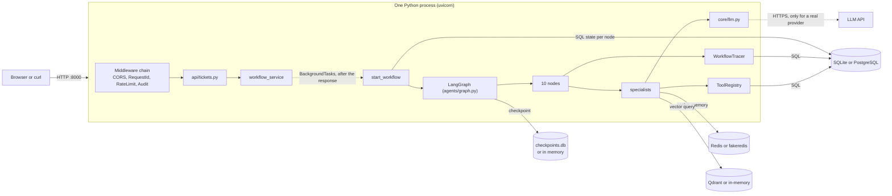
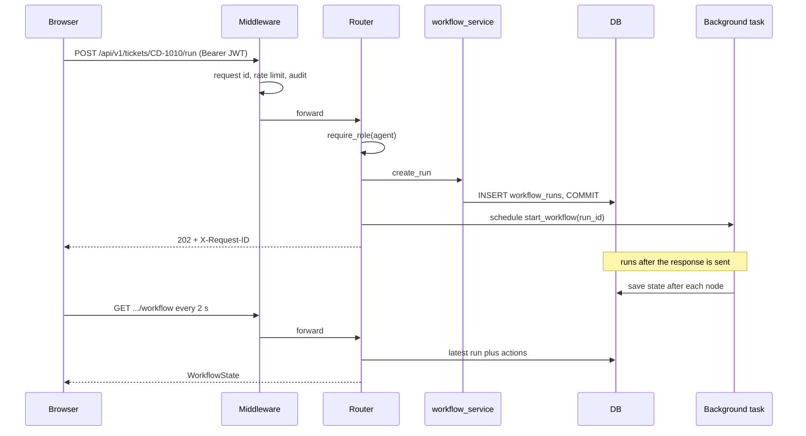
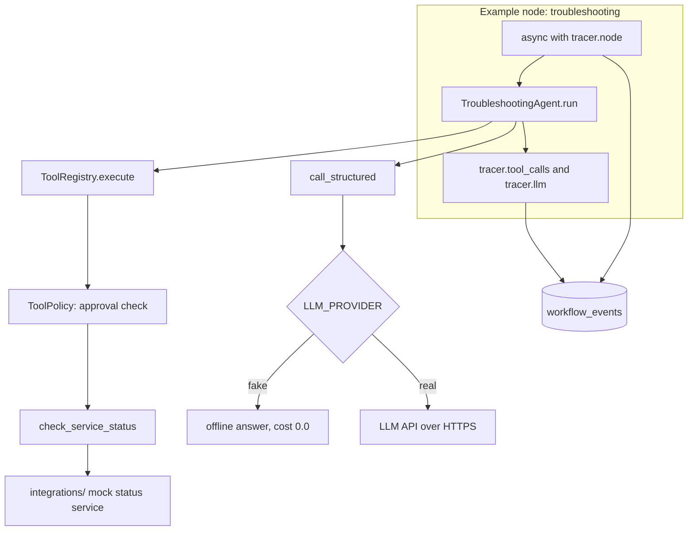
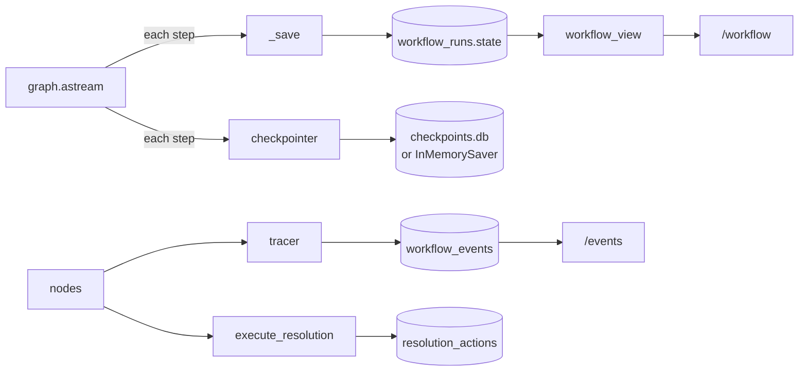
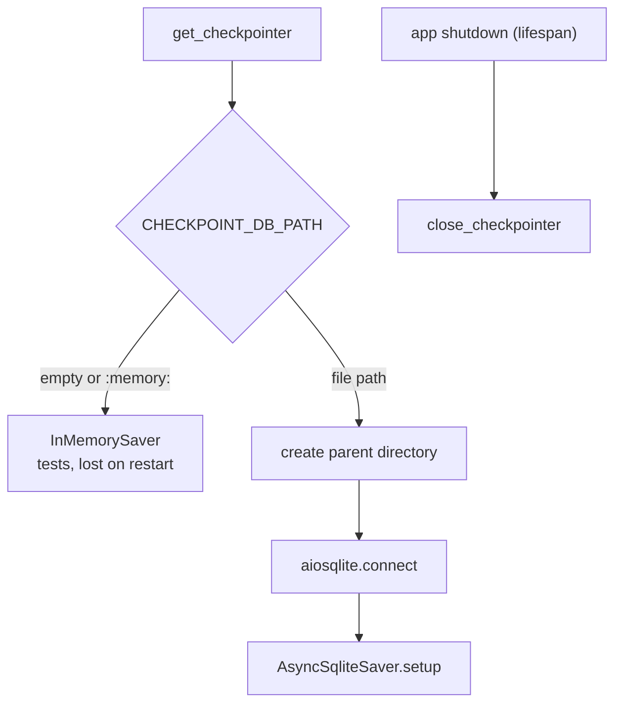
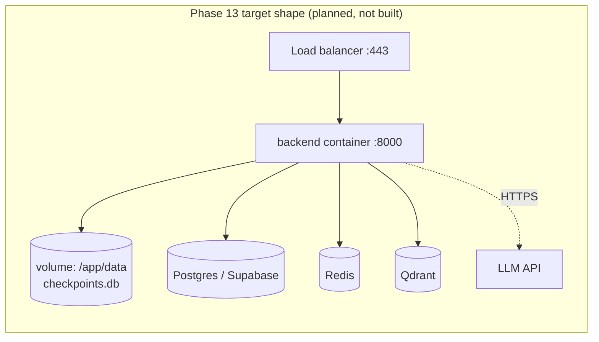

# Phase 10: Infrastructure Design Evolution

*CloudDesk: Autonomous Customer Support & Resolution Platform*

**Phase 10: Workflow graph and trace.** This file explains how the workflow is **wired** into the running application: which routes and stores it touches, where it holds state, how a request becomes a background run, and what that means for Docker and the cloud in the final phase.

---

## Read this first: Phase 10 still has no Docker containers

There is no Dockerfile, Compose file or Terraform yet. Phase 10 adds **no container, port or network**. It adds code to `agents/` and `backend/app/`, two HTTP routes on the existing port, one new dependency and one on-disk file.

| Decision in Phase 10 | Built? | Why Docker/cloud cares later |
|---|---|---|
| `agents/graph.py`, `nodes/`, `state.py`, `risk.py` | Built | Backend image must copy `agents/` and keep the repo root on `PYTHONPATH` |
| `agents/checkpointer.py` | Built | **Needs a writable path** for `CHECKPOINT_DB_PATH` (default `./data/checkpoints.db`), i.e. a volume in a container |
| New dependency `langgraph-checkpoint-sqlite` (brings `sqlite-vec`) | Built | Lands in the backend image through `uv.lock` |
| `backend/app/core/observability.py` (tracer) | Built | Writes to the same database as everything else; no new service |
| `POST /tickets/{id}/run`, `GET /tickets/{id}/workflow` | Built | Same port 8000, same `/api/v1` prefix; nothing new at the load balancer |
| Background execution (`BackgroundTasks`) | Built | Work continues **after** the HTTP response, inside the same process |
| New environment variable | **None** | Reuses `CHECKPOINT_DB_PATH`, `LLM_PROVIDER`, `TOOL_TIMEOUT_SECONDS` |
| New table or migration | **None** | Uses `workflow_runs`, `workflow_events`, `resolution_actions` from Phase 2 |
| Worker container, queue | **Not built** | CLAUDE.md: in-process for v1 |
| Containers, network, volumes | **Not built** | Final phase |

---

## Step 1: Where the workflow sits in the process

Everything runs **inside one Python process** (uvicorn on `:8000`). Node-to-specialist, specialist-to-tool and tool-to-repository are plain function calls. The only network hops are to the database, Redis and (for a real provider) the LLM API.



---

## Step 2: Request routing for a run

Two requests matter. The first **starts** a run and returns at once. The second **reads** progress.

| Route | Method | Role | Result |
|---|---|---|---|
| `/api/v1/tickets/{id}/run` | POST | agent, admin | **202** `{workflow_id, status}`; **409** if waiting on approval or already running; **404** unknown ticket; **403** viewer |
| `/api/v1/tickets/{id}/workflow` | GET | viewer and up | `WorkflowState` JSON of the latest run; **404** if never run |
| `/api/v1/tickets/{id}/events` | GET | viewer and up | Ordered `workflow_events` (now populated) |
| `/api/v1/tickets/{id}` | GET | viewer and up | `TicketDetail` with `workflow` embedded |

`{id}` accepts the UUID or the ticket number (`CD-1010`).



Why the **commit before scheduling**: the background task opens its **own** database session. If the first transaction were still open, the task would not find the run row.

The audit middleware (N6) records the `POST /run` like any other state-changing request.

---

## Step 3: Component wiring inside the run

How one node talks to everything it needs. Every arrow is an in-process call except the stores.



---

## Step 4: Where state lives (three places, three jobs)

| Store | What | Who writes | Who reads | Needs a volume in a container? |
|---|---|---|---|---|
| `workflow_runs.state` (DB) | Full state JSON after **every** node | `workflow_service._save` | `/workflow`, `TicketDetail` | Only the DB |
| `workflow_events` (DB) | Timeline: node, tool, llm, error, completed | `WorkflowTracer` | `/events` | Only the DB |
| Checkpointer | LangGraph's own snapshot per thread | LangGraph | LangGraph (resume in Phase 11) | **Yes** for the SQLite file |



The checkpointer choice is made once, from `CHECKPOINT_DB_PATH`:



---

## Step 5: Concurrency and connections

- Every node step, tracer event and tool call uses a **short, separate** `session_scope()` (commit on success). No session is held across a model call.
- The tracer and the workflow write in **different** transactions on purpose: a failed event write cannot roll back real work.
- SQLite allows one writer at a time, which is fine for the demo because steps are sequential. On PostgreSQL the engine pool (default size) serves these short sessions.
- The checkpointer holds **one** `aiosqlite` connection for the process lifetime and closes it at shutdown.
- Foreign keys are enabled on SQLite (`PRAGMA foreign_keys=ON`) so event and action rows must point at a real run and ticket, as on Postgres.

---

## Step 6: What changes when this is containerised (planned for Phase 13)

| Concern | Today (local) | In a container or cloud |
|---|---|---|
| Checkpoint file | `./data/checkpoints.db` | Mount a **named volume** at `/app/data`, or use a shared store. A container's own filesystem is lost on redeploy |
| Replicas | One process | Background tasks and a SQLite checkpointer are **per process**. More than one replica needs a shared checkpointer (for example a Postgres saver) and a worker. **Not built** |
| Health probes | `/health/live`, `/health/ready` | Unchanged. A long run does not block probes because it runs after the response |
| Shutdown | Lifespan closes the checkpointer, then the DB engine | On `SIGTERM` a run in progress may be cut off; its row stays `running` (see the gap below) |
| Egress | None offline | Real provider needs outbound HTTPS to the LLM API |
| Secrets | `.env` | `LLM_API_KEY` from the cloud secret store, never in the image |
| Image contents | n/a | `agents/`, `memory/`, `rag/`, `integrations/`, `sample_data/` and `backend/` all copied; repo root plus `backend` on `PYTHONPATH` |
| Load balancer | n/a | No new rule: same port, same prefix. Allow a timeout long enough for the 202 only; the run itself is not held open |



---

## Step 7: Known operational gaps (honest status)

| Gap | Effect | Plan |
|---|---|---|
| A crash or restart mid-run leaves the run `running` | The ticket answers **409** to `/run` until that run is cleared | Add a staleness timeout or a startup sweep. Not built |
| Background tasks are in-process | A deploy cuts running workflows | Worker process later (CLAUDE.md: production extension) |
| SQLite checkpointer is single-node | Cannot be shared by replicas | Postgres saver. Not built |
| Real LLM provider untested | Fake provider only | Needs a key and a provider package |
| No LangSmith tracing | Our own `workflow_events` only | Optional, via env vars later |
| No Docker, Compose or Terraform | Everything is local | Phase 13 |

---

## Quick reference: how to run and watch it locally

```bash
# PowerShell, from the repo root
$env:PYTHONPATH = "backend;."
.venv/Scripts/python.exe -m uvicorn app.main:app --port 8000

# In tests, the checkpointer is :memory: and nothing touches disk
.venv/Scripts/python.exe -m pytest tests/workflow -q
```
