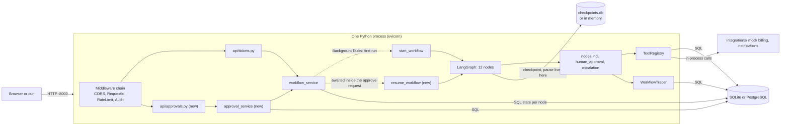
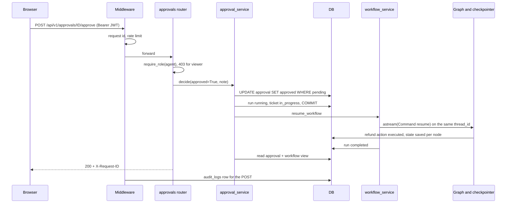
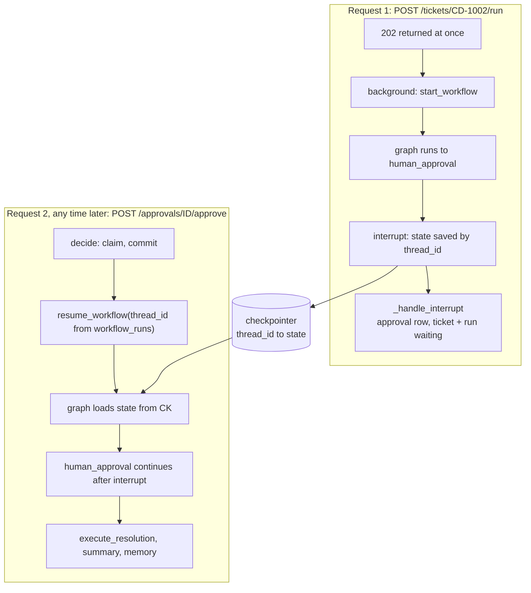
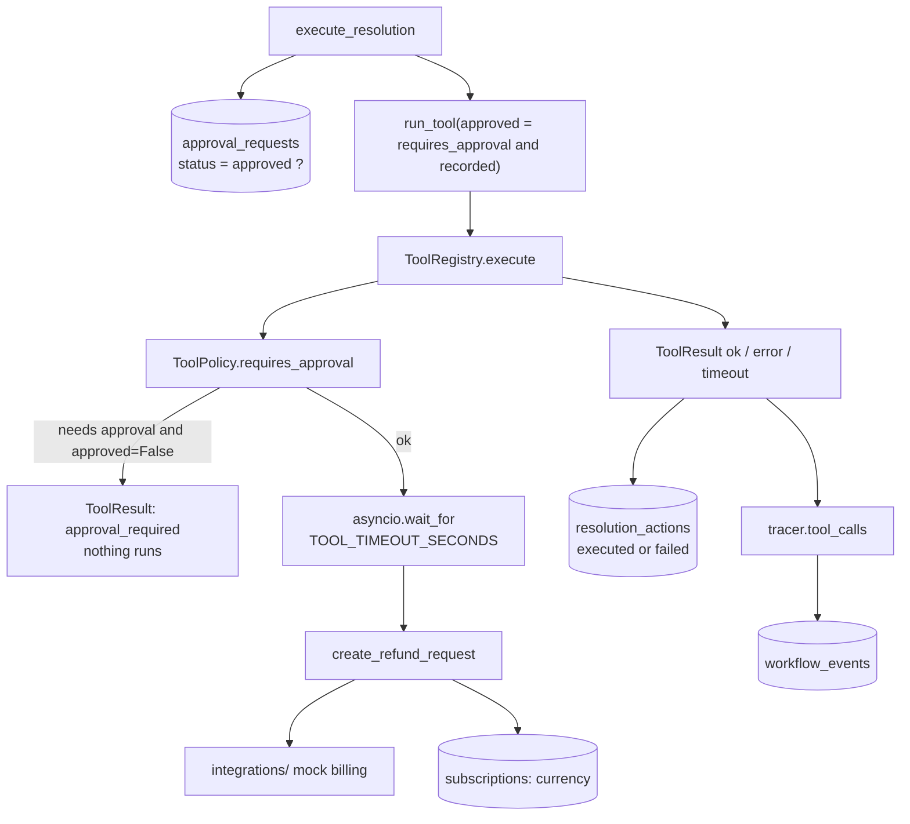
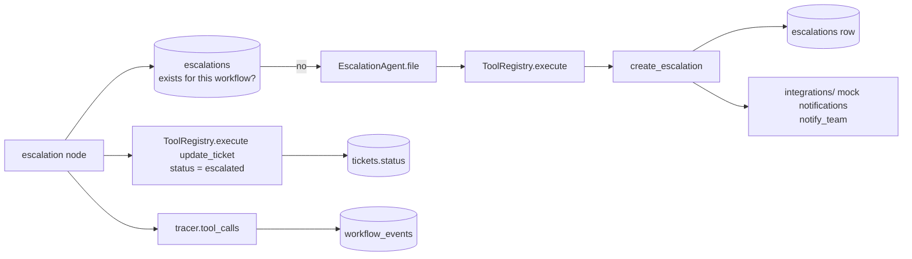
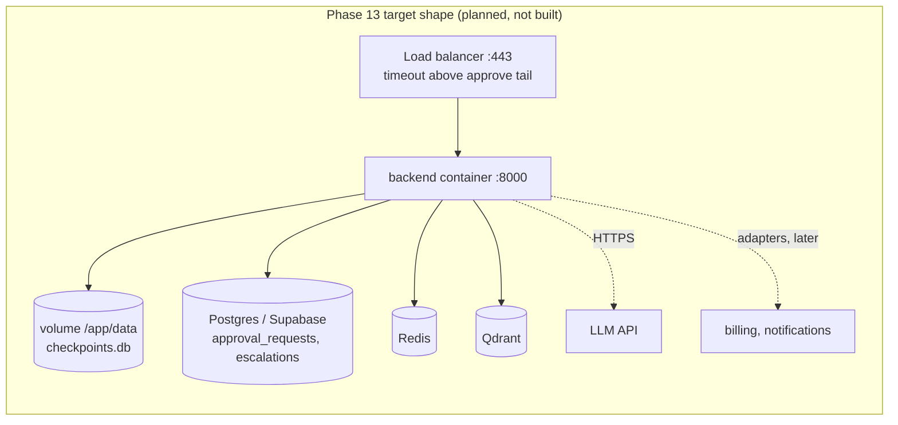

# Phase 11: Infrastructure Design Evolution

*CloudDesk: Autonomous Customer Support & Resolution Platform*

**Phase 11: Approval and escalation.** This file explains how the pause, the approval routes and the escalation are **wired** into the running application: which routes and stores they touch, where the paused state lives, how one human click turns into a resumed run, and what that means for Docker and the cloud in the final phase.

---

## Read this first: Phase 11 still has no Docker containers

There is no Dockerfile, Compose file or Terraform yet. Phase 11 adds **no container, port, network or volume**. It adds code to `agents/` and `backend/app/`, one router (`/approvals`) on the existing port, and one script.

| Decision in Phase 11 | Built? | Why Docker/cloud cares later |
|---|---|---|
| `agents/nodes/approval.py` (`human_approval`, `escalation`) | Built | Same `agents/` folder the backend image already copies |
| `interrupt()` pause and `Command(resume=...)` | Built | The paused state lives in the **checkpointer**. A container needs that file on a **volume** (or a shared store) to survive a restart |
| `backend/app/api/approvals.py`: four routes | Built | Same port 8000, same `/api/v1` prefix. **No new load balancer rule** |
| `approval_service`, `workflow_service.resume_workflow` | Built | In-process. No worker, no queue |
| New environment variable | **None** | Reuses `CHECKPOINT_DB_PATH`, `APPROVAL_REQUIRED_FOR_REFUNDS`, `MAX_REFUND_WITHOUT_APPROVAL`, `TOOL_TIMEOUT_SECONDS` |
| New table or migration | **None** | Uses `approval_requests`, `escalations`, `resolution_actions`, `workflow_runs` from Phase 2 |
| New dependency | **None** | `langgraph.types.interrupt` and `Command` ship with the LangGraph already pinned |
| `scripts/demo.py` | Built | A dev tool. Not copied into a runtime image on purpose. Uses a temporary database |
| Containers, network, volumes | **Not built** | Final phase |

---

## Step 1: Where the new pieces sit in the process

Everything still runs **inside one Python process** (uvicorn on `:8000`). Approve, resume, node and tool calls are plain function calls. The only network hops are to the stores, and to the LLM API if a real provider is configured.



Key difference from Phase 10: the **first run** is a background task, but the **resume** is awaited inside the approve request. That is why the approve response can contain the final workflow state.

---

## Step 2: Request routing for the new routes

All routes sit under `/api/v1` and pass the same middleware chain (CORS, request id, rate limit, audit). The audit middleware (N6) records every `POST /approvals/{id}/approve` and `/reject`, like any state-changing request.

| Route | Method | Role | Result |
|---|---|---|---|
| `/api/v1/approvals` | GET | viewer and up | `ApprovalRequest[]`, filter `?status=pending`, bad value **422** |
| `/api/v1/approvals/{id}` | GET | viewer and up | one request; **404** `Approval not found` |
| `/api/v1/approvals/{id}/approve` | POST | agent, admin | `{approval, workflow}`; **403** viewer; **404**; **409** |
| `/api/v1/approvals/{id}/reject` | POST | agent, admin | same shape; the run escalates |
| `/api/v1/tickets/{id}/run` | POST | agent, admin | **409** while the ticket is `waiting_on_approval` (unchanged, now reachable) |
| `/api/v1/tickets/{id}/workflow` | GET | viewer and up | now reports `waiting_for_approval`, `escalated`, `approval_request_id` |

Two different 409s on approve, both from `approval_service`:

| Detail | Cause |
|---|---|
| `Approval has already been decided` | The request is not `pending`, or another click claimed it first |
| `Workflow is not waiting for approval` | The run is not in `waiting_on_approval` |



---

## Step 3: How a pause is wired (the paused state lives in the checkpointer)

The pause is **not** a thread sleeping in memory. When `interrupt()` is called, LangGraph writes the whole graph state to the **checkpointer** under the run's `thread_id` and **stops**. The background task ends. Nothing waits. Hours later, a different request resumes it with the same `thread_id`.



Three places hold state, with three jobs:

| Store | What | Written by | Read by | Needs a volume in a container? |
|---|---|---|---|---|
| Checkpointer | LangGraph's snapshot, so it can resume | LangGraph | LangGraph, on resume | **Yes** for the SQLite file |
| `workflow_runs.state` | JSON for the screen, saved after every node | `workflow_service._save` | `/workflow`, `TicketDetail` | Only the DB |
| `approval_requests` | The question, the answer, who and when | `_handle_interrupt`, `claim` | `/approvals`, `execute_resolution` | Only the DB |

`workflow_runs.thread_id` is the **link** between the database row and the checkpoint. If the row survives and the checkpoint is lost (for example `:memory:` after a restart), the run shows `waiting_for_approval` but **cannot resume**. That is why the checkpointer file matters.

---

## Step 4: Component wiring of the approved action

Every action, automatic or approved, goes through the same chain. The difference is one argument.



Two independent locks sit in front of a refund:

1. `execute_resolution` does not even attempt it without an approved row in the database.
2. `ToolRegistry.execute` refuses it again unless `approved=True`.

---

## Step 5: Component wiring of an escalation



The notification is a **mock** (no email, no webhook). In a cloud deployment it would be a real adapter behind the same Protocol, with no change to the node.

---

## Step 6: Concurrency and connections

- **Two sessions per approve.** The request session records the decision and **commits**. The resumed graph then opens its own short sessions (`session_scope`). If the first were still open, SQLite could report "database is locked" and the graph would not see the decision.
- **First click wins.** `ApprovalRepository.claim` is one `UPDATE ... WHERE status = 'pending'`. The database serialises it, so two simultaneous clicks cannot both win. The loser gets 409 and no second refund runs.
- **Stale reads.** The request session caches loaded rows. After the resume it calls `expire_all()` so the response shows the finished run, not the `running` it saw earlier.
- **Request length.** Approve returns after the graph finishes its remaining nodes (execute, summary, memory). With the offline model that is well under a second. With a real LLM it adds the model latency of `ticket_summary`. Load-balancer idle timeouts must allow it.
- **SQLite writer lock.** One writer at a time is fine here because steps are sequential. PostgreSQL serves the short sessions from its pool.
- **One run per ticket at a time.** `create_run` answers 409 while a run is active or the ticket is `waiting_on_approval`. It is a check, not a database lock, so two simultaneous run clicks could in theory both pass it. Not hardened yet.

---

## Step 7: What changes when this is containerised (planned for Phase 13)

| Concern | Today (local) | In a container or cloud |
|---|---|---|
| Checkpoint file | `./data/checkpoints.db` | **Mount a named volume** at `/app/data`, or move to a shared store. Without it a redeploy loses every paused run |
| Replicas | One process | The checkpointer is a local SQLite file and the first run is an in-process task. **Approve and run must reach the same replica/volume.** More than one replica needs a shared checkpointer (for example a Postgres saver) and a worker. **Not built** |
| Request timeout | None | The approve request does real work. Set the proxy and load-balancer timeout above the longest expected tail (summary plus memory) |
| Health probes | `/health/live`, `/health/ready` | Unchanged. A long approve does not block `/health/live` (no I/O) |
| Shutdown (SIGTERM) | Lifespan closes the checkpointer, then the DB engine | A resume in flight may be cut off. The run stays `running`; the approval is already `approved` (see the gap below) |
| RBAC | JWT role claim | Unchanged. Viewers can read `/approvals`, never decide |
| Secrets | `.env` | `JWT_SECRET`, `LLM_API_KEY` from the cloud secret store, never in the image |
| Real billing, real notifications | Mocks | Adapters need egress and credentials; the node code does not change |
| Image contents | n/a | `agents/`, `memory/`, `rag/`, `integrations/`, `sample_data/`, `backend/`; repo root plus `backend` on `PYTHONPATH`. `scripts/demo.py` may stay out |



---

## Step 8: Known operational gaps (honest status)

| Gap | Effect | Plan |
|---|---|---|
| Restart while a run is paused is **untested** | With `:memory:` the pause is lost. With the SQLite file it should resume, but we have not proved it | Add a restart test, then document |
| A crash during the resume leaves the run `running` and the approval `approved` | A later "approve" is 409. The ticket stays `in_progress`. There is no retry route | Add a staleness sweep or a retry. Not built |
| A finished refund is never run twice | Good, but also means a failed run cannot re-run it automatically | Same retry route |
| In-process resume | A deploy during an approve can cut it off | Worker process (CLAUDE.md: production extension) |
| SQLite checkpointer is single-node | Cannot be shared by replicas | Postgres saver |
| Mock billing and notifications | No real money or email moves, by design for v1 | Real adapters later |
| No console screen for the buttons | Routes are tested through the API only | Phases 12 and 13 |
| No Docker, Compose or Terraform | Everything is local | Phase 13 |

---

## Quick reference: how to run and watch it locally

```bash
# Terminal demo: a throwaway database, no server and no key needed
.venv/Scripts/python.exe scripts/demo.py CD-1002            # pause, approve, refund once
.venv/Scripts/python.exe scripts/demo.py CD-1002 --reject   # pause, reject, escalate
.venv/Scripts/python.exe scripts/demo.py CD-1005            # policy escalation, no pause

# Against a real server (PowerShell, from the repo root)
$env:PYTHONPATH = "backend;."
.venv/Scripts/python.exe -m uvicorn app.main:app --port 8000
# POST /api/v1/tickets/CD-1002/run, then GET /api/v1/approvals?status=pending, then POST .../approve

# Tests (checkpointer is :memory:, nothing touches disk)
.venv/Scripts/python.exe -m pytest tests/workflow -q
```
