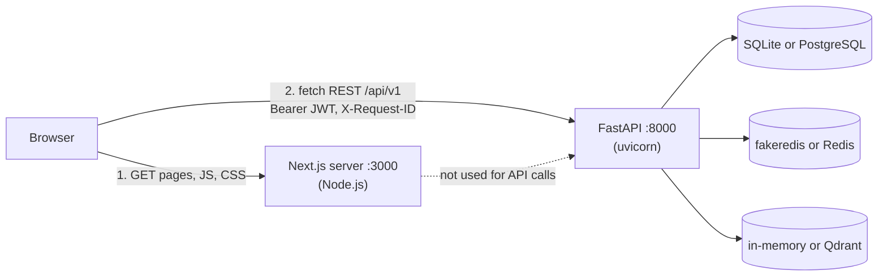
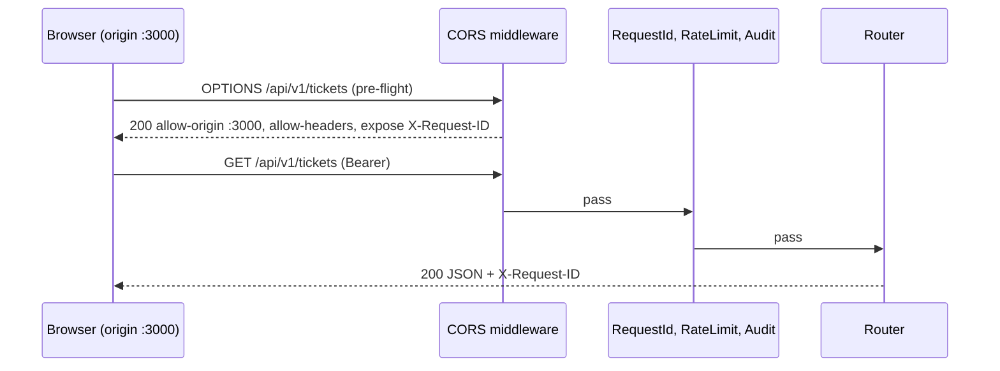
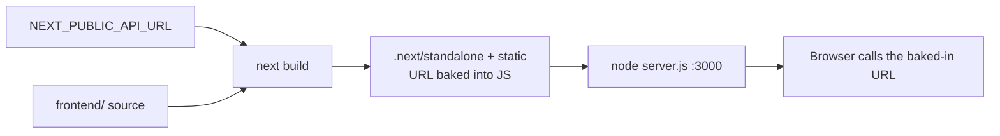
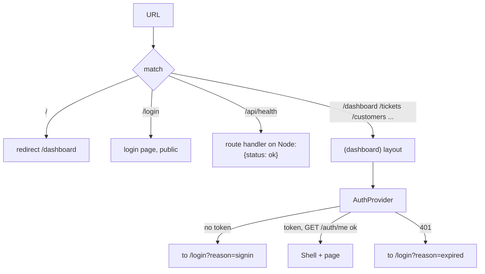
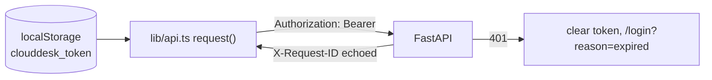
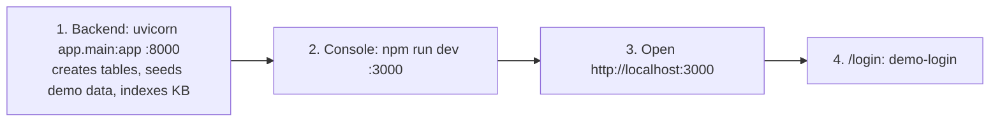
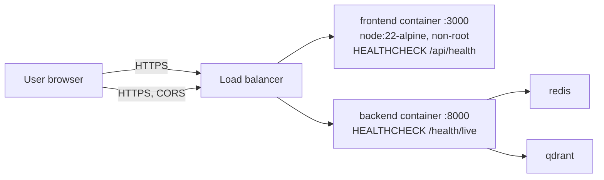

# Phase 12: Infrastructure Design Evolution

*CloudDesk: Autonomous Customer Support & Resolution Platform*

**Phase 12: Console shell.** This is the first phase with a **second runtime**: a Node.js process serving the Next.js console on port 3000. This file explains how the browser, the console and the API are **wired and routed**, what is built-time versus run-time, and what that means for Docker and the cloud in the final phase.

---

## Read this first: still no Docker containers

There is no Dockerfile, Compose file or Terraform yet (Phase 14). Phase 12 runs two **local processes**. It adds one port (3000), one build-time variable and one health route, but no container, network or volume.

| Decision in Phase 12 | Built? | Why Docker/cloud cares later |
|---|---|---|
| `frontend/` Next.js 15, `output: "standalone"` | Built | Standalone output produces a small self-contained server for `node:22-alpine` |
| Console on `:3000`, API on `:8000` | Built (local) | Two services, two ports, two origins |
| `NEXT_PUBLIC_API_URL` (default `http://localhost:8000`) | Built | **Inlined at build time.** One image per environment |
| `GET /api/health` on the console | Built | The future container `HEALTHCHECK` target |
| CORS allow-list `http://localhost:3000` (already `CORS_ORIGINS`) | Existing | Must list the deployed console origin in each cloud |
| `frontend/.env.example` | **Not created** (blocked here) | Add before Phase 14 |
| `frontend/Dockerfile`, Compose, Terraform | **Not built** | Phase 14 |
| Service-role key in the frontend | **Never** | The browser only ever gets the demo JWT (later: Supabase anon key) |

---

## Step 1: Two processes, two origins

The browser downloads the console from Node (:3000). The console's JavaScript then calls the API (:8000) **directly from the browser**. The console server does **not** proxy API calls. Because the two have different origins (different ports), the API must send **CORS** headers.

| Hop | Who calls | Protocol | Notes |
|---|---|---|---|
| Browser -> console | user | HTTP :3000 | Static JS and pages |
| Browser -> API | **console JavaScript** | HTTP :8000, CORS | Needs `Access-Control-Allow-Origin: http://localhost:3000` |
| API -> stores | backend | SQL, Redis, vector | Unchanged since earlier phases |

---

## Step 2: CORS and the browser pre-flight

A request with an `Authorization` header and JSON body is not "simple", so the browser first sends an `OPTIONS` pre-flight. The API's CORS middleware (outermost, per CLAUDE.md section 9) answers it, then the real call goes through the chain.

If the console is served from any other origin and `CORS_ORIGINS` is not updated, every call fails in the browser as a **network error** even though the API is healthy. The console reports that as "Cannot reach the CloudDesk API", which is why the message mentions both the backend and the port.

---

## Step 3: Build time versus run time

`NEXT_PUBLIC_*` values are **copied into the JavaScript bundle during `next build`**. Changing them later has no effect on an existing build.

| Environment | `NEXT_PUBLIC_API_URL` | Consequence |
|---|---|---|
| Local dev | `http://localhost:8000` | Default |
| Compose (Phase 14) | URL the **browser** can reach (not the Docker service name) | The browser is outside the Docker network |
| Cloud | Public API URL | Rebuild the image per environment |

A common mistake: setting the URL to `http://backend:8000`. That name only exists **inside** Docker's network; a user's browser cannot resolve it.

---

## Step 4: Request routing inside the console

Next.js decides which file answers a URL. There are two kinds: **pages** (rendered in the browser after load) and a **route handler** (runs on the Node server).

| URL | Where it runs | Auth |
|---|---|---|
| `/login` | Browser | None |
| `/api/health` | **Node server** | None, no API call (proves only that Next.js is up) |
| every other page | Browser (data from the API) | Token checked by `AuthProvider`; real enforcement is the API's `require_role` |

Note the name clash: console `/api/health` (:3000) is **not** the API's `/health` (:8000). They have different jobs.

---

## Step 5: Token and header flow

- The token is a demo JWT (HS256, 8 h). It lives in `localStorage` per the project rule.
- Every response carries `X-Request-ID` (exposed through CORS). That id also appears in the audit log, so a click can be traced end to end.
- Rate limiting is per client in Redis (demo 120 per minute): polling in Phase 13 (every 2 s) stays well under it.

---

## Step 6: Local run order (today)

Console health does not depend on the API: `/api/health` answers `ok` even when the backend is down. The API's own `/health/ready` is the one that checks database, Redis, vector store and LLM.

---

## What Phase 14 will add (not built)

Open items for that phase: rebuild the frontend image per environment (build arg for `NEXT_PUBLIC_API_URL`); add the deployed console origin to `CORS_ORIGINS`; add `frontend/.env.example`; decide whether a same-origin reverse proxy should replace browser-to-API CORS.

## Status
Validated locally: build, type check, lint, 15 unit tests. **Not validated:** a live browser against the running backend, any container, any cloud.
