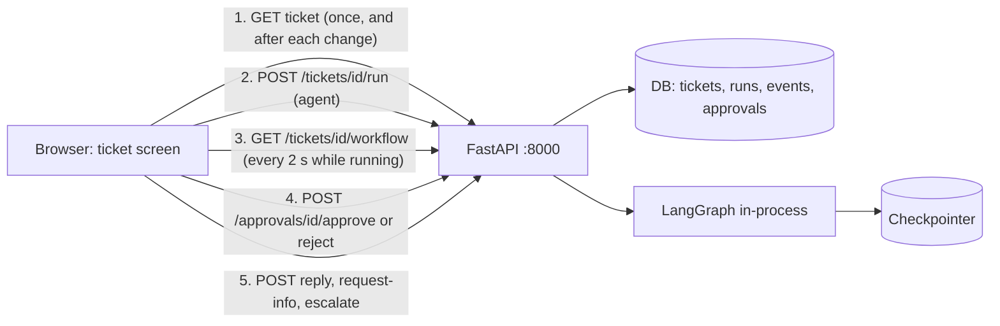
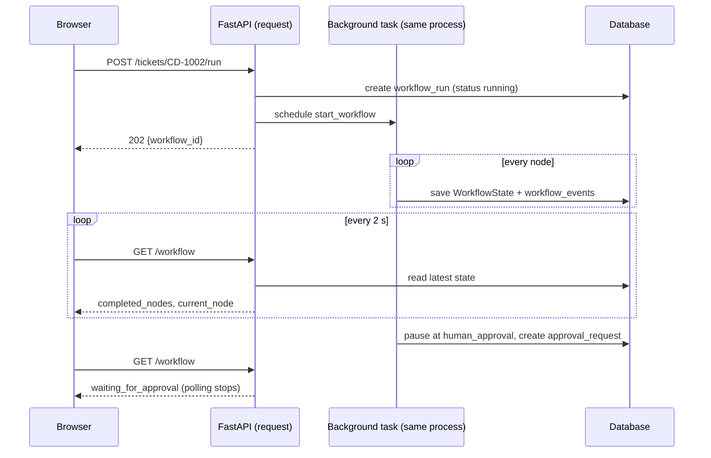
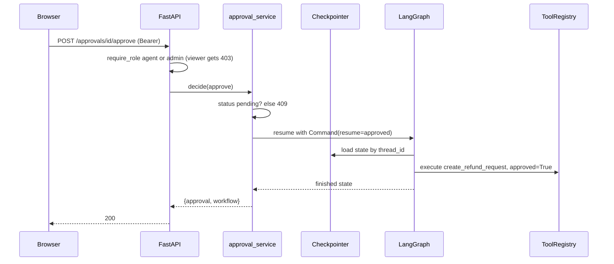
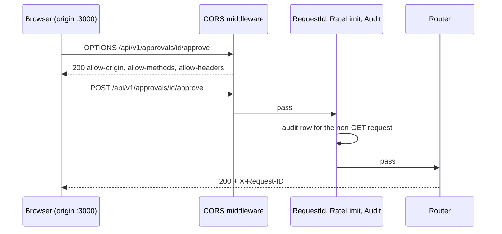
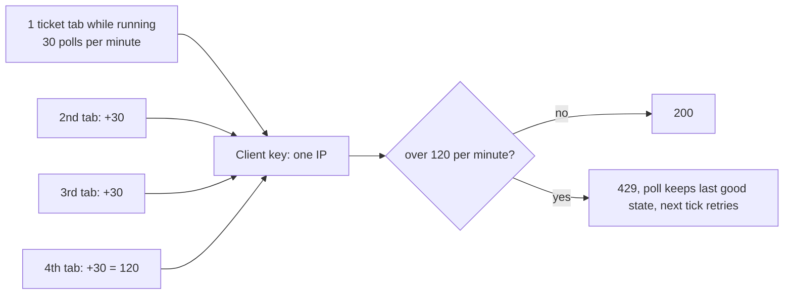
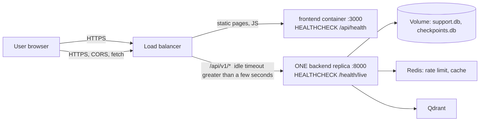
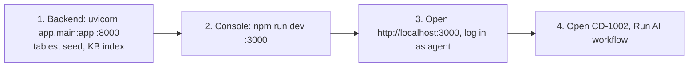

# Phase 13: Infrastructure Design Evolution

*CloudDesk: Autonomous Customer Support & Resolution Platform*

**Phase 13: Ticket workflow screen.** No new service, port, container or variable is added. What changes is the **traffic pattern**: the console now sends **writes** (run, approve, reply) and a **steady 2-second poll**, and a long-lived background workflow runs inside the API process. This file explains that wiring and routing, and what it means for Docker and the cloud in the delivery phase.

---

## Read this first: still no Docker containers

There is still no Dockerfile, Compose file or Terraform (the next phase). Phase 13 runs the same two **local processes** as Phase 12. The table lists the decisions that matter for containers later.

| Decision in Phase 13 | Built? | Why Docker or the cloud cares later |
|---|---|---|
| Browser polls `GET /tickets/{id}/workflow` every 2 s while a run is `running` | Built | Steady request load; counts against the rate limit |
| Workflow runs as a FastAPI **background task** in the API process | Built (since Phase 10) | The API container must stay alive; no separate worker yet |
| Pause and resume use the **checkpointer** (`CHECKPOINT_DB_PATH`) | Built (Phase 10/11) | Needs a **shared or persistent** store if more than one replica |
| Writes are `POST` with a bearer token and JSON | Built | CORS pre-flight on every write |
| No new env var, port, or secret | Confirmed | Nothing to add to `.env.example` |
| `frontend/Dockerfile`, Compose, Terraform | **Not built** | Next phase |

---

## Step 1: The five kinds of traffic the ticket screen sends

| # | Call | Who | Notes |
|---|---|---|---|
| 1 | `GET /tickets/{id}` | viewer+ | Safe to retry (GET) |
| 2 | `POST /tickets/{id}/run` | agent+ | Returns **202** at once; the work continues in the background |
| 3 | `GET /tickets/{id}/workflow` | viewer+ | The poll. Reads saved state, does no AI work |
| 4 | `POST /approvals/{id}/approve` | agent+ | Returns **after** the resumed run finishes |
| 5 | `POST .../reply`, `/request-info`, `/escalate` | agent+ | Normal writes, audited |

Every `POST` is **never retried** by the client, so a flaky network cannot send two replies or approve twice. The server adds a second guard: a repeat approve returns **409**.

---

## Step 2: Why "run" returns 202 and the screen polls

The AI workflow takes seconds. Holding an HTTP request open that long would hit load-balancer timeouts. So the API answers immediately and the screen asks for progress.

The poll **reads the database**, not the running process. So it does not matter which API instance answers it, as long as they share the database.

---

## Step 3: The approval round trip and the checkpointer

Approve is the one request that **resumes** the paused graph. The graph's saved position lives in the **checkpointer**, keyed by `thread_id`, not in memory of the HTTP request.

| Where the checkpointer lives | Behaviour | Container impact |
|---|---|---|
| `:memory:` (tests) | Lost when the process ends | Tests only |
| SQLite file `./data/checkpoints.db` (local) | Survives a restart on the same disk | Needs a **volume**, or the pause is lost on redeploy |
| A shared database (future) | Any replica can resume | Needed before running two API replicas |

**Consequence:** with the current SQLite file and in-process background tasks, run **one API replica**. A second replica would not see the first one's checkpoint file, and an approve routed there would fail to resume.

---

## Step 4: CORS and the pre-flight for writes

A `POST` with `Authorization` and a JSON body triggers a browser **OPTIONS pre-flight** each time. The API's CORS middleware (outermost) answers it with `allow_methods=["*"]`, `allow_headers=["*"]` and exposes `X-Request-ID`.

Pre-flights are answered before rate limiting and auditing, so they do not create audit rows. Only the real `POST` is audited (N6), and its `X-Request-ID` ties the click to the workflow events.

---

## Step 5: Polling versus the rate limit

The limiter is a fixed window per **client key** (first `X-Forwarded-For` hop, else the socket IP), `RATE_LIMIT_PER_MINUTE` = 120 in the demo.

| Fact | Consequence |
|---|---|
| Polling happens **only while a run is `running`** | Idle and paused tickets send no poll traffic |
| 30 polls per minute per active tab | Four simultaneous active runs from one office IP, plus normal clicks, can hit 120 |
| Everyone behind one corporate NAT shares **one key** | In production, tune `RATE_LIMIT_PER_MINUTE`, or move to a per-user key |
| The screen **ignores a failed poll** and keeps the last state | A 429 or a blip causes a delay, not a blank screen |

---

## Step 6: What the load balancer must do (design for the next phase)

| Requirement | Reason |
|---|---|
| Backend `desired_count = 1` until the checkpointer is shared | Resume needs the same checkpoint store |
| Persistent volume (or Postgres) for DB and checkpoints | A redeploy must not lose a paused approval |
| `CORS_ORIGINS` includes the deployed console origin | Otherwise every poll and write fails as a "network error" |
| `NEXT_PUBLIC_API_URL` is the **browser-reachable** API URL, baked at build | Not the Docker service name |
| Trust `X-Forwarded-For` only from the load balancer | Otherwise the rate limit can be dodged (known gap from Phase 3) |
| Graceful shutdown | A background run in flight is lost if the container is killed (no worker queue yet) |

---

## Step 7: Local run order (unchanged)

---

## Status
Validated locally: 32 console tests, type check, lint, production build; backend 408 tests. **Not validated:** a live browser pass against the running stack, multi-replica behaviour, any container, any cloud. The replica and rate-limit notes above are design reasoning from the code, not load-tested.
