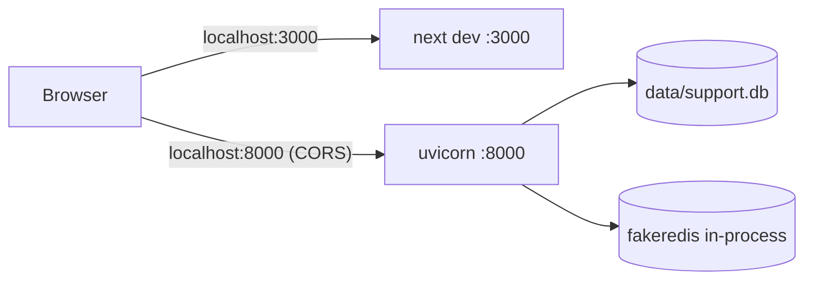
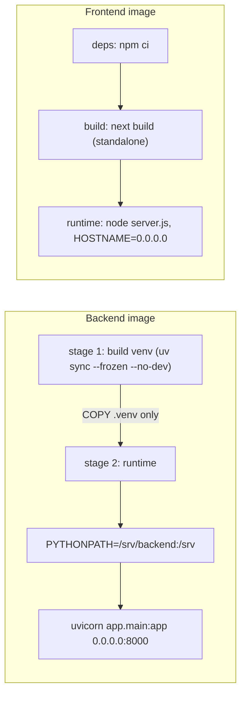
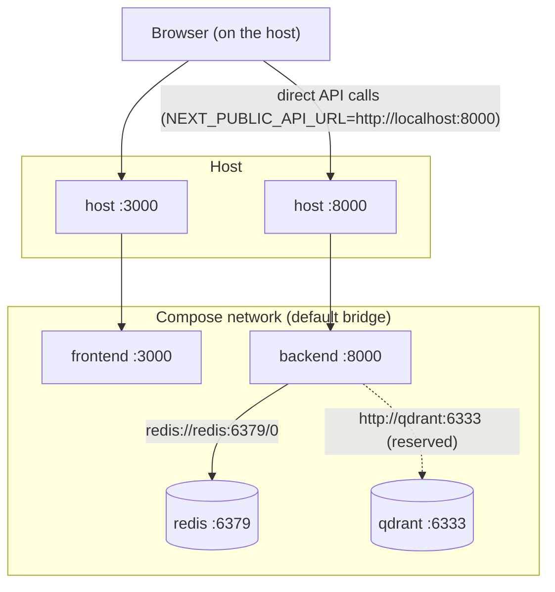
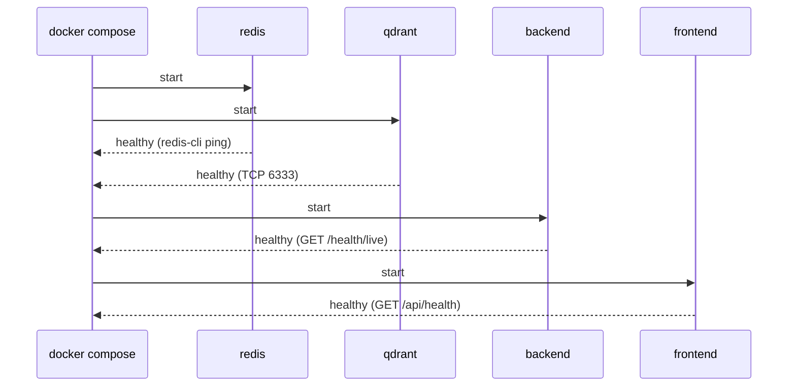
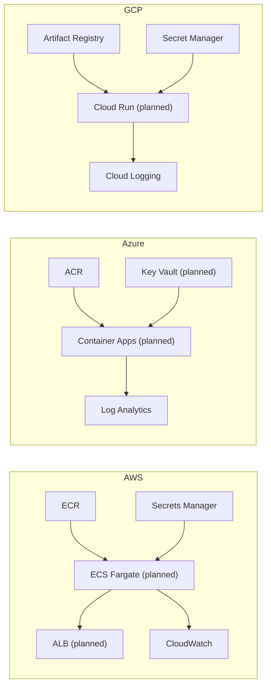
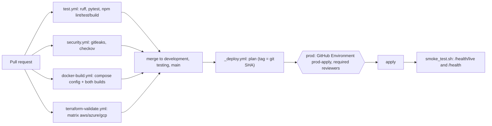
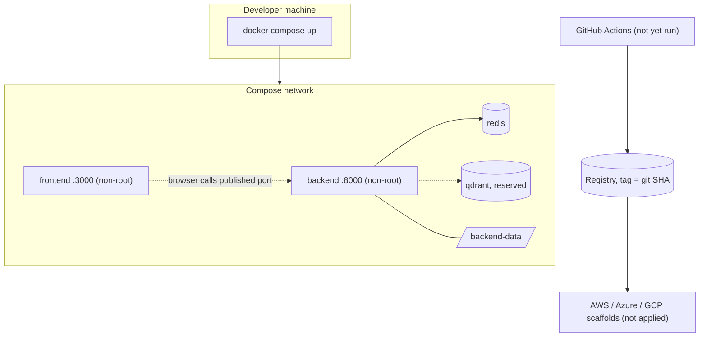

# Phase 14: Infrastructure Design Evolution

*CloudDesk: Autonomous Customer Support & Resolution Platform*

**Phase 14: Evaluation and delivery.** This is the first phase with containers. It explains the **component wiring, networking and routing**: which container talks to which, on which port, under which name, and what the cloud scaffolds map that to.

Honest status up front: `docker compose config -q` passes. The images were **not built** and the stack was **not started** (the Docker daemon was not running on this machine). Terraform was **not validated** (not installed) and **nothing was applied** to any cloud.

---

## Step 0: Before Phase 14

Two local processes, no containers, no network.



---

## Step 1 (P14-2): Two images

| Image | Base | Port | User | Health check | Built from |
|---|---|---|---|---|---|
| backend | `python:3.12-slim` | 8000 | `app` (uid 10001) | `GET /health/live` | repo root context (needs `backend/`, `agents/`, `rag/`, `memory/`, `integrations/`, `sample_data/`) |
| frontend | `node:22-alpine` | 3000 | `app` | `GET /api/health` | `frontend/` context |



Wiring details that matter:
- **`0.0.0.0` binding.** A container that listens on `127.0.0.1` is unreachable from outside it. Both servers bind all interfaces.
- **`PYTHONPATH`.** Backend imports both `app.*` (under `backend/`) and top-level `agents`, `rag`, `memory`, `integrations`; both roots are on the path.
- **State directory.** `/srv/data` is created and owned by `app`, so SQLite and the checkpoint DB are writable as non-root.
- **Build-time URL.** `NEXT_PUBLIC_API_URL` is a Docker build `ARG`, inlined into the browser bundle. Changing it needs a rebuild.
- **`.dockerignore`** keeps `.env`, `data/`, `*.db`, `node_modules` and tests out of the build context, so no secret can be baked into a layer.

---

## Step 2 (P14-3): Compose network and routing

Compose creates one private bridge network. Containers reach each other by **service name** through its built-in DNS. Only two ports are published to the host.



### The routing rule people get wrong
The **browser**, not the frontend container, calls the API. So `NEXT_PUBLIC_API_URL` must be a URL the browser can reach: `http://localhost:8000` (the published port). It must **not** be `http://backend:8000`: that name exists only inside the Docker network. A test asserts this.

| From | To | Address used | Why |
|---|---|---|---|
| Browser | frontend | `localhost:3000` | published port |
| Browser | backend | `localhost:8000` | published port; CORS allows `http://localhost:3000` |
| backend | redis | `redis://redis:6379/0` | service-name DNS inside the network |
| backend | qdrant | `http://qdrant:6333` | reserved; `VECTOR_STORE` is still `memory` |
| redis, qdrant | host | none | **not published**, unreachable from outside |

### Start order



`depends_on: condition: service_healthy` waits for the real health result, not just "process started". `/health/live` does no I/O on purpose, so a slow dependency cannot make the probe flap.

### Volumes

| Volume | Mounted at | Holds |
|---|---|---|
| `backend-data` | `/srv/data` | SQLite DB, checkpoints DB (pause and resume survive restarts) |
| `redis-data` | `/data` | Redis persistence |
| `qdrant-data` | `/qdrant/storage` | vector storage |

### Configuration wiring

| Variable | Set by | Notes |
|---|---|---|
| `JWT_SECRET`, `LLM_API_KEY` | `${VAR:-default}` from the shell | dev-only fallback; real values never in the file |
| `REDIS_URL` | Compose | empty would mean fakeredis |
| `CORS_ORIGINS` | Compose | must equal the browser's origin |
| `LLM_PROVIDER` | shell, default `fake` | the stack runs with no API key |

---

## Step 3 (P14-4): Mapping to the clouds

Same two images, same health routes, different managed services. All three are **scaffolds**: registry, secrets and logging resources exist; compute, load balancer, network and Redis are the next increment.



| Compose concept | AWS | Azure | GCP |
|---|---|---|---|
| Image registry | ECR (immutable tags) | ACR | Artifact Registry |
| Run containers | ECS Fargate | Container Apps | Cloud Run |
| Public entry | ALB | Container Apps ingress | Cloud Run URL / LB |
| Secrets | Secrets Manager | Key Vault | Secret Manager |
| Health probe | target-group check `/health/live` | probe | startup/liveness probe |
| Logs | CloudWatch | Log Analytics | Cloud Logging |
| Redis | ElastiCache (planned) | Azure Cache (planned) | Memorystore (planned) |

Routing in the cloud: a load balancer terminates HTTPS, sends `/api/*` and `/health*` to the backend and everything else to the frontend (or uses two hostnames). `NEXT_PUBLIC_API_URL` then becomes the **public API hostname**, so the frontend image is **rebuilt per environment**.

### Constraint to remember
The backend runs the workflow as an **in-process background task**, with SQLite and a file checkpointer. That means **one replica** until `DATABASE_URL` is Postgres and the checkpointer is shared. The Kubernetes reference manifest sets `replicas: 1` for this reason.

---

## Step 4 (P14-4 and P14-5): Delivery pipeline and its guards



| Guard | Enforced by |
|---|---|
| Containers are non-root with health checks | hygiene tests |
| Start order waits for healthy dependencies | hygiene tests |
| No `.env`, `terraform.tfvars`, `backend.hcl`, state, plan or `.db` tracked | hygiene test using `git ls-files`, plus `.gitignore` |
| No key-shaped strings in `deployment/`, `.github/`, Compose | hygiene test |
| `.env.example` lists every setting | hygiene test against the `Settings` model |
| No `--auto-approve` for staging or prod | `deploy.sh` (tested) |
| Tested artifact = shipped artifact | image tag is the git SHA |

---

## Final infrastructure at the end of Phase 14



### Status

| Item | State |
|---|---|
| Dockerfiles, `.dockerignore`, Compose | Written. `docker compose config -q` passes |
| Image build, `compose up`, smoke test | **Not run** (Docker daemon unavailable) |
| Terraform | Written; **not validated** (Terraform not installed), **not applied** |
| Workflows | **Never executed** |
| Cloud credentials | None used |
| Qdrant wiring | Container only; no client dependency or code path yet |

### How to verify when the tools are available
```bash
docker compose up --build        # then, in another shell:
BASE_URL=http://localhost:8000 make smoke
make terraform-validate
```
