# Phase 1: Infrastructure Design Evolution

*CloudDesk: Autonomous Customer Support & Resolution Platform*

**Phase 1: Runtime skeleton.** This file explains how the parts of the application are **connected**: which process runs, on which port, how a request is routed inside it, how the server decides which database, cache or AI to use, and how health monitors talk to it.

---

## Read this first: Phase 1 has no Docker containers yet

Phase 1 does **not** contain Dockerfiles, Docker Compose or cloud (Terraform) files. Those are built in the final delivery phase. In Phase 1 the whole backend runs as **one program on the developer's computer**.

Phase 1 still makes almost every wiring decision that the containers will later rely on:

| Decision made in Phase 1 | Why Docker and the cloud need it later |
|---|---|
| Backend listens on port **8000** | The container exposes the same port; the load balancer forwards to it |
| All settings come from **environment variables** | Containers and cloud services inject settings the same way, with no code change |
| `/health/live` touches nothing | Docker `HEALTHCHECK` and cloud liveness probes call it |
| `/health/ready` returns **503** when degraded | Load balancers stop sending traffic to an unready container |
| CORS allows the console origin (port **3000**) | The frontend container calls the backend container across origins |
| Every response carries `X-Request-ID` | A request can be traced through the load balancer, the container and the logs |
| Logs go to **standard output** as JSON | `docker logs`, CloudWatch, Log Analytics and Cloud Logging collect stdout |
| Offline stand-ins exist for every store | Tests and demos need no containers at all |

**Diagram key:** solid boxes exist in that step. Dashed grey boxes are planned for later phases and appear only to show where they will connect.

---

## Step 0: Where the infrastructure is headed

### Target: local Docker Compose network (final delivery phase)

The finished application will run as four containers on one private Docker network. Only the frontend and the backend are reachable from the developer's browser. Redis and Qdrant are reachable only by the backend, using their service names as hostnames.

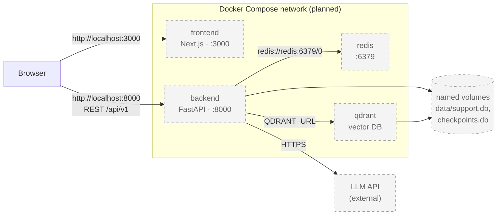

Compose start-up order is `frontend → backend → redis, qdrant`. Each container waits until the one it depends on reports **healthy** (`depends_on: service_healthy`). That health signal is the `/health/live` route built in Phase 1.

### Target: cloud deployment (final delivery phase)

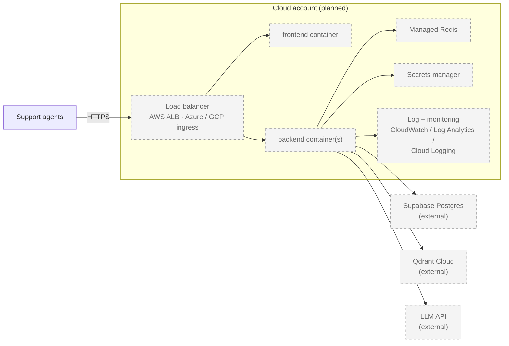

### What existed at the start of Phase 1

No running process, no ports and no network. Only the plans above.

---

## Step 1: P1-1, settings and logging (the wiring switchboard)

### What was added

The **settings panel** (`backend/app/core/config.py`) acts as the system's switchboard. Each environment variable decides which real or stand-in component a part of the system is connected to. The code never hard-codes an address. It asks the settings panel.

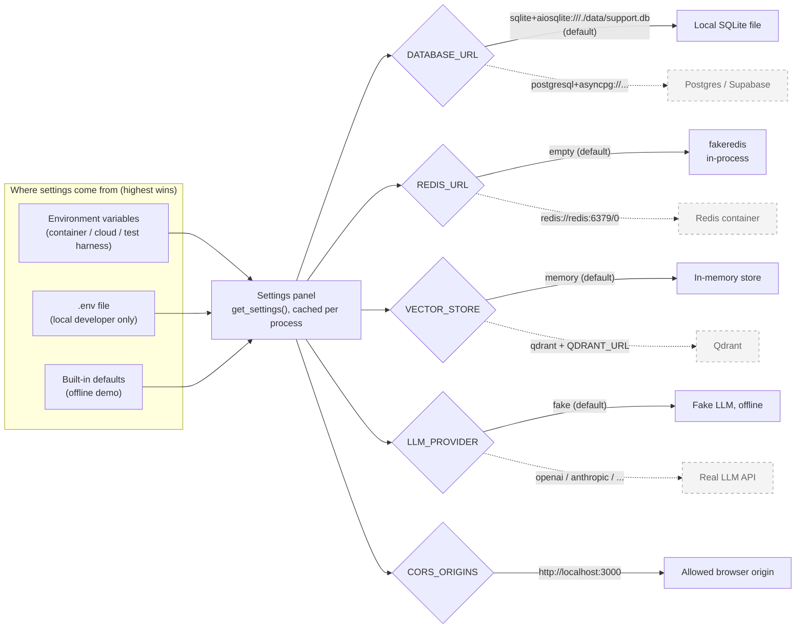

**Plain words:** one environment variable decides whether the system uses a pretend component on the laptop or a real server. Phase 1 wires up the **switches**. The real connections are built in later phases. Defaults always choose the offline option, so the system runs anywhere with nothing installed.

### Logging wiring

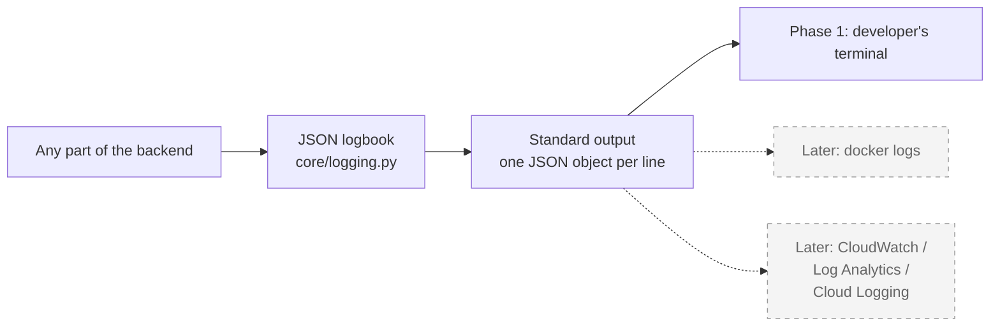

Logs are written to standard output, never to a file inside the app. This is the standard container practice: the platform collects stdout, and the app never has to know where logs end up.

### Security of the wiring

Addresses such as `DATABASE_URL` and `REDIS_URL` can contain passwords. The settings panel masks them (`postgresql://***@host/db`) whenever settings are printed. API keys are stored as a protected type that shows `**********`. In the cloud phase, real values come from a secrets manager as environment variables. The code path stays the same.

---

## Step 2: P1-2, the server process, ports and request routing

### What was added

A real **network listener**. The backend now runs as a web server on port 8000 and routes incoming requests through checkpoints to the right handler.

### The process on the developer machine

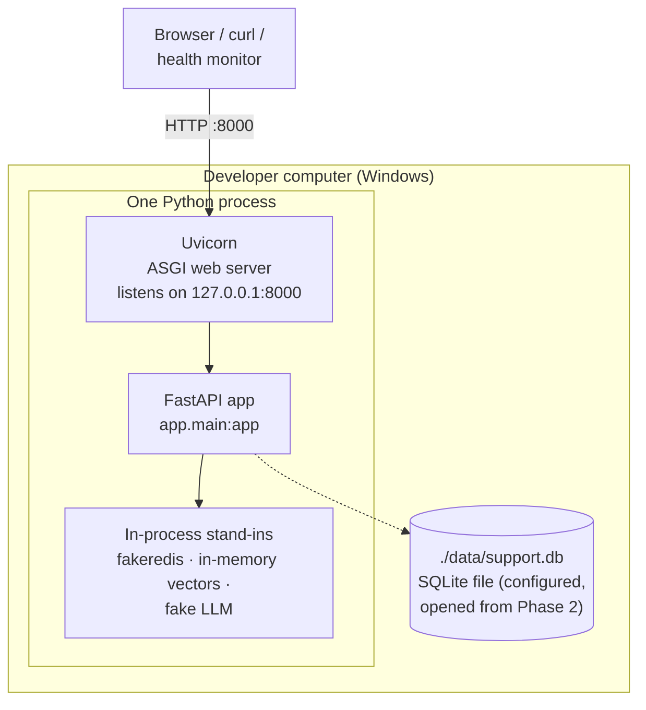

**Uvicorn** is the program that actually opens port 8000 and speaks HTTP. It hands each request to the **FastAPI app**, which decides what to do with it. In a container, Uvicorn listens on `0.0.0.0:8000` instead of `127.0.0.1`, so the Docker network can reach it.

### How one request is routed inside the server

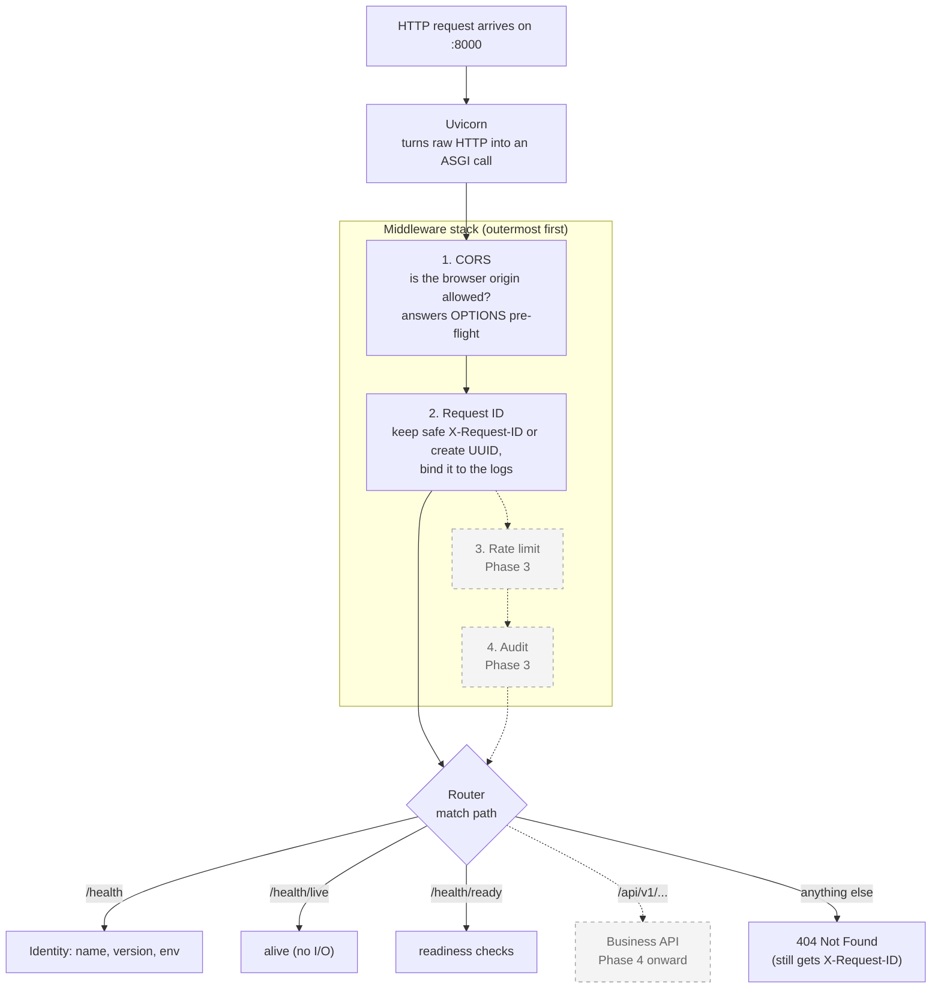

### Route table at the end of P1-2

| Path | Prefix | Purpose | Touches other systems? | Used by |
|---|---|---|---|---|
| `GET /health` | none | Service name, version, environment | No | Humans, dashboards |
| `GET /health/live` | none | "Process is up" | **No, by design** | Docker `HEALTHCHECK`, liveness probes |
| `GET /health/ready` | none | "Can serve traffic"; 503 when degraded | Reads settings only (no network calls yet) | Load balancers, readiness probes |
| `/api/v1/...` | `/api/v1` | All business routes | Yes | Frontend (Phase 4 onward) |

Health routes deliberately sit **outside** `/api/v1`. Probes then keep working even if API versioning changes, and they will not require a login once authentication arrives in Phase 3.

### Cross-origin wiring (frontend :3000 → backend :8000)

The console (frontend) and the backend run on different ports, so the browser treats them as different **origins**. CORS is the permission slip that lets the browser make the call and read the reply.

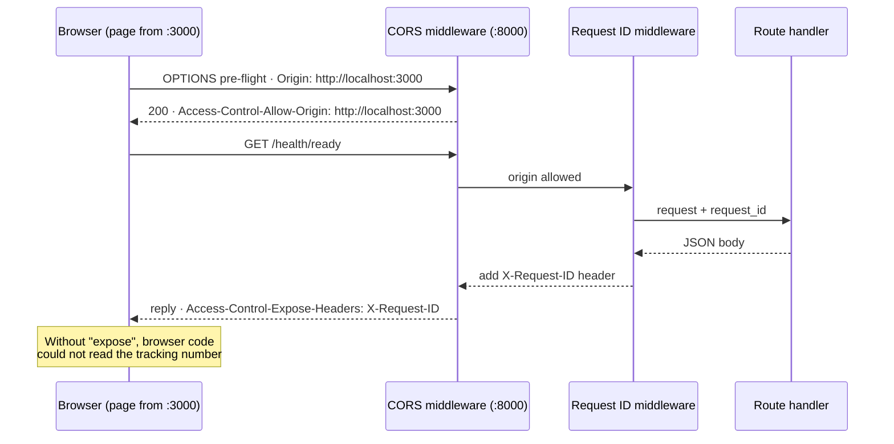

### Request ID across the future network hops

The tracking number is designed to travel through every hop. If an upstream component (such as a load balancer) already set a safe `X-Request-ID`, the backend keeps it. Otherwise the backend creates one. Unsafe values are replaced so nobody can forge log lines.

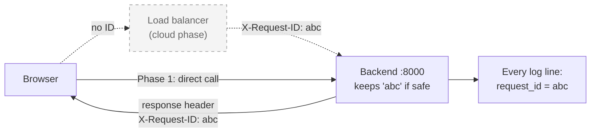

### Health probes and who calls them

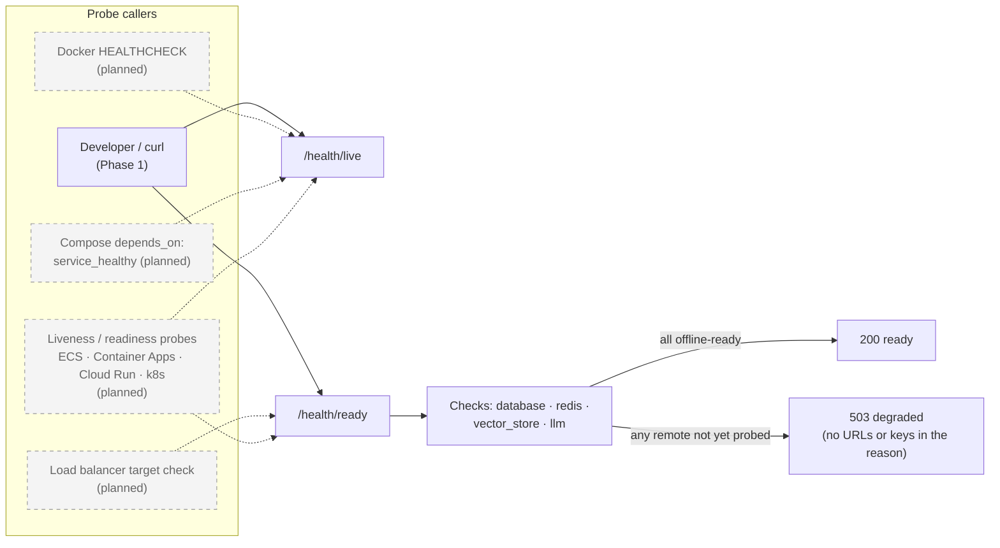

**Why there are two probes:**

- **Live** answers "should this container be restarted?" It must not depend on the database. Otherwise a short database outage would make the platform restart every backend container for no benefit.
- **Ready** answers "should this container receive traffic?" If a dependency is missing, the load balancer routes around the container instead of sending users errors.

In Phase 1, Ready reports `ok` for the offline stand-ins and `error` ("not probed yet") for any remote service. Real connection checks are added when each client exists in later phases.

### Crash safety on the wire

If a handler fails before sending a response, the Request ID middleware sends a clean `500 {"detail":"Internal Server Error"}`, still stamped with the `X-Request-ID`. Nothing internal (stack traces, file paths, settings) ever crosses the network. The full error is written to the logs under the same ID.

---

## Step 3: P1-3, offline test harness (no network at all)

### What was added

Tests run the real app **without opening any port**. The test client calls the ASGI app directly in memory.

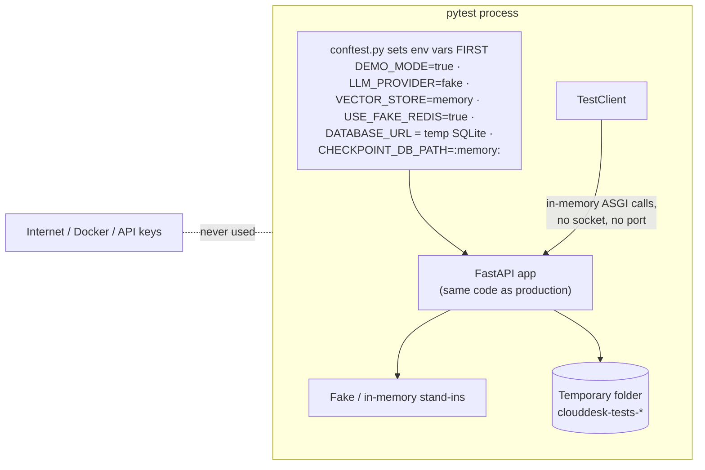

**Why it matters for infrastructure:** CI pipelines (later phase) can run the full test suite on a plain build machine without starting containers, databases or paid services. The same middleware and routing are tested exactly as they run in production.

---

## Step 4: P1-4, Makefile and `.env.example` (how a developer starts the wiring)

### What was added

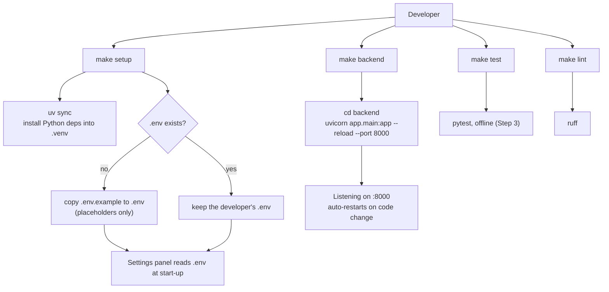

- **`.env.example`** is committed and lists every setting the system uses, with placeholder values. It is the single list of "wires" that a container or cloud service must provide.
- **`.env`** holds real local values and is git-ignored. It is never baked into a container image.
- On Windows without `make`, run the same commands directly with `.venv/Scripts/python.exe`. `PYTHONPATH` must include `backend`.

---

## Step 5: End of Phase 1, the complete wiring

### Everything that is connected at the end of Phase 1

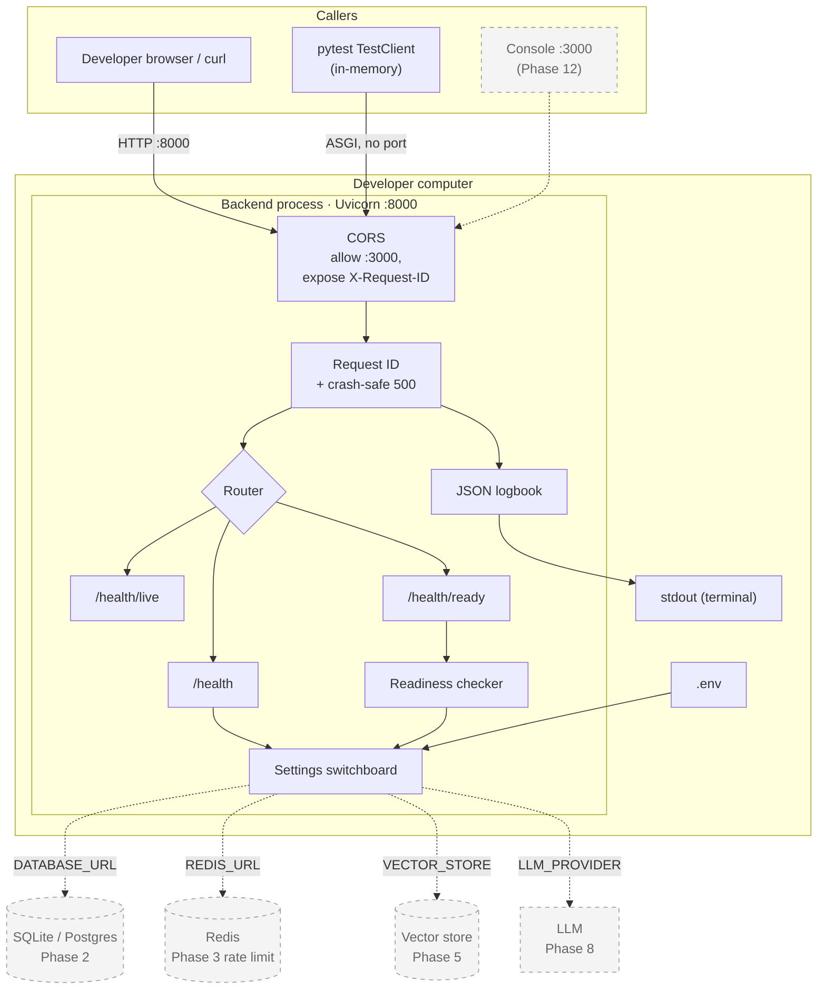

### How Phase 1 maps onto the future Docker network

Each Phase 1 piece has a direct place in the planned containers. Nothing has to be redesigned.

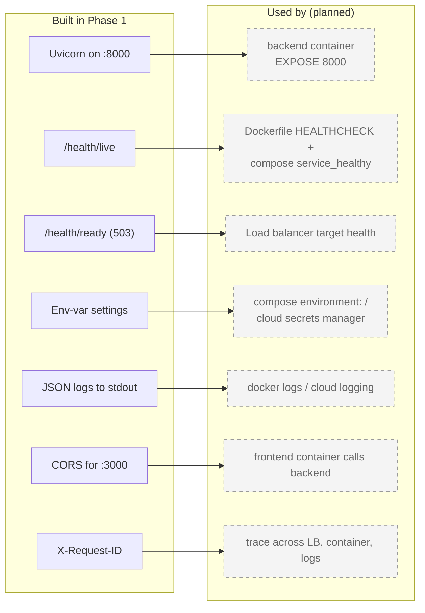

### Ports and addresses

| Component | Address in Phase 1 | Address planned in Docker Compose | Status |
|---|---|---|---|
| Backend API | `http://localhost:8000` | `backend:8000` (published to host :8000) | **Running in Phase 1** |
| Frontend console | (allowed by CORS only) | `frontend:3000` (published to host :3000) | Phase 12 |
| Database | `./data/support.db` (configured) | SQLite on a named volume, or external Supabase | Phase 2 |
| Redis | in-process fakeredis | `redis:6379`, internal only | Phase 3 onward |
| Vector store | in-process memory | `qdrant` service, internal only | Phase 5 |
| LLM | in-process fake | external HTTPS API | Phase 8 |

### Honest status

- **Implemented:** the process, port, routing, CORS, request ID, health probes, settings switchboard, offline harness and developer commands (P1-1 to P1-4).
- **Not in Phase 1:** Dockerfiles, Compose, Kubernetes, Terraform, CI pipelines, and any real connection to a database, Redis, Qdrant or an LLM. All of them are planned for later phases.
- **Known issue:** merge commit `2f297f5` left `backend/app/main.py` and `backend/app/middleware/request_id.py` with two versions mixed together, and neither file compiles. The server will not start until that merge is fixed. `pyproject.toml` also lists `fastapi`, `langchain`, `pydantic-settings` and `uvicorn` twice. The diagrams show the intended wiring.
- **Cloud:** no cloud credentials used; nothing deployed.
