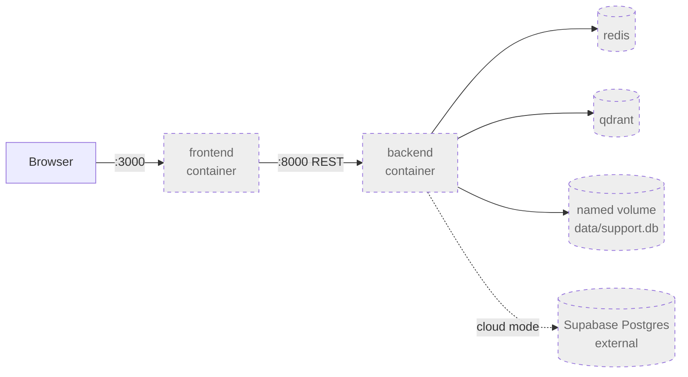
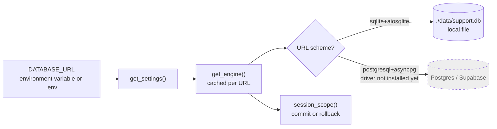
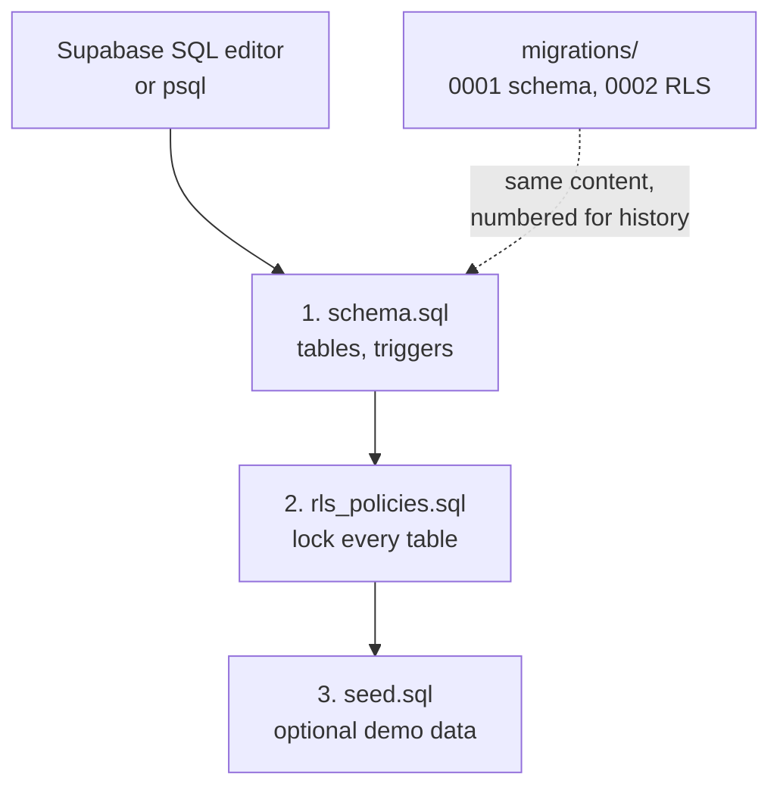
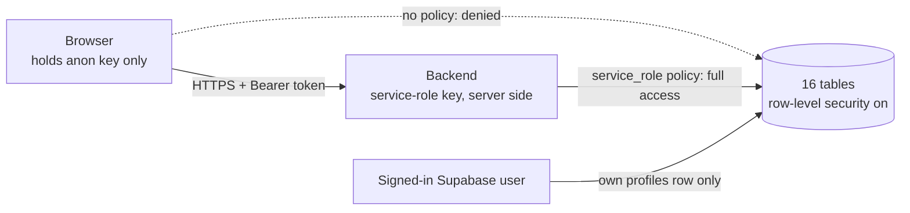
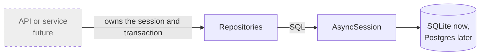
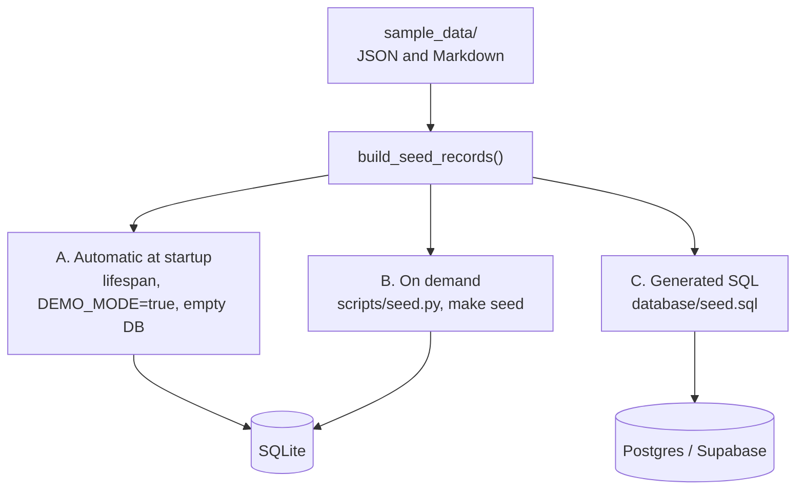
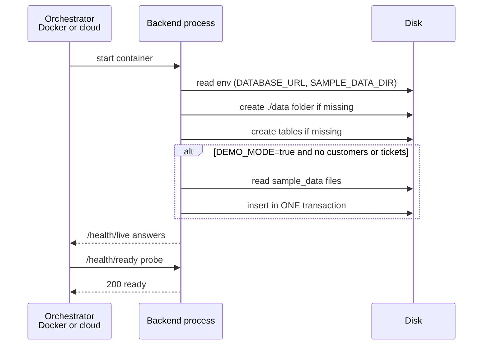
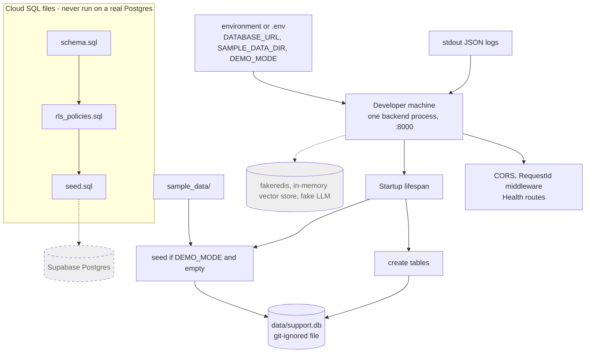

# Phase 2: Infrastructure Design Evolution

*CloudDesk: Autonomous Customer Support & Resolution Platform*

**Phase 2: Persistence and demo data.** This file explains how the **data stores are wired**: where the database lives, how the server finds and connects to it, how the demo and cloud databases differ, who is allowed to read them, and how the data gets there. It also says what this means for the Docker and cloud setup that comes in the final phase.

---

## Read this first: Phase 2 still has no Docker containers

Phase 2 does **not** add Dockerfiles, Docker Compose or Terraform. The backend is still **one program on the developer's computer**, and for the first time it owns a **database file** on that computer.

What Phase 2 does add is the data wiring those containers will depend on. The table is split into what is **built and tested** and what is a **design note for later**; the second column is never claimed as done.

| Decision made in Phase 2 | Built? | Why Docker and the cloud need it later |
|---|---|---|
| The database is chosen by one environment variable, `DATABASE_URL` | Built | A container or cloud service injects the URL; no code change |
| SQLite file for the demo, Postgres URL for the cloud, same models | Built (SQLite). Postgres path untested | The same image can run against either |
| Tables are created at startup on SQLite | Built | A fresh container starts with an empty disk and still works |
| Demo data loads only if the database is empty | Built | A restarted container never duplicates or overwrites data |
| Postgres schema, RLS and migrations as SQL files | Built, never run on a real Postgres | Applied to Supabase in the SQL editor or by a migration job |
| Browser gets no database access (RLS default deny) | Built as SQL, never run on a real Postgres | The frontend container only ever calls the backend |
| Postgres driver (`asyncpg`) in the dependencies | **Not added yet** | Required before `DATABASE_URL=postgresql+asyncpg://...` can work |
| A writable volume for the SQLite file | **Not built** | A container's own disk is lost on restart |
| `sample_data/` shipped inside the backend image | **Not built** | The seed reads those files at startup |

**Diagram key:** solid boxes exist now. Dashed grey boxes are planned for later phases and appear only to show where they will connect.

---

## Step 0: Where the data infrastructure is headed

### Target: local Docker Compose network (final delivery phase)

From `CLAUDE.md` section 15, the planned network is `frontend → backend → redis, qdrant`. The relational database is either a SQLite file on a named volume (demo) or an external Supabase Postgres.

### Target: cloud deployment

Supabase (Postgres), Qdrant Cloud and the LLM API are **external on every cloud**. The backend container reaches Supabase through `DATABASE_URL`, using the service-role connection kept in the cloud's secret store.

### What existed at the start of Phase 2

The backend process on port 8000, settings from environment variables, JSON logs to stdout, health routes, and `database_configured()`, a stub that only checked that `DATABASE_URL` was not empty.

---

## Step 1: P2-1, the connection and the data model

### What was added

The server now opens a real connection. The wiring is a single chain from an environment variable to a session:

| Setting | Default | Meaning |
|---|---|---|
| `DATABASE_URL` | `sqlite+aiosqlite:///./data/support.db` | Where the data lives. The path is relative to where the server is started. |
| `SAMPLE_DATA_DIR` | `sample_data` | Where the seed reads from. May be absolute, relative to the working directory, or relative to the repo root. |
| `DEMO_MODE` | `true` | Whether to load sample data into an empty database |

### Wiring details that matter in a container

| Detail | Behaviour | Container consequence |
|---|---|---|
| Parent folder of the SQLite file | Created automatically if missing | A fresh volume mount works without a manual step |
| One cached engine per URL | Disposed at shutdown | Clean connection close on `docker stop` |
| SQLite foreign keys | Switched on for every connection | Demo behaves like Postgres on bad references |
| Redis, Qdrant, LLM | Unchanged: fakeredis, in-memory, fake | The demo still needs no other container |

### Security of the wiring

`model_dump()` redacts the password in `DATABASE_URL`, and `repr` omits it, so a logged settings object cannot leak the Supabase password. Connection code reads the attribute directly.

---

## Step 2: P2-2, how the Postgres side is wired

### What was added

SQL files that are run **by a person or a migration job**, not by the application:

The order matters: RLS policies refer to tables that must already exist, and seed data should go in after the locks are set.

### Who talks to the database

| Credential | Held by | Reaches the database as |
|---|---|---|
| anon key | The browser | `anon` role: **no policy, so no access** |
| service-role key | The backend only | `service_role`: full-access policy on each table |
| user JWT | A signed-in user | `authenticated`: may read only their own profile |

The service-role key is never in the frontend image. This is the same rule as the Terraform and CI plan: secrets arrive as `TF_VAR_*` and secret-store values, never in committed files.

### Postgres specifics wired in `schema.sql`

| Feature | Detail |
|---|---|
| Ids | `varchar(36)` with `gen_random_uuid()::text` default (needs Postgres 13 or newer, or the `pgcrypto` extension on older versions) |
| JSON | `JSONB` in the DDL; the models say `JSON` and the parity test maps one to the other |
| `updated_at` | `set_updated_at()` trigger on all 16 tables |
| Checks | Category, status, severity and similar columns restricted by `CHECK` constraints |

---

## Step 3: P2-3, the repository layer (no new wiring)

Repositories add **no network or infrastructure wiring**. They matter to infrastructure for one reason: **they are the only code that sends database commands.** Moving from SQLite to Postgres, or adding a read replica, is therefore a change in `core/database.py` and the repositories, never in the agents or the API.

---

## Step 4: P2-4, how the data gets in

### Three ways data enters a database

| Route | Used for | Safe to repeat? |
|---|---|---|
| A. Startup | Local demo, tests | Yes: skipped when customers or tickets exist |
| B. Script | Loading a chosen database without starting the server | Yes: same guard |
| C. SQL file | Cloud demo environment | Yes: every insert is `ON CONFLICT (id) DO NOTHING` |

### Startup sequence from the infrastructure point of view

### Design notes for the delivery phase (planned, not built)

| Concern | What to do when containers arrive |
|---|---|
| **Persistence** | Mount a named volume at the folder holding the SQLite file, or the demo starts empty on every restart. |
| **Image contents** | The backend image build context is the repo root. It must copy `sample_data/`, or `SAMPLE_DATA_DIR` must point at a mounted path, otherwise the seed has nothing to read. |
| **Non-root user** | The Dockerfile hygiene tests require a non-root user, so the data folder must be writable by that user. |
| **More than one replica** | Do not run several containers against one SQLite file. Use Postgres, and set `DEMO_MODE=false` so replicas do not race to seed. Load demo data with `seed.sql` instead. |
| **Postgres driver** | Add `asyncpg` to the dependencies before pointing `DATABASE_URL` at Postgres. |
| **Schema creation** | `create_tables()` is for the SQLite demo. On Postgres, apply `database/schema.sql` or the migrations; the application should not create production tables. |
| **Readiness** | `/health/ready` still checks configuration only. Before a load balancer depends on it, it should actually open a connection. |
| **Secrets** | `DATABASE_URL` for Supabase goes in the cloud secret store. `tests/deployment` already checks that no `.env` is committed. |

---

## Step 5: End of Phase 2, the complete wiring

### Everything connected at the end of Phase 2

### Ports, files and addresses

| Item | Value |
|---|---|
| Backend | `http://localhost:8000` (unchanged) |
| Demo database | `./data/support.db`, relative to where the server starts (git-ignored) |
| Tests | A temporary SQLite file per run; never `./data` |
| Sample data | `./sample_data/` (resolved from the working directory, then the repo root) |
| SQL for Supabase | `database/schema.sql`, `rls_policies.sql`, `seed.sql`, `migrations/` |
| Redis, Qdrant, LLM | Still offline stand-ins; no extra process needed |

### How Phase 2 maps onto the future Docker network

| Phase 2 piece | Future home |
|---|---|
| SQLite file | A named volume on the backend container (demo) |
| `DATABASE_URL` | Container environment, from the cloud secret store |
| `schema.sql`, RLS, migrations | A one-off migration step or the Supabase SQL editor |
| `seed.sql` | One-off load into a cloud demo environment |
| `scripts/seed.py` | `docker compose run` one-off command |
| `sample_data/` | Copied into the backend image, or mounted |

### Honest status

| Item | State |
|---|---|
| Implemented | Connection wiring, SQLite demo database, Postgres SQL files, seed paths A, B and C |
| Validated locally | 68 tests pass offline; seed script run directly; `seed.sql` freshness checked by a test |
| Docker, Compose, Terraform | **Not started** (final delivery phase) |
| Real Postgres or Supabase | **Never run** |
| `asyncpg` | **Not installed** |
| Cloud credentials | None used; nothing deployed |
