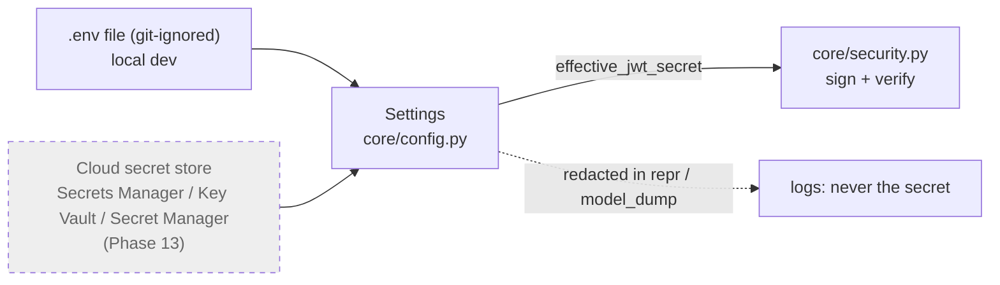
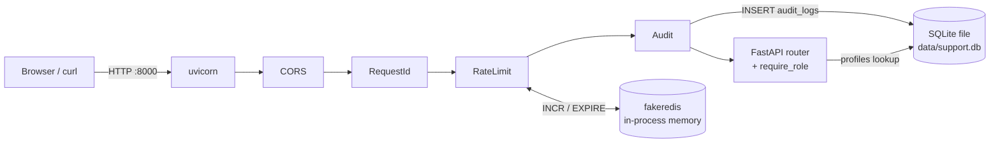
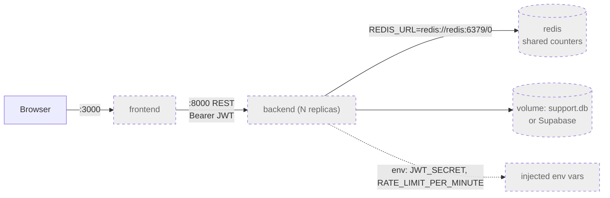
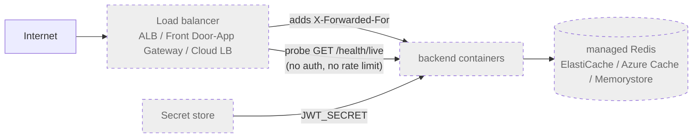

# Phase 3: Infrastructure Design Evolution

*CloudDesk: Autonomous Customer Support & Resolution Platform*

**Phase 3: Identity and request guards.** This file explains how the **security components are wired**: where the signing secret comes from, how requests are routed through the guards, how Redis fits in, and what that means for the Docker and cloud setup in the final phase.

---

## Read this first: Phase 3 still has no Docker containers

No Dockerfile, Compose file or Terraform exists yet. The backend is still one process on the developer's machine. Phase 3 adds the wiring those containers will depend on.

| Decision in Phase 3 | Built? | Why Docker/cloud needs it later |
|---|---|---|
| Signing secret comes from `JWT_SECRET` / `SUPABASE_JWT_SECRET` env vars | Built | Cloud secret stores inject env vars; nothing in the image |
| Redis chosen by `REDIS_URL`; empty means in-process fakeredis | Built (fakeredis). Real Redis path **untested** | Compose and cloud set `REDIS_URL` to a Redis service |
| Rate limit reads the client from `X-Forwarded-For` | Built | Behind a load balancer every socket IP is the balancer's; the real client is in that header |
| Health routes exempt from the limiter and auth | Built | Container health checks and load-balancer probes must never be throttled or need a token |
| Fail-open when Redis is down | Built | A Redis restart must not take the API down |
| `RATE_LIMIT_PER_MINUTE` env var | Built | Tuned per environment without a rebuild |
| Real Redis container, healthcheck, network | **Not built** | Final phase (compose: `frontend → backend → redis, qdrant`) |
| Trusting `X-Forwarded-For` only from the load balancer | **Not built** | See security note below |

---

## Step 1: Where the secret lives

- If `SUPABASE_JWT_SECRET` is set it wins; otherwise `JWT_SECRET`.
- If neither is set, **tokens cannot be issued or accepted**: login returns 503 and every token check returns 401. The system fails closed.
- Only the anon key may ever reach the browser; the signing secret is never returned (a test asserts the login response does not contain it).

---

## Step 2: How a request travels through the guards (local, single process)

Everything sits in **one Python process**; fakeredis lives in that process's memory, so its counters vanish on restart and are not shared between processes. That is fine for a demo, and exactly why real Redis is needed once there is more than one container.

---

## Step 3: Target wiring in Docker Compose (Phase 13, design only)

Why Redis matters here: with two backend replicas, an in-process counter would let a client send 120 requests to *each*. A shared Redis counter keeps the limit global. Redis would use `depends_on: service_healthy` so the backend starts after it.

### Target wiring in the cloud

Mapping: AWS = ElastiCache + Secrets Manager; Azure = Azure Cache for Redis + Key Vault; GCP = Memorystore + Secret Manager. These match `CLAUDE.md` section 15, but none of it is created yet.

### Security note on `X-Forwarded-For`

The limiter trusts the first hop in `X-Forwarded-For`. Behind a load balancer that is correct. If the backend were reachable **directly**, a caller could forge the header to dodge the limit. In Phase 13 the backend must only accept traffic from the load balancer (security groups / ingress rules), or the code must be taught the number of trusted proxies. This is a known gap, not yet addressed.

---

## Step 4: Routing and which paths are protected

| Path | Auth | Rate limited | Audited |
|---|---|---|---|
| `GET /health`, `/health/live`, `/health/ready` | No | No | No (GET) |
| `POST /api/v1/auth/demo-login` | No (demo mode only) | Yes | Yes (actor empty) |
| `GET /api/v1/auth/me` | Any valid token | Yes | No (GET) |
| Phase 4+ routes | `require_role(...)` | Yes | Yes if non-GET |

Response headers added by the guards: `X-Request-ID` (all), `X-RateLimit-Limit` and `X-RateLimit-Remaining` (limited paths), `Retry-After` (429), `WWW-Authenticate: Bearer` (401).

---

## Step 5: Environment variables touched in Phase 3

| Variable | Used by | Default / note |
|---|---|---|
| `JWT_SECRET` | sign + verify | empty → fail closed; use 32+ bytes |
| `SUPABASE_JWT_SECRET` | overrides `JWT_SECRET` | empty |
| `DEMO_MODE` | enables demo login | `true` |
| `REDIS_URL` | limiter backend | empty → fakeredis |
| `USE_FAKE_REDIS` | force fakeredis | `false` (`true` in tests) |
| `RATE_LIMIT_PER_MINUTE` | limit per client per minute | `120` (tests set a huge value) |

## Status (honest)

| Item | State |
|---|---|
| Guard wiring in one process | Implemented, validated locally |
| Real Redis connection | Written, **never run against a real server** |
| Redis in Compose / cloud | **Not built** |
| Trusted-proxy handling | **Not built** |
| Deployed anywhere | No |
