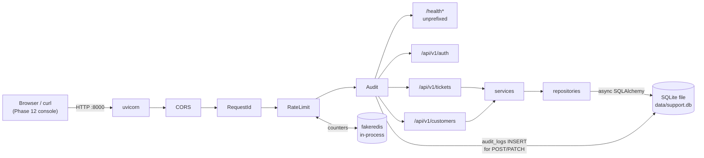
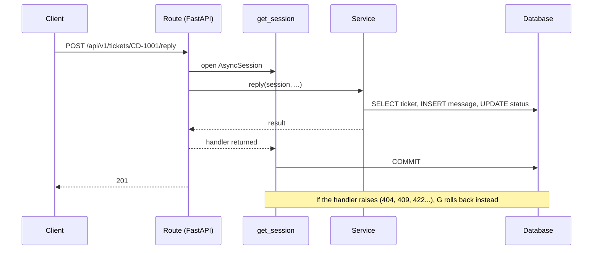
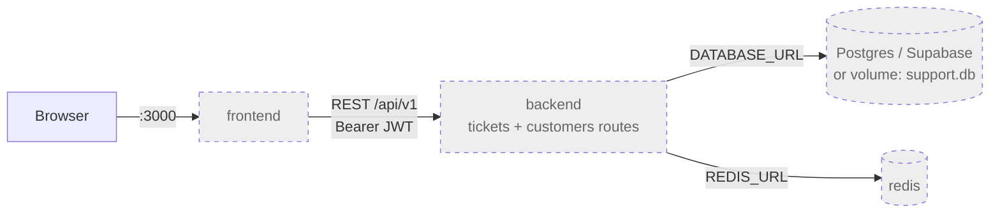
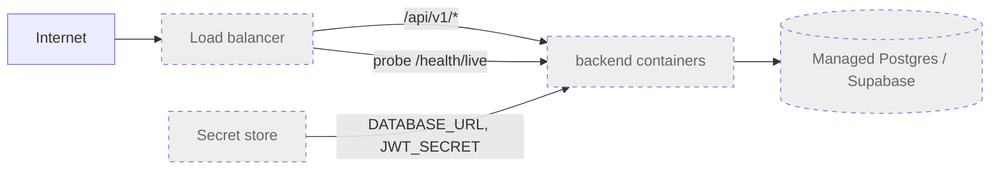

# Phase 4: Infrastructure Design Evolution

*CloudDesk: Autonomous Customer Support & Resolution Platform*

**Phase 4: Support API.** This file explains how the new routes are **wired** into the running application, how a request reaches the database, and what that means for the Docker and cloud setup in the final phase.

---

## Read this first: Phase 4 still has no Docker containers

There is no Dockerfile, Compose file or Terraform yet. The backend is one process on the developer's machine, and Phase 4 adds **no new infrastructure**: no new service, port, environment variable or dependency. It adds routes inside the same process.

| Decision in Phase 4 | Built? | Why Docker/cloud cares later |
|---|---|---|
| Routers mounted under `/api/v1` in `main.py` | Built | The load balancer routes `/api/v1/*` to the backend; health stays unprefixed for probes |
| All data access through an `AsyncSession` per request | Built | One DB connection pool per container; `DATABASE_URL` switches SQLite to Postgres with no code change |
| Session commits when the request succeeds, rolls back on error | Built | A crashed request leaves no half-written ticket, which matters with several replicas |
| Pagination capped at 100 | Built | Protects the container's memory and the DB from huge responses |
| No new environment variables | Built | `.env.example` and the future Compose file do not change |
| Postgres connection, pool sizing | **Not built / untested** | Final phase |
| Containers, network, volumes | **Not built** | Final phase |

---

## Step 1: Where the new routes sit in the process

Every ticket or customer call passes the Phase 3 guards unchanged. The new things in the audit log are `POST /api/v1/tickets…` and `PATCH /api/v1/tickets/…` rows; GETs are not audited.

---

## Step 2: One request, one session, one transaction

Why it matters for containers: each request is self-contained, so any replica can serve any request, and there is no state in the process (apart from the in-memory rate-limit counters from Phase 3, still replaced by real Redis in the final phase).

---

## Step 3: Routing table (what a load balancer would see)

| Path | Method | Role | Mounted |
|---|---|---|---|
| `/health`, `/health/live`, `/health/ready` | GET | none | Phase 1 |
| `/api/v1/auth/demo-login`, `/auth/me` | POST, GET | none / any token | Phase 3 |
| `/api/v1/tickets` | GET / POST | viewer / agent | **Phase 4** |
| `/api/v1/tickets/{id}` | GET / PATCH | viewer / agent | **Phase 4** |
| `/api/v1/tickets/{id}/events` | GET | viewer | **Phase 4** |
| `/api/v1/tickets/{id}/reply`, `/request-info`, `/escalate` | POST | agent | **Phase 4** |
| `/api/v1/customers`, `/customers/{id}` | GET | viewer | **Phase 4** |
| `/api/v1/tickets/{id}/run`, `/workflow` | POST, GET | agent / viewer | Phase 10 (not mounted: 404) |

A single path rule `/api/v1/* → backend` is enough at the load balancer; the application does the finer routing.

---

## Step 4: Target wiring in Docker Compose (final phase, design only)

The Phase 4 routes need only the **database**. They do not call Redis (the rate limiter does), Qdrant, or any LLM. So `backend` can start and serve tickets and customers even if Qdrant is down. `/health/ready` is where that dependency check will be reported.

### Target wiring in the cloud

Mapping stays as in `CLAUDE.md` §15 (AWS ECS Fargate/ALB, Azure Container Apps, GCP Cloud Run). Nothing is created yet.

### Gaps to remember for deployment

- **Ticket numbers** come from "highest existing number + 1". Two replicas creating tickets at the same instant could pick the same number; the unique constraint turns that into an error on one request instead of corrupt data. Under real load use a database sequence (a later migration, never an edit of 0001).
- **Search** is a `LIKE` scan, fine for the demo, to be replaced by an index or full-text search at scale.
- **SQLite vs Postgres**: tests only ran on SQLite. Case-insensitive search uses `lower()`/`ilike`, which Postgres supports, but it has never been run there.

---

## Step 5: Environment variables touched in Phase 4

None added. Existing ones now matter for the new routes:

| Variable | Used by | Note |
|---|---|---|
| `DATABASE_URL` | every ticket/customer call | `sqlite+aiosqlite:///./data/support.db` locally, `postgresql+asyncpg://…` in cloud |
| `JWT_SECRET` / `SUPABASE_JWT_SECRET` | `require_role` on every route | unchanged from Phase 3 |
| `DEMO_MODE` | seeds the 13 tickets and 8 customers the routes serve | unchanged |

## Status (honest)

| Item | State |
|---|---|
| New routes inside the single process | Implemented, validated locally |
| Docker, Compose, Terraform | Not built |
| Real Postgres / Redis | Not tried |
| Cloud | Nothing deployed |
