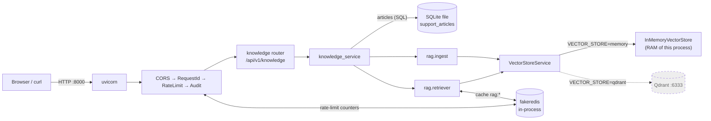
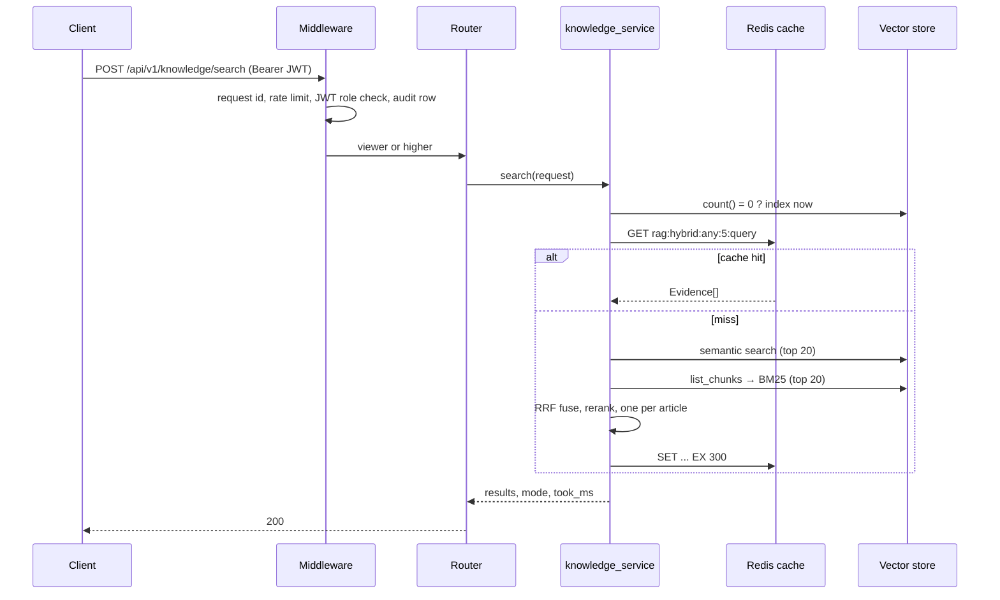
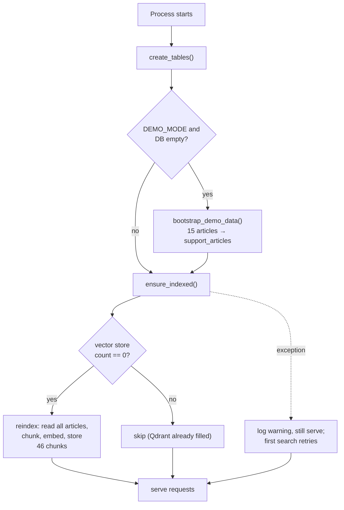
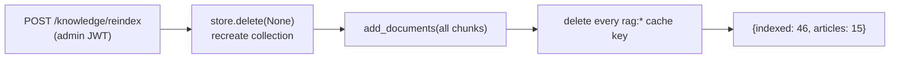
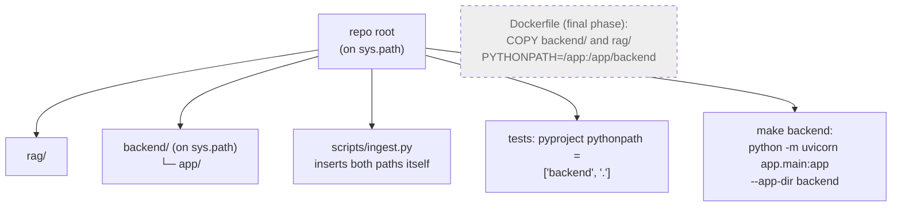
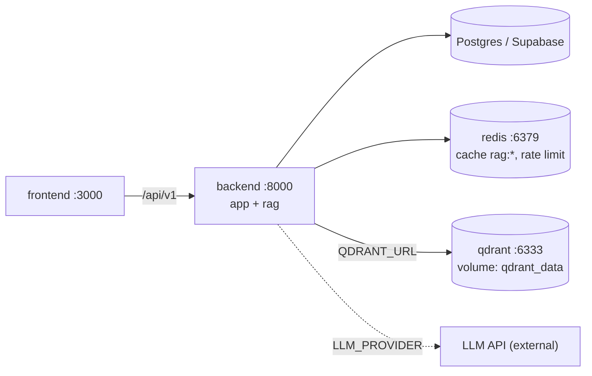

# Phase 5: Infrastructure Design Evolution

*CloudDesk: Autonomous Customer Support & Resolution Platform*

**Phase 5: Knowledge pipeline.** This file explains how the knowledge pipeline is **wired** into the running application, which stores it talks to, how requests are routed to it, and what it means for the Docker and cloud setup in the final phase.

---

## Read this first: Phase 5 still has no Docker containers

There is no Dockerfile, Compose file or Terraform yet. The backend is one process on the developer's machine. Phase 5 adds **no new container, port or service**, but it does introduce the *shape* of two things the final phase must deploy: a **vector store** and a **Redis cache**. Offline, both run inside the same Python process.

| Decision in Phase 5 | Built? | Why Docker/cloud cares later |
|---|---|---|
| New `rag/` package at the repo root | Built | The backend image must copy `rag/` as well as `backend/`, and the Python path must include both |
| `/api/v1/knowledge/*` routes in the same FastAPI process | Built | Same port 8000, same load-balancer rule `/api/v1/*` |
| `VectorStoreService` with `VECTOR_STORE` = `memory` or `qdrant` | Built | In Compose this selects the `qdrant` service; in cloud, Qdrant Cloud |
| In-memory store (default) | Built | Per-process: each replica holds its own copy and must index at startup |
| `QdrantVectorStore` | **Written, never run** | Needs the `qdrant-client` package and a running server |
| Retrieval cache in Redis (`rag:*`, TTL 300 s) | Built (fakeredis offline) | Shared across replicas only with real Redis |
| Index built in the app lifespan | Built | Container start does a one-off index; health must not report ready before that if the index matters |
| Makefile `backend` target changed to run from the repo root | Built | Same import-path rule as the Dockerfile `WORKDIR` and `PYTHONPATH` |
| New environment variables | **None** | `EMBEDDING_*`, `VECTOR_STORE`, `QDRANT_*` were already in `.env.example` |
| Containers, network, volumes | **Not built** | Final phase |

---

## Step 1: The component wiring inside the process

Three stores, three jobs:

| Store | Holds | Offline | In the cloud |
|---|---|---|---|
| SQL database | The articles (source of truth) | SQLite file | Postgres / Supabase |
| Vector store | Chunks and their vectors (rebuildable) | RAM | Qdrant |
| Redis | Cached search results and rate-limit counters (disposable) | fakeredis in RAM | Redis |

Only the database is the source of truth. The vector store can always be rebuilt from it with `POST /knowledge/reindex`, and the cache can always be thrown away.

---

## Step 2: Request routing for a search

A `POST /search` is a non-GET request, so the Phase 3 audit middleware records it. That is fine for demo traffic; at scale you would exclude read-only POST searches from the audit table.

---

## Step 3: Startup and reindex

**Why it matters with several replicas.** With the in-memory store, every replica indexes itself at start, so a reindex call reaches only the replica that served it. With Qdrant, the index is shared and a reindex is global. This is a key reason the cloud profile uses `VECTOR_STORE=qdrant`.

---

## Step 4: Import paths: the one real change to how the app boots

`rag/` is at the repository root, next to `backend/`. Python must find both.

Before Phase 5 the server was started with `cd backend`, which put only `backend/` on the path. That would fail to import `rag`, so the Makefile now starts from the root with `python -m` (which adds the current directory) plus `--app-dir backend`. The container will need the equivalent.

---

## Step 5: Where this lands in Docker Compose (final phase, not built)

| Setting | Offline demo | Compose / cloud |
|---|---|---|
| `VECTOR_STORE` | `memory` | `qdrant` |
| `QDRANT_URL` | empty | `http://qdrant:6333` (service name, not localhost) |
| `QDRANT_API_KEY` | empty | secret (Qdrant Cloud only), via the secrets manager |
| `QDRANT_COLLECTION` | `clouddesk_knowledge` | same |
| `REDIS_URL` | empty (fakeredis) | `redis://redis:6379/0` |
| `EMBEDDING_PROVIDER` / `EMBEDDING_DIMENSIONS` | `fake` / `384` | must match what built the collection |

**Dimension rule.** A Qdrant collection is created with a fixed vector size. Changing the embedding model changes the size, so the collection must be recreated: that is exactly what `POST /knowledge/reindex` does.

**Health.** `/health/ready` still reports the vector store as `ok` for `memory` and `error: not probed yet` for Qdrant. `QdrantVectorStore.health()` exists but is not yet called by readiness; wiring it is final-phase work.

---

## Status (honest)

| Item | State |
|---|---|
| Wiring inside one process (router → service → `rag/` → stores) | Implemented, validated locally |
| Redis cache for retrieval | Implemented with fakeredis; never run against real Redis |
| Qdrant store | Written, never run, dependency not installed |
| `make` targets | `make` is not installed on this Windows machine; the underlying commands were run directly |
| Dockerfile, Compose, Terraform, `rag/` in the image | Not built |
| Replica behaviour of the in-memory index | Reasoned, not tested |
| Cloud | Nothing deployed |
