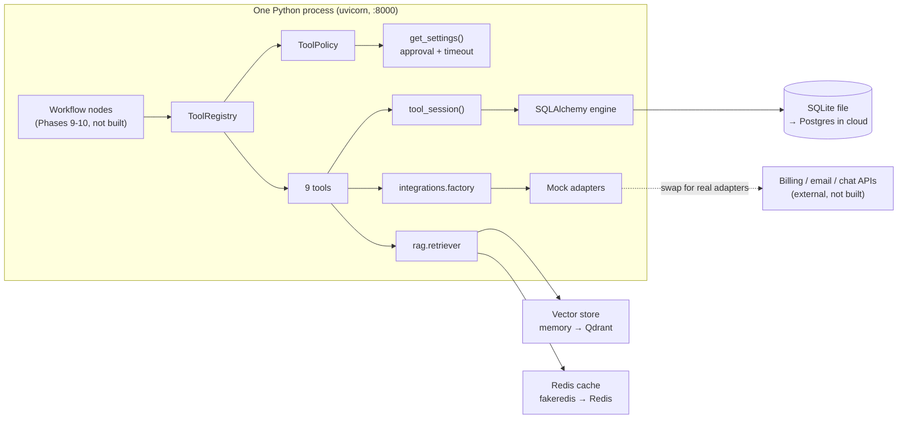
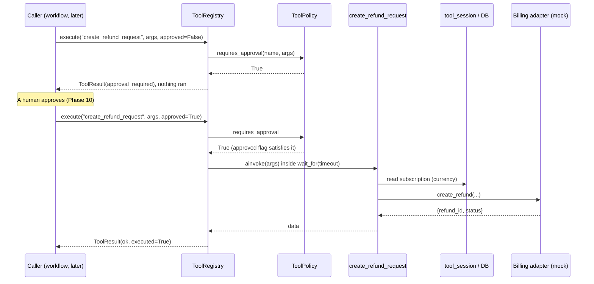
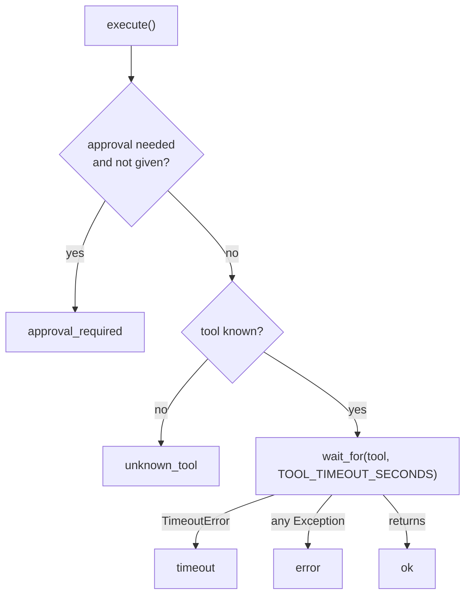
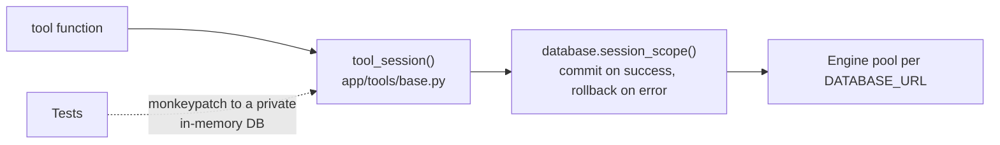
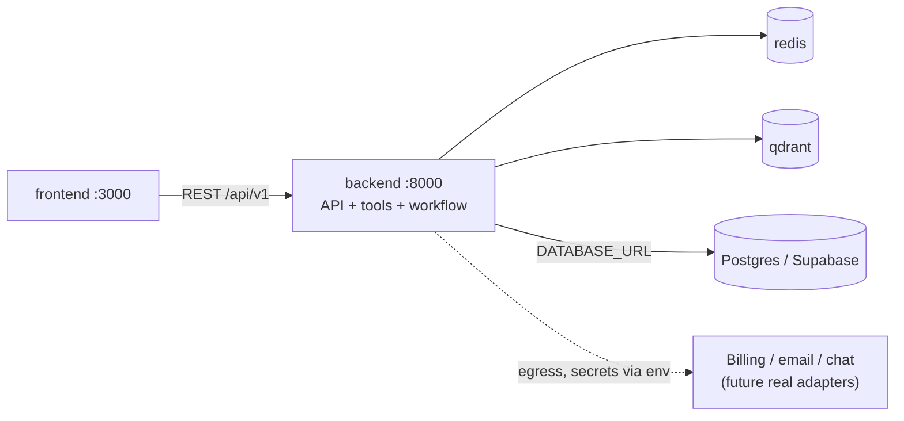

# Phase 6: Infrastructure Design Evolution

*CloudDesk: Autonomous Customer Support & Resolution Platform*

**Phase 6: Tools and policy.** This file explains how the tool layer is **wired** into the running application, what it talks to, how a call is routed, and what it means for Docker and the cloud in the final phase.

---

## Read this first: Phase 6 still has no Docker containers

There is no Dockerfile, Compose file or Terraform yet. The backend is one process on the developer's machine. Phase 6 adds **no new container, port, route, or environment variable**. The tool layer is plain Python inside the same process. It matters for infrastructure because it fixes *what the deployed backend will call outward to*.

| Decision in Phase 6 | Built? | Why Docker/cloud cares later |
|---|---|---|
| New `integrations/` package at the repo root | Built | Like `rag/`, the backend image must copy it and have the repo root on `PYTHONPATH` |
| `backend/app/tools/` package | Built | Inside `backend/`, nothing special |
| No new HTTP route | True | Same port 8000, same load-balancer rule `/api/v1/*` |
| Mock integrations (billing, email, notify, workspace admin) | Built | In-process, no network. Real adapters would need **egress** to those providers and **secrets** (Secrets Manager / Key Vault / Secret Manager) |
| `TOOL_TIMEOUT_SECONDS` | Already in settings | Must stay **below** the load balancer and probe timeouts |
| `APPROVAL_REQUIRED_FOR_REFUNDS`, `MAX_REFUND_WITHOUT_APPROVAL` | Already in settings | Policy knobs; must be set explicitly per environment (prod stays gated) |
| Tools reach the DB through `tool_session()` | Built | Uses the same `DATABASE_URL` pool as the API |
| `search_docs` uses the vector store and Redis cache | Built | Same `VECTOR_STORE`, `QDRANT_*`, `REDIS_URL` wiring as Phase 5 |
| Containers, network, volumes | **Not built** | Final phase |

---

## Step 1: Component wiring inside the process

Every arrow inside the box is a Python function call. Every arrow leaving the box is a network hop in the cloud version.

---

## Step 2: Routing of one tool call

The routing here is **in-process control flow**, not network routing. This is the path of `create_refund_request`.

A read tool skips the first half: the policy answers "no", and the call runs straight away.

---

## Step 3: Failure routing

All five outcomes are a `ToolResult`. In the cloud this means a failing downstream provider produces a recorded result, never a crashed container and never a failed health probe.

---

## Step 4: Where the database session comes from

Tools do not receive a session from FastAPI, because they will be called from background workflow tasks, not from a request. Each tool opens its own short unit of work.

One seam, so tests never touch the real database. In production it is the same pool the API uses, so connection limits must cover API requests plus concurrent workflow tools.

---

## Step 5: Where this lands in Docker Compose (final phase, not built)

What the final phase must remember because of Phase 6:

1. The backend image copies `backend/`, `rag/` **and** `integrations/`.
2. Real adapters need outbound network access and secrets injected as `TF_VAR_*` / secret-manager values, never baked in the image.
3. `TOOL_TIMEOUT_SECONDS` must be shorter than the load balancer idle timeout.
4. Tools run in the backend container; there is no separate "tool service" in v1. A worker split later would still call the same registry.
5. Production must keep `APPROVAL_REQUIRED_FOR_REFUNDS=true`. A test in the delivery phase can assert the `.env.example` default.

---

## Status (honest)

| Item | State |
|---|---|
| Tool layer wired in-process | Implemented |
| Validated offline with a private SQLite database and mocks | Validated locally |
| Docker, Compose, Terraform | Not built |
| Real outbound integrations, egress rules, secrets | Not built, needs cloud credentials |
| Nothing is deployed | True |
