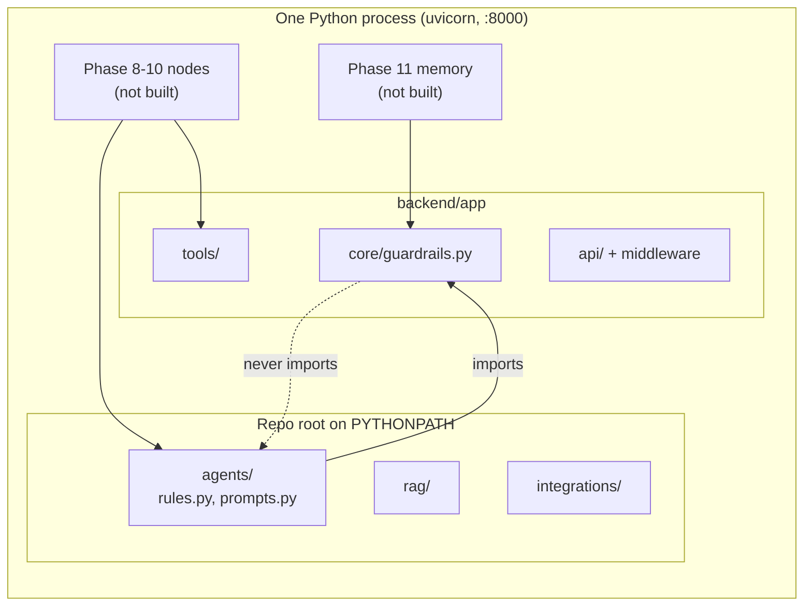
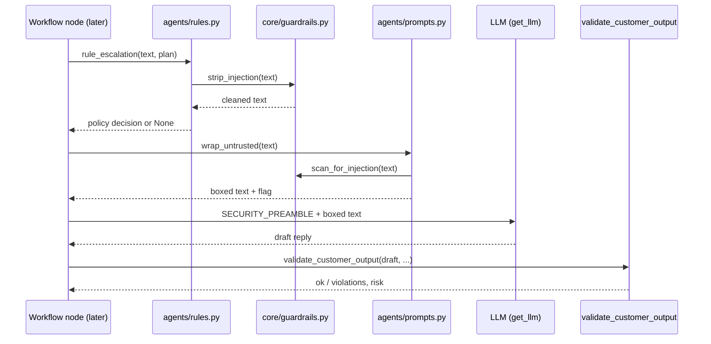
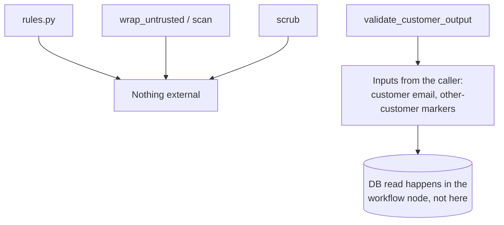

# Phase 7: Infrastructure Design Evolution

*CloudDesk: Autonomous Customer Support & Resolution Platform*

**Phase 7: Rules and guardrails.** This file explains how the guardrails are **wired** into the running application, how data is routed through them, and what it means for Docker and the cloud in the final phase.

---

## Read this first: Phase 7 still has no Docker containers

There is no Dockerfile, Compose file or Terraform yet. Phase 7 adds **no container, port, route, network call, database table or environment variable**. It is pure Python inside the same backend process. Its infrastructure significance is mostly what it **does not need**.

| Decision in Phase 7 | Built? | Why Docker/cloud cares later |
|---|---|---|
| New top-level `agents/` package | Built | Like `rag/` and `integrations/`, the backend image must copy it and have the repo root on `PYTHONPATH` |
| `backend/app/core/guardrails.py` | Built | Inside `backend/`, nothing special |
| No I/O, no network, no DB, no Redis | True | Guardrails add **no egress**, no secrets, no new health-probe dependency |
| No model call | True | Works with `LLM_PROVIDER=fake` and with no API key |
| No new HTTP route | True | Same port 8000, same load-balancer rule `/api/v1/*` |
| No new environment variable | True | `.env.example` unchanged |
| Regex work is CPU-only | True | Cheap; no memory or CPU sizing change |
| Containers, network, volumes | **Not built** | Final phase |

---

## Step 1: Where the code sits in the process

Every arrow is a Python function call inside one process. Nothing crosses the network, so there is nothing to route, secure or time out between containers.

---

## Step 2: Routing of one ticket through the guardrails

This is **in-process control flow**, not network routing. It shows where, in later phases, each guardrail will sit on the path.

Rules run **before** the model call, validation **after**. Both are local, so a model-provider outage does not stop policy escalation.

---

## Step 3: What each guardrail needs at runtime

`validate_customer_output` deliberately does not look up customers. The caller passes in who is who, so the guardrail stays I/O-free and the DB connection stays in the layer that owns it.

---

## Step 4: Security and secrets, infra view

| Concern | How Phase 7 handles it |
|---|---|
| Secrets in logs | Validation reports labels (`secret: api_key`), never the value |
| Secrets in memory notes | `scrub` is applied before any note is stored (Phase 11) |
| Staff addresses in customer replies | `@clouddesk.demo` is treated as internal; only `PUBLIC_EMAIL_DOMAINS` is allowed |
| Internal hosts in replies | Private IPs, `localhost`, `.internal`, single-label hosts, `kb://` and `/api/v1/` are blocked, which matters once real internal DNS names exist in the cloud |

When the cloud deploy arrives, `PUBLIC_EMAIL_DOMAINS` is a constant to update to the real support domain, and the private-host list covers the internal names the container platforms hand out (for example `*.svc.cluster.local`).

---

## What changes for Docker in the final phase

1. `COPY agents/` into the backend image alongside `backend/`, `rag/`, `integrations/`, `memory/`.
2. `PYTHONPATH` includes `backend` and the repo root.
3. No new port, volume, secret or `depends_on`.
4. Unit tests for Phase 7 need no containers, so CI runs them in the plain Python job.
