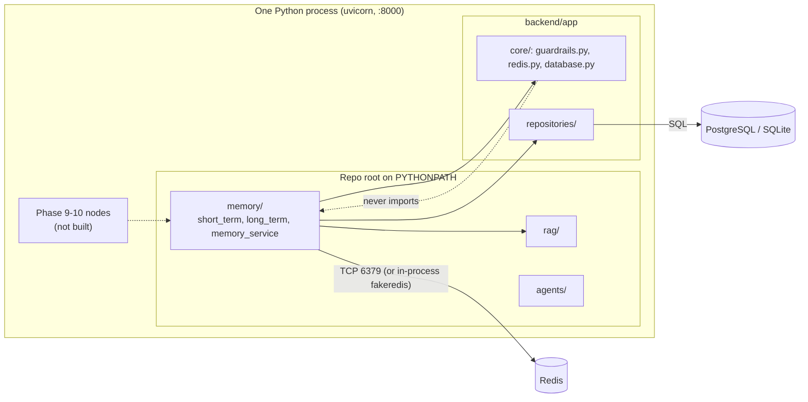
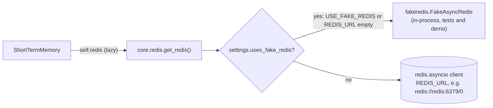
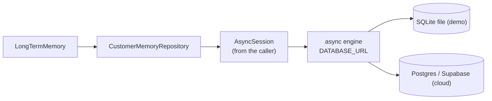
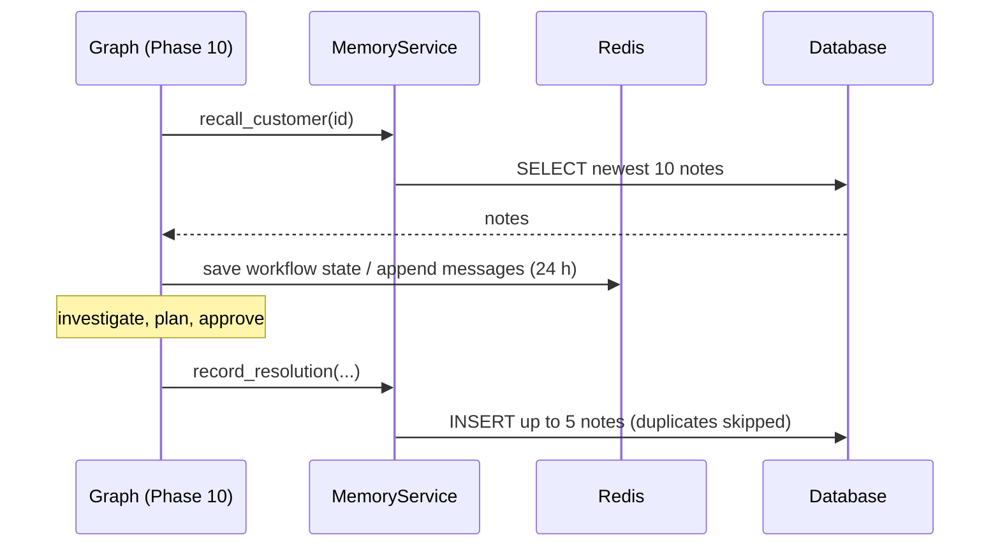
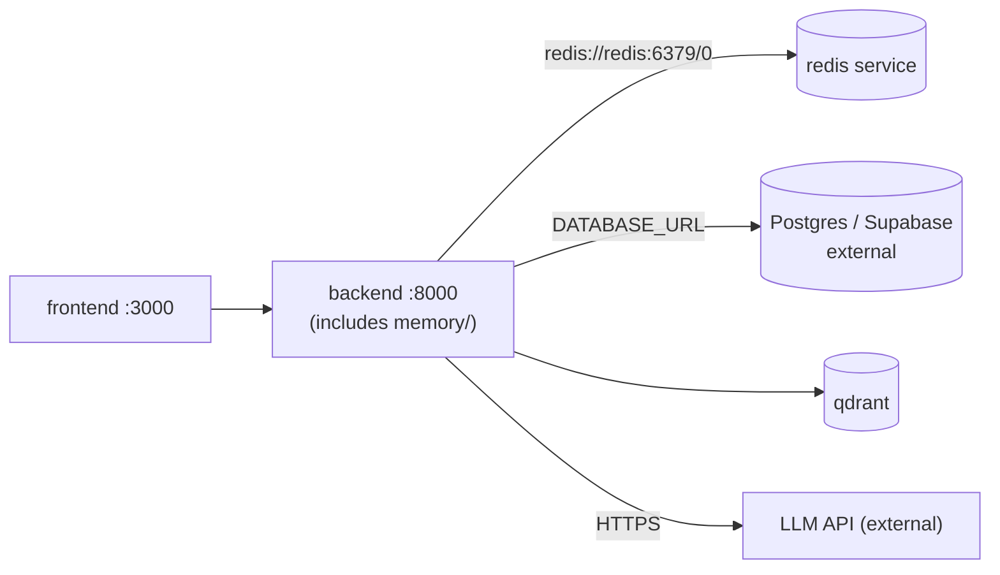

# Phase 8: Infrastructure Design Evolution

*CloudDesk: Autonomous Customer Support & Resolution Platform*

**Phase 8: Memory.** This file explains how the memory components are **wired** into the running application, which stores they talk to, and what that means for Docker and the cloud in the final phase.

---

## Read this first: Phase 8 still has no Docker containers

There is no Dockerfile, Compose file or Terraform yet. Phase 8 adds **no container, port, HTTP route, table or environment variable**. It adds one new top-level Python package, `memory/`, which talks to two stores that already exist: Redis and the SQL database.

| Decision in Phase 8 | Built? | Why Docker/cloud cares later |
|---|---|---|
| New top-level `memory/` package | Built | Like `rag/`, `agents/`, `integrations/`: the backend image must copy it and keep the repo root on `PYTHONPATH` |
| Uses Redis (short-term) | Built | Needs the `redis` service in Compose, and `REDIS_URL` in the cloud |
| Uses SQL (long-term) | Built | Same `DATABASE_URL` as everything else; table already exists |
| Offline mode: fakeredis + SQLite | Built | Same code path as production, so `make test` needs no containers |
| No new HTTP route | True | Same port 8000; nothing new at the load balancer |
| No new environment variable | True | Reuses `REDIS_URL`, `USE_FAKE_REDIS`, `DATABASE_URL` |
| No new migration | True | `customer_memory` (with its unique constraint) came in Phase 2 |
| No network call to an LLM | True | No new egress |
| Containers, network, volumes | **Not built** | Final phase |

---

## Step 1: Where the code sits in the process

Calls between packages are in-process Python calls. Only the two arrows to Redis and the database leave the process.

---

## Step 2: Component wiring for each store

### 2.1 Short-term memory to Redis

- The client is created **lazily** on first use and cached per URL by `get_redis()`. A test can inject its own client.
- Keys in Redis: `conv:{ticket_id}` (list), `wfstate:{ticket_id}` (string), and `rag:{mode}:{category}:{top_k}:{query}` (Phase 5 cache). TTLs: 24 h, 24 h, 300 s.
- A Redis outage is **non-fatal**: errors are caught and logged. This matters in the cloud, where a Redis restart must not turn into failed tickets.

### 2.2 Long-term memory to SQL

- The **session is passed in** by the caller. Memory never opens its own connection, so a later workflow node controls the transaction.
- Same SQLAlchemy models run on SQLite and Postgres, so no environment-specific code exists.
- A `UNIQUE (customer_id, kind, content_hash)` constraint in the database backs up the code-level duplicate check, which matters when two workers write at once.

---

## Step 3: Routing of one ticket through memory (future flow)

In-process control flow, not network routing, showing where the stores are touched once Phases 9-10 connect it.

---

## Step 4: What this means for the final phase

### 4.1 Docker Compose (planned)

Compose service names become DNS names on the project network, so `REDIS_URL=redis://redis:6379/0` works with no IP addresses. Redis needs a health check (`redis-cli ping`) and the backend `depends_on: service_healthy`.

### 4.2 Cloud mapping (planned)

| Piece | AWS | Azure | GCP |
|---|---|---|---|
| Redis | ElastiCache | Azure Cache for Redis | Memorystore |
| SQL | Supabase (external) on every cloud | | |
| Secrets (`REDIS_URL` may carry a password) | Secrets Manager | Key Vault | Secret Manager |

### 4.3 Things the final phase must remember

| Concern | Action |
|---|---|
| Backend image must include `memory/` | `COPY memory/ ./memory/`, repo root on `PYTHONPATH` |
| `REDIS_URL` may contain a password | Pass as a secret, never in committed files; settings already redact it in dumps |
| Redis is a cache and scratchpad, not the source of truth | No persistence is required for correctness; losing it loses at most 24 h of scratch data |
| Memory TTLs are expiry, not deletion on demand | A privacy erasure request needs a separate delete path (not built) |
| `/health/ready` is the readiness probe | Phase 8 adds no probe of its own; check that the readiness check covers Redis once real clients are wired |

---

## Status (honest)

| Item | State |
|---|---|
| `memory/` package, both stores wired | Implemented, tested with fakeredis and in-memory SQLite |
| Real Redis connection | Not exercised |
| Compose, Dockerfile, Terraform | Not built |
| Called from the running app | Not yet |
