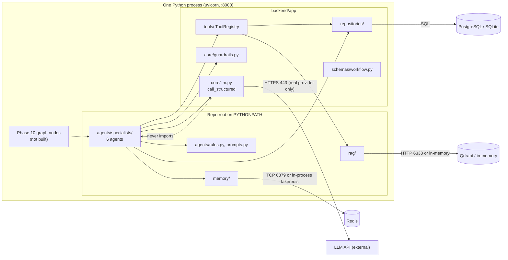
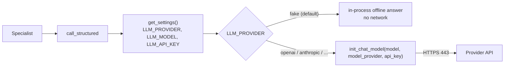
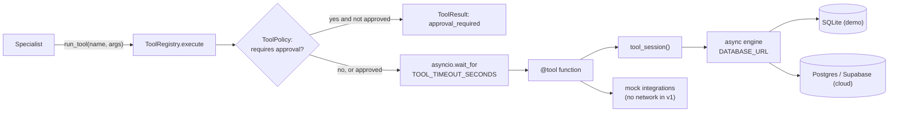
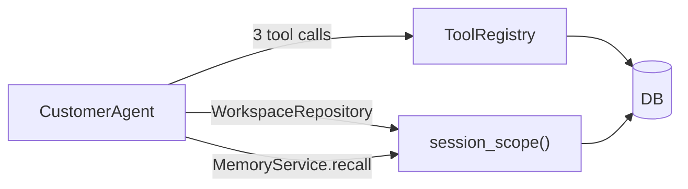
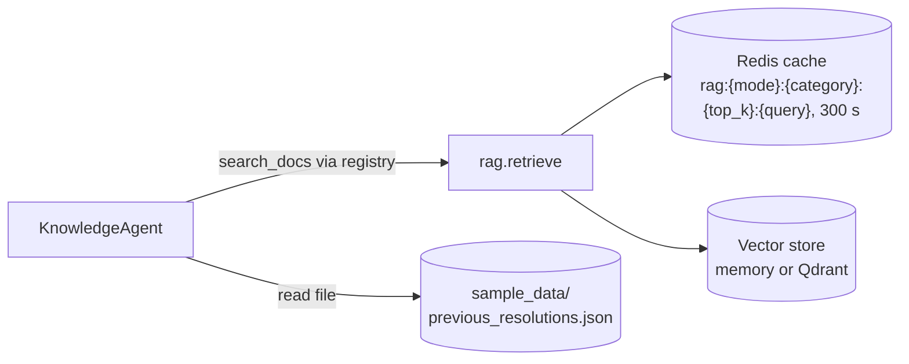
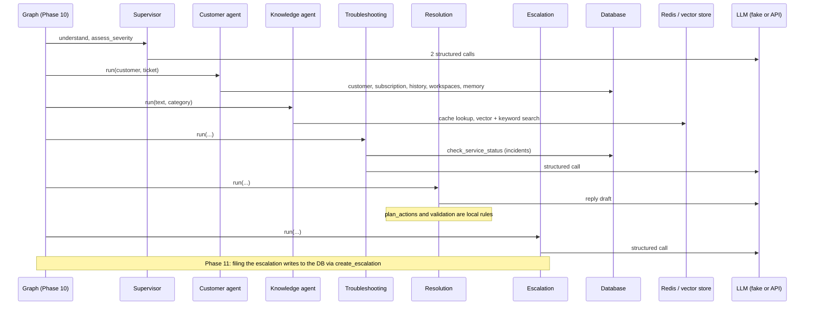
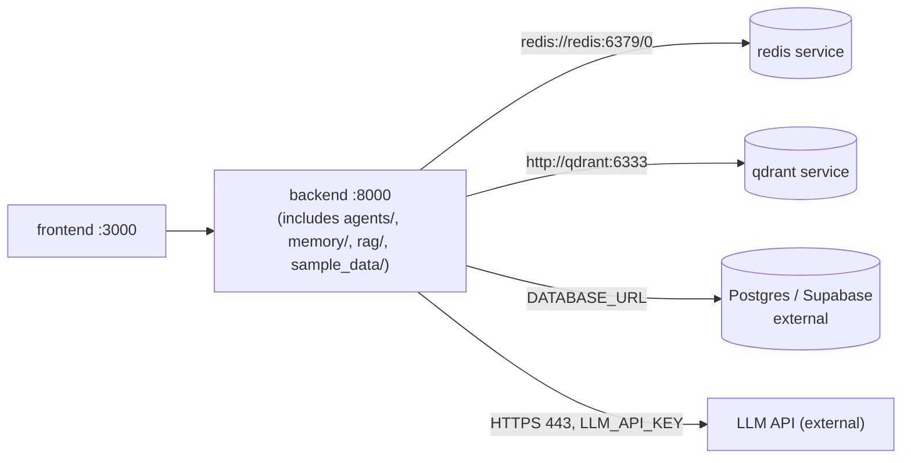

# Phase 9: Infrastructure Design Evolution

*CloudDesk: Autonomous Customer Support & Resolution Platform*

**Phase 9: Specialist agents.** This file explains how the agent components are **wired** into the running application, which stores and services they reach, the one genuinely new network path (the LLM API), and what that means for Docker and the cloud in the final phase.

---

## Read this first: Phase 9 still has no Docker containers

There is no Dockerfile, Compose file or Terraform yet. Phase 9 adds **no container, port, HTTP route, table, migration or environment variable**. It adds code to the existing `agents/` package and one module to `backend/app/core/`. It reuses stores and settings that exist.

| Decision in Phase 9 | Built? | Why Docker/cloud cares later |
|---|---|---|
| `agents/specialists/` (new sub-package of `agents/`) | Built | Backend image must copy `agents/` and keep the repo root on `PYTHONPATH` |
| `backend/app/core/llm.py` | Built | The one place an outbound LLM call can leave the process |
| Offline `fake` provider is the default | Built | `make test`, `make demo` and CI need no key and no egress |
| Real provider path via LangChain `init_chat_model` | Written, **never run** | Needs `LLM_API_KEY`, outbound HTTPS to the provider, and a provider package that is **not installed** |
| `previous_resolutions.json` read as a file | Built | `sample_data/` must be in the image (or `SAMPLE_DATA_DIR` must point to it) |
| `datasets/eval_cases.json` | Built | Used by tests/CI only; not needed in the runtime image |
| New HTTP route | **None** | Same port 8000; nothing new at the load balancer |
| New environment variable | **None** | Reuses `LLM_PROVIDER`, `LLM_API_KEY`, `LLM_MODEL`, `SAMPLE_DATA_DIR` |
| New migration or table | **None** | Specialists read and write through existing repositories and tools |
| Containers, network, volumes | **Not built** | Final phase |

---

## Step 1: Where the code sits in the process

Everything below runs **inside one Python process** (uvicorn on `:8000`). Specialist-to-tool, tool-to-repository and rules calls are plain function calls, not network hops.

Only four arrows leave the process: the database, Redis, the vector store, and (**new in Phase 9, and only with a real provider**) the LLM API.

---

## Step 2: Component wiring

### 2.1 The LLM access layer (the one new egress path)

- **Default is no network.** `fake` is the default value of `LLM_PROVIDER`, so a fresh container with no secrets still works.
- **Secrets:** `LLM_API_KEY` is a `SecretStr`, redacted in `model_dump()` and never logged. `call_structured` never logs or returns prompts, only sizes.
- **Failure:** a provider error becomes a typed `LLMError`; invalid structured output is retried once.
- **Missing model name:** a real provider with an empty `LLM_MODEL` raises `LLMError` (tested).
- **Not yet true:** `langchain-openai` and `langchain-anthropic` are not installed, so a real provider cannot start today.

### 2.2 How a tool call travels (in-process)

Specialists never open a tool directly. `run_tool` in `agents/specialists/base.py` is the only wrapper, and it records the tool name, status and duration (never the arguments) for the future tracer.

### 2.3 The Customer agent's three data paths

The workspace and memory reads share **one session** opened with `database.session_scope()`. Memory recall touches only the SQL database here, not Redis.

### 2.4 The Knowledge agent's two data paths

- Retrieval and its Redis cache were built in Phase 5. A Redis error is non-fatal there (the cache is advisory).
- The previous-resolutions file is read from `SAMPLE_DATA_DIR` (default `sample_data`), resolved against the working directory and the repo root. **In a container, this folder must exist at runtime.**

---

## Step 3: Routing of one ticket through the specialists (future flow)

Control flow inside the process, showing where each store or service is touched once Phase 10 connects the graph.

Per ticket in offline mode this is **zero network calls**. With a real provider it is up to **six model calls** (two Supervisor, one Troubleshooting, one Resolution, one Escalation, plus one for the end-of-run summary).

---

## Step 4: What this means for the final phase

### 4.1 Docker Compose (planned)

Service names become DNS names on the Compose project network, so no IP addresses appear in configuration. The only new **outbound** rule compared with Phase 8 is HTTPS 443 to the LLM provider (egress allow-list or NAT in the cloud).

### 4.2 Cloud mapping (planned)

| Piece | AWS | Azure | GCP |
|---|---|---|---|
| Backend container | ECS Fargate | Container Apps | Cloud Run |
| `LLM_API_KEY` | Secrets Manager | Key Vault | Secret Manager |
| Egress to the LLM API | NAT gateway or public subnet | Container Apps outbound | Cloud Run egress (VPC connector if locked down) |
| Logs (JSON, no prompts) | CloudWatch | Log Analytics | Cloud Logging |

### 4.3 Things the final phase must remember

| Concern | Action |
|---|---|
| Image must include `agents/`, `memory/`, `rag/`, `integrations/` and `sample_data/` | `COPY` each; keep the repo root on `PYTHONPATH`; `SAMPLE_DATA_DIR` must resolve |
| `datasets/` is for tests/CI | Not needed in the runtime image; the evaluation job needs it |
| A real provider needs its package | Add `langchain-openai` or `langchain-anthropic` to dependencies, and rebuild; today they are absent |
| `LLM_API_KEY` is a secret | Pass as a secret (`TF_VAR_*`, secret store), never in committed files; settings already redact it |
| `get_settings()` is cached | A changed `LLM_PROVIDER` needs a restart or a new deploy |
| Per-call latency and rate limits of the provider | Not measured; `TOOL_TIMEOUT_SECONDS` covers tools, not model calls. A model-call timeout is **not built** |
| Egress control | Allow only the provider host over 443 where the platform supports it |
| Readiness | `/health/ready` already reports `llm`; check it reflects a real client once one is wired |

---

## Status (honest)

| Item | State |
|---|---|
| Specialists wired to tools, repositories, memory, rules, guardrails | Implemented, tested offline (in-memory SQLite, in-memory vector store, fakeredis) |
| Real LLM connection | **Not exercised**; provider package not installed |
| Model-call timeout and cost tracking | Not built |
| Compose, Dockerfile, Terraform | Not built |
| Called from the running app | Not yet (Phase 10) |
| Deployed anywhere | No |
