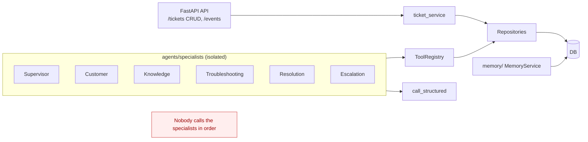
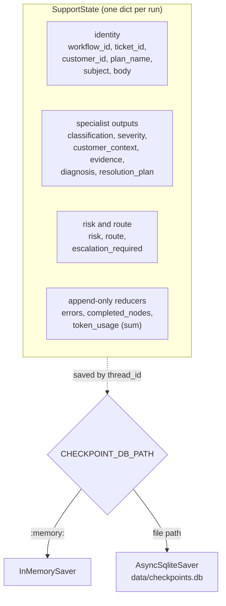
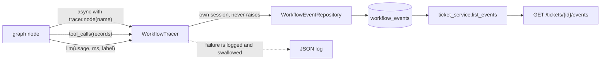
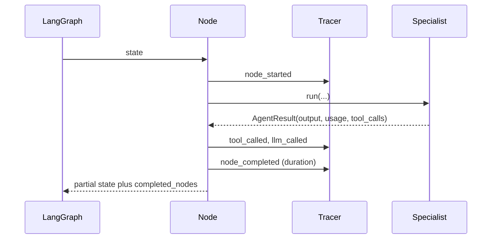
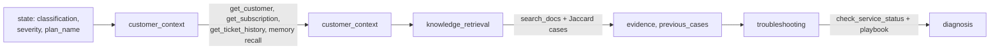
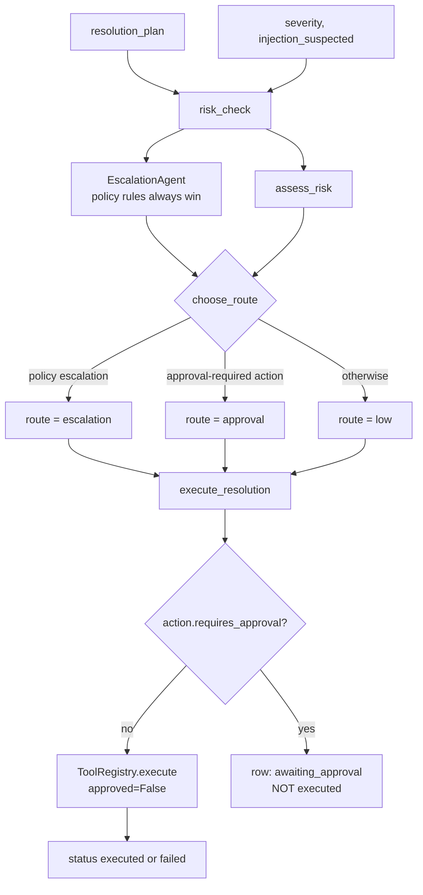
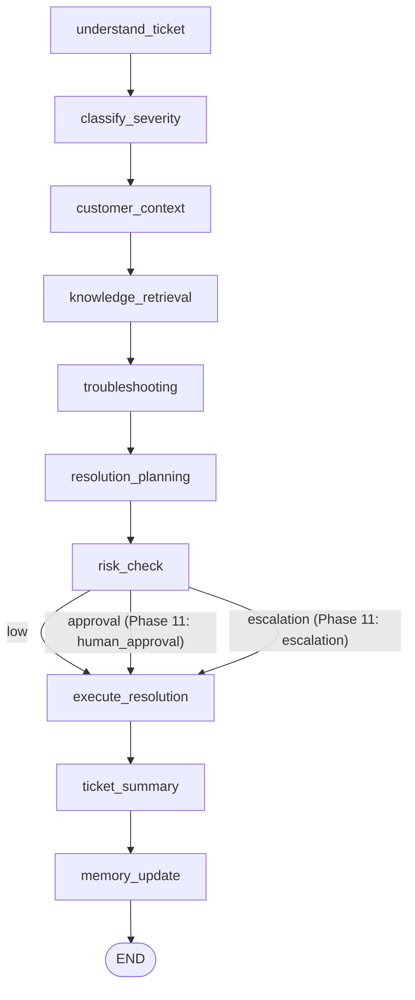
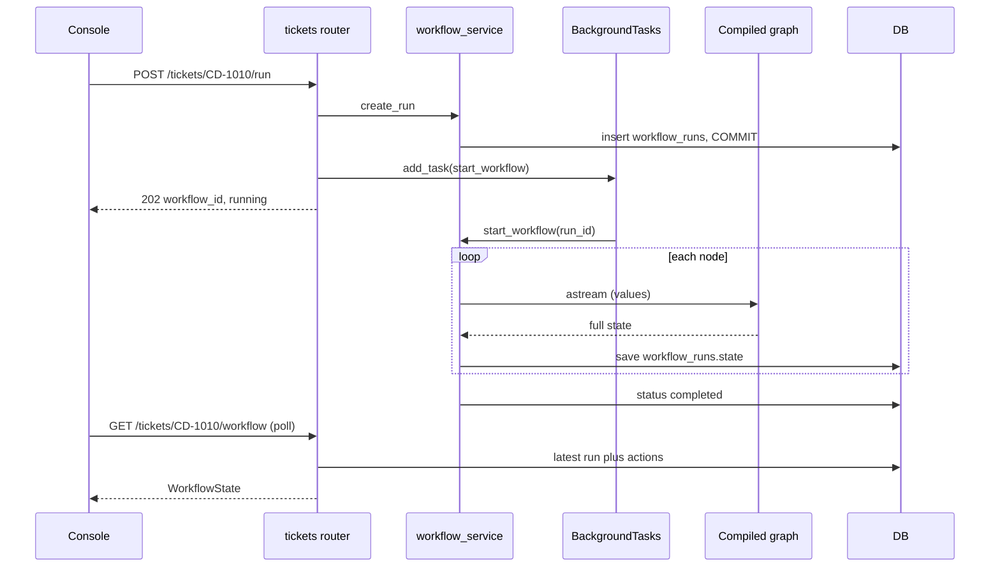
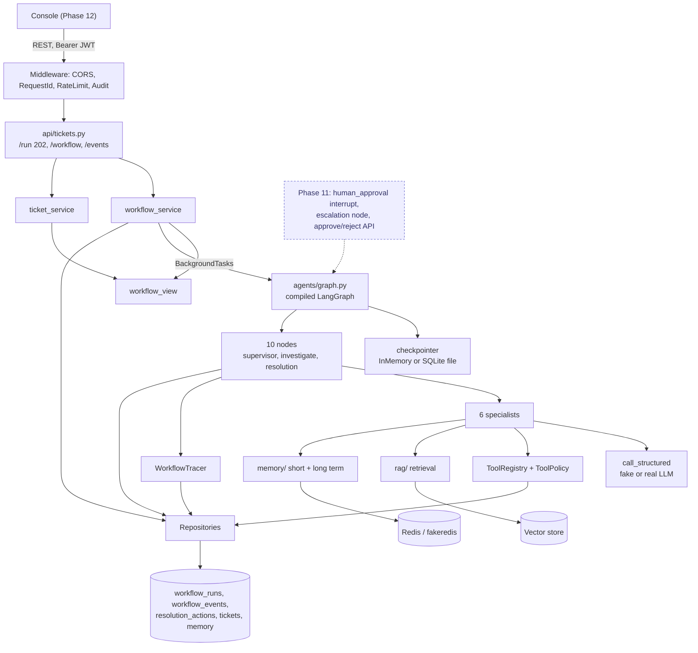

# Phase 10: System Design Evolution

*CloudDesk: Autonomous Customer Support & Resolution Platform*

**Phase 10: Workflow graph and trace.** The six specialists from Phase 9 are wired into one LangGraph workflow with shared state, a checkpointer, a tracer, a run API and a workflow view. This file shows the design growing one task at a time (P10-1 to P10-6).

Merge order in `TASKS.md`: P10-1 first, then P10-2, P10-3, P10-4, P10-6 in parallel, P10-5 last (it wires the nodes). The steps below follow the dependency order that makes the design easiest to read.

---

## Step 0: Starting point (end of Phase 9)

Six specialists exist and are tested alone. Nothing runs them in order, nothing saves their combined result, and nothing records what they did. `GET /tickets/{id}/events` exists (Phase 4) but always returns `[]`. `/run` and `/workflow` return 404.

---

## Step 1 (P10-1): Support state and checkpointer

**Added:** `agents/state.py` (`SupportState`), `agents/checkpointer.py`, dependency `langgraph-checkpoint-sqlite`.

- `SupportState` is a `TypedDict`. Every node returns a **partial** dict. Values are plain JSON (dicts, lists, strings) so they can be stored.
- Three **reducers**: `errors` and `completed_nodes` append (`operator.add`), `token_usage` sums (`merge_usage`). Everything else is overwritten by the node that owns it.
- `get_checkpointer()`: `InMemorySaver` when `CHECKPOINT_DB_PATH` is `:memory:` (tests), otherwise `AsyncSqliteSaver` on a file (created on first use inside the running event loop). `close_checkpointer()` runs at app shutdown.

---

## Step 2 (P10-6): Workflow tracer and events API

**Added:** `backend/app/core/observability.py` with `WorkflowTracer`. The existing `GET /tickets/{id}/events` now returns real rows.

- `emit()` writes one `workflow_events` row **in its own transaction** and **never raises**.
- `node(name)` is an async context manager: `node_started`, then `node_completed` with duration, or `error` (error type only) if the node raises.
- `tool_calls()` records name, status and duration per tool. `llm()` records token counts and cost per model call.
- Never recorded: prompts, ticket bodies, tool arguments. Only names, statuses, sizes and timings.
- `core` does not import `agents/`. Nodes import the tracer, not the other way round.

---

## Step 3 (P10-2): Supervisor graph nodes

**Added:** `agents/nodes/common.py` (tracer and typed views of state), `agents/nodes/supervisor.py`.

| Node | Wraps | Writes to state |
|---|---|---|
| `understand_ticket` | `SupervisorAgent.understand` | `classification` |
| `classify_severity` | `SupervisorAgent.assess_severity` | `severity`, `severity_reason`, `rule_ids`, `injection_suspected` |
| `ticket_summary` | `SupervisorAgent.summarize` | `ticket_summary`, and `tickets.summary` / `severity_reason` via `TicketRepository` |

Every node has the same shape: open the tracer scope, run the specialist, record its tool and model calls, return a partial dict with `completed_nodes` and `current_node`.

---

## Step 4 (P10-3): Investigate graph nodes

**Added:** `agents/nodes/investigate.py`.

| Node | Wraps | Writes to state |
|---|---|---|
| `customer_context` | `CustomerAgent` (no model call; reads memory notes) | `customer_context` |
| `knowledge_retrieval` | `KnowledgeAgent` (`search_docs`, similar cases) | `evidence`, `previous_cases` |
| `troubleshooting` | `TroubleshootingAgent` (`check_service_status`) | `diagnosis` |

---

## Step 5 (P10-4): Resolution and risk nodes

**Added:** `agents/risk.py` (`assess_risk`, `choose_route`) and `agents/nodes/resolution.py`.

| Node | Behaviour |
|---|---|
| `resolution_planning` | `ResolutionAgent`. Computes **other customers' names** to block leaks, uses them once, **never stores them in state**. |
| `risk_check` | `EscalationAgent.run` (policy rules win) then `assess_risk`. Writes `risk`, `route`, `escalation_required`, `escalation_team`. |
| `execute_resolution` | Records each planned action in `resolution_actions`. Runs only actions that need **no** approval, through `ToolRegistry`. Approval-required actions are stored as `awaiting_approval` and **not run**. Skips an action already recorded for this run. |
| `memory_update` | `MemoryService.record_resolution` with the one-line summary, first 3 steps and plan summary. Best effort: a failure is appended to `errors`. |

Risk is `high` for: approval-required action, policy escalation, critical severity, injection suspected, failed output validation. `medium` for high severity. Else `low`.

---

## Step 6 (P10-5): Graph wiring and run API

**Added:** `agents/graph.py`, `backend/app/services/workflow_service.py`, `backend/app/services/workflow_view.py`, routes `POST /tickets/{id}/run` (202) and `GET /tickets/{id}/workflow`, `TicketDetail.workflow` filled, and `close_checkpointer()` in the app lifespan.

- `build_graph(checkpointer)` adds 10 nodes, straight edges, and one conditional edge after `risk_check` keyed by `route`.
- **Phase 10 simplification:** `ROUTE_TARGETS` sends all three routes to `execute_resolution`. Phase 11 changes two entries to `human_approval` and `escalation`; nothing else moves.
- `create_run` records a `workflow_runs` row and **commits** (so the background task can see it). It raises a conflict if the ticket is `waiting_on_approval` or a run is already active (HTTP 409).
- `start_workflow(run_id)` loads the ticket and customer plan, streams the graph with `stream_mode="values"`, and **saves state to `workflow_runs.state` after every node**. On success: status `completed` plus a `workflow_completed` event. On any exception: status `failed` and the error type is stored. It never raises.
- `workflow_view.build_view` turns the stored row into the `WorkflowState` JSON in `docs/API_CONTRACT.md`.

---

## Step 7: Final design at the end of Phase 10

### Design decisions

| Decision | Reason |
|---|---|
| State is plain JSON dicts, not Pydantic objects | The checkpointer and `workflow_runs.state` both store it; nodes rebuild typed models with small helpers |
| Reducers only on `errors`, `completed_nodes`, `token_usage` | Append and sum cannot erase earlier work (rule 9) |
| Other customers' names are **not** put in state | State is exposed by `/workflow`; leaking names would break N5 |
| Tracer opens its own session and swallows errors | Telemetry must not fail or roll back a run |
| `create_run` commits before the background task starts | The task opens its own session and must see the row |
| State saved after **every** node (our own table) plus the checkpointer | The table feeds the polling UI; the checkpointer is for pause/resume in Phase 11 |
| All routes go to `execute_resolution` in Phase 10 | Safe by construction: the registry refuses approval-required tools without `approved=True`, and nothing sets it yet |
| `execute_resolution` skips an action already recorded for the run | Re-execution cannot double-run a tool |
| `memory_update` is best effort | A memory problem must not fail a resolved ticket |

### What is NOT built (honest status)

| Item | Status |
|---|---|
| `human_approval` node, `interrupt()`, approve/reject API, resume | Phase 11 |
| `escalation` node and filing an escalation row for policy cases | Phase 11 (`escalation_required` is reported, nothing is filed) |
| Ticket status `waiting_on_approval` set by the workflow | Phase 11 |
| Stale `running` runs after a crash expiring | Not built: such a ticket answers 409 until its run is cleared |
| A real LLM provider run | Written in Phase 9, never run |
| LangSmith tracing | Not wired |
| Worker process for workflows | Not built: runs in-process (v1 by design) |
