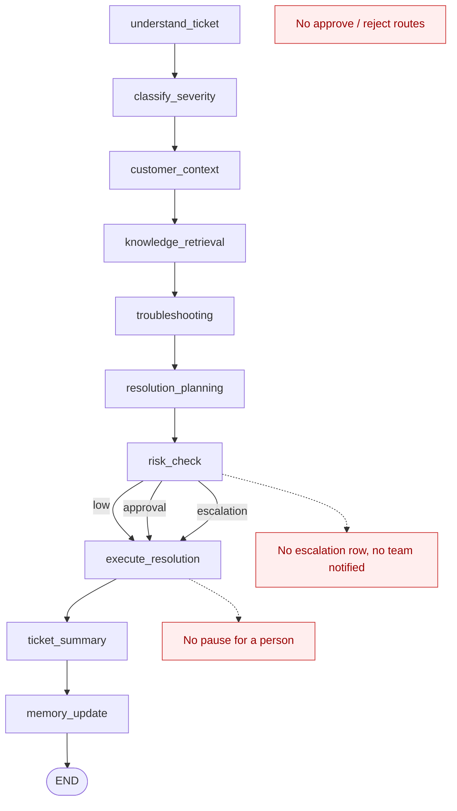
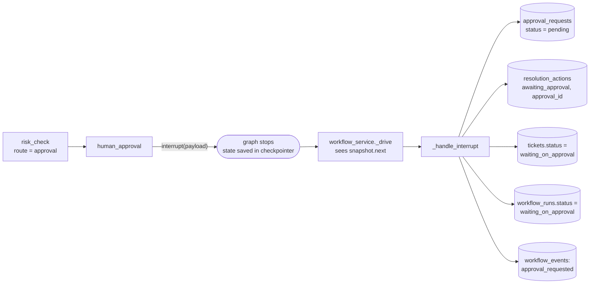
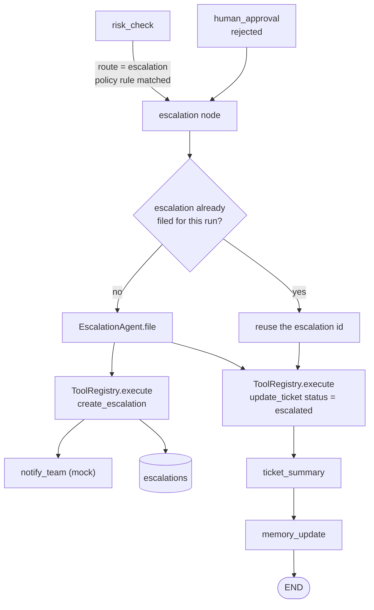
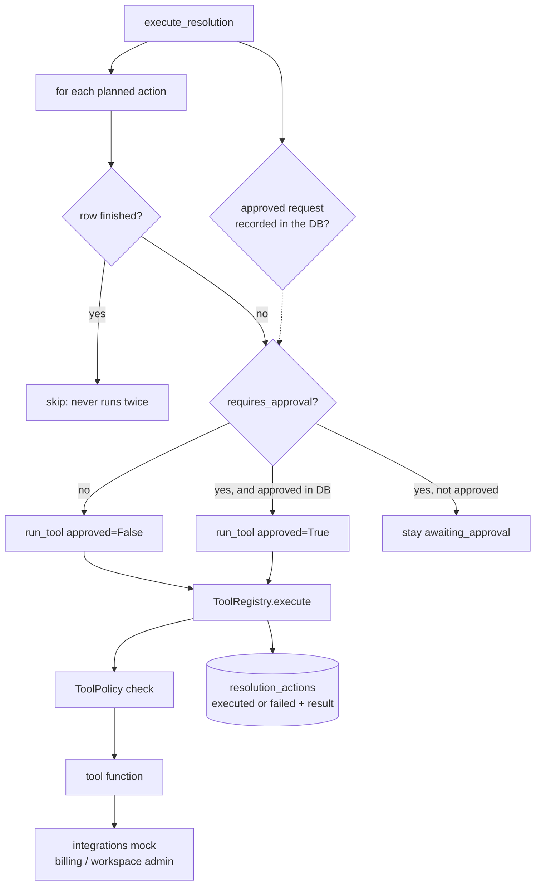
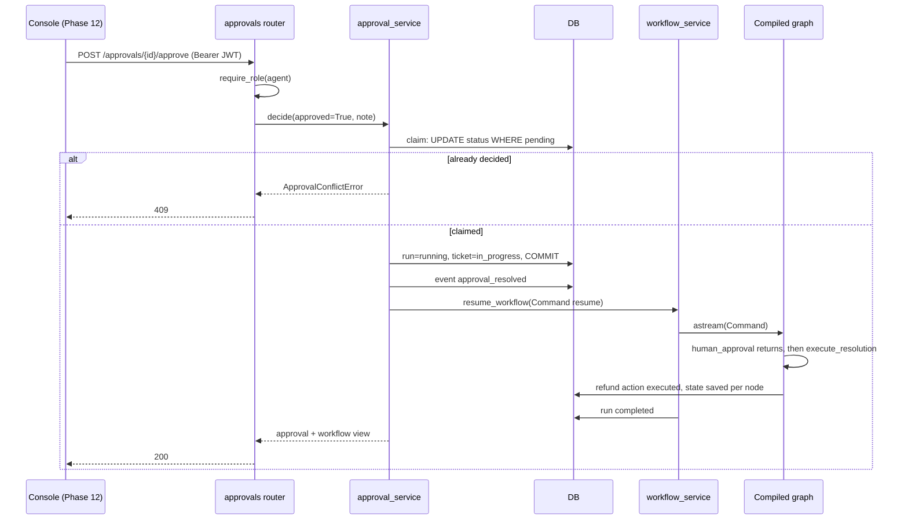
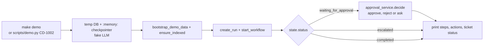
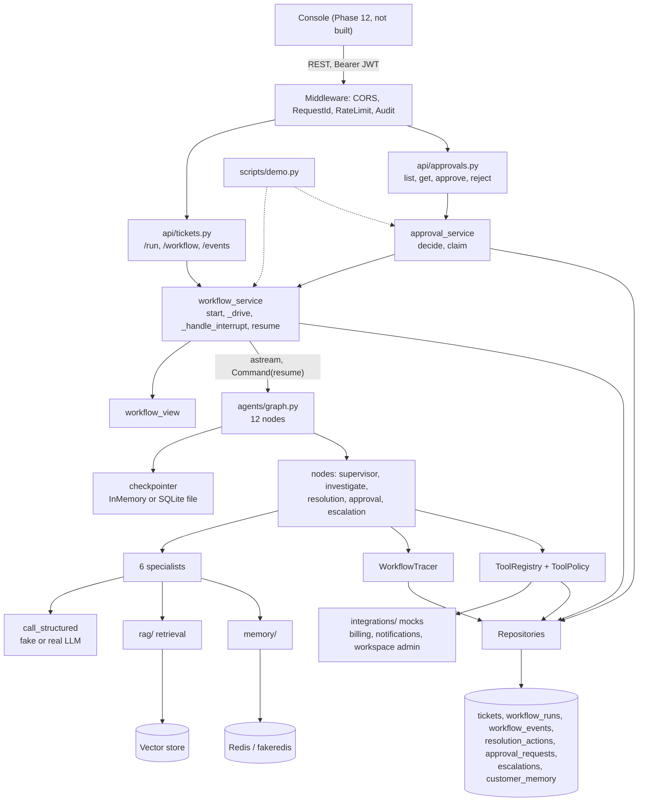
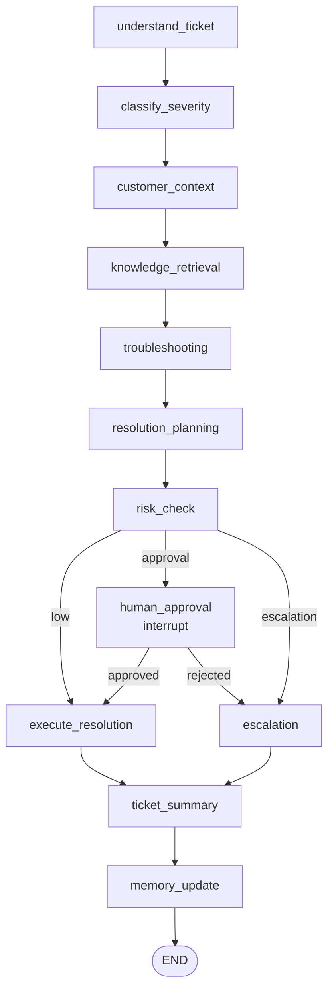
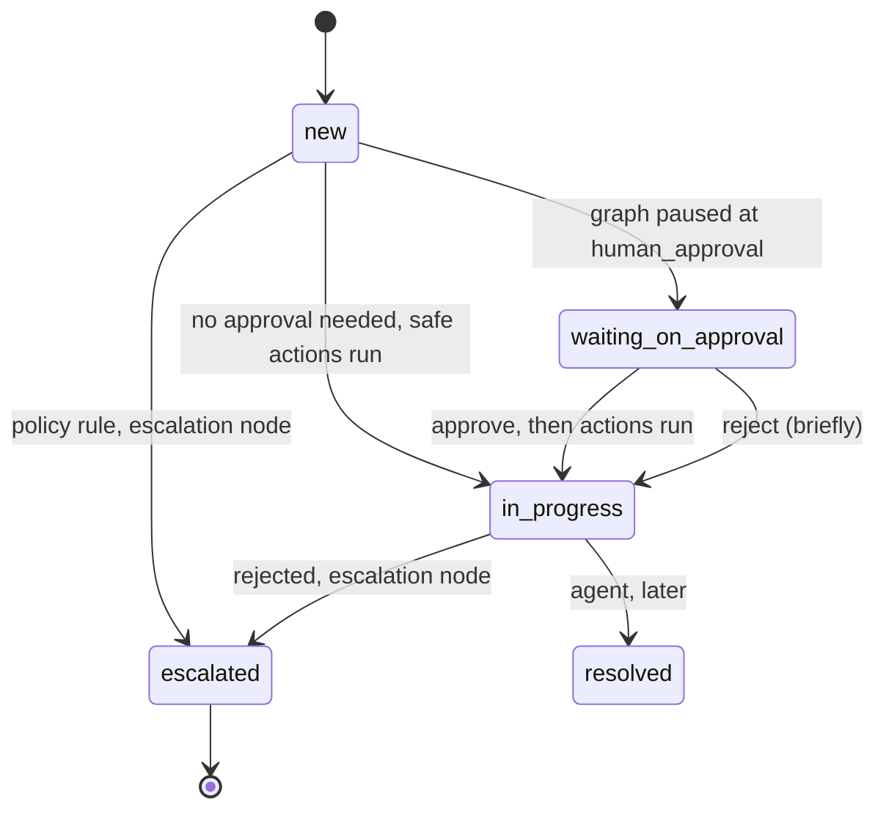

# Phase 11: System Design Evolution

*CloudDesk: Autonomous Customer Support & Resolution Platform*

**Phase 11: Approval and escalation.** The Phase 10 workflow ran to the end and only *recorded* risky actions. This phase makes the graph **pause for a human** (`interrupt()`), **resume** with the decision, **escalate** policy cases and rejected plans, and run approved actions through the **same tool path** as automatic ones. This file shows the design growing one task at a time (P11-1 to P11-5).

Merge order in `TASKS.md`: P11-1 and P11-3 in parallel, P11-2 after P11-1, P11-4 after P11-1 and P11-3, P11-5 last. The steps below follow that order.

---

## Step 0: Starting point (end of Phase 10)

A ten-node graph runs every ticket straight to `execute_resolution`. `risk_check` already writes a `route` (`low`, `approval`, `escalation`), but all three routes point to the same node. An approval-required action is stored as `awaiting_approval` and never runs. `escalation_required` is reported but **no escalation row is filed**, and nothing can say "a human approved this".

---

## Step 1 (P11-1): Human approval interrupt

**Added:** `agents/nodes/approval.py` (`human_approval`), graph route `approval -> human_approval`, `route_after_approval`, the pause handling in `workflow_service` (`_drive`, `_handle_interrupt`), new state keys `approval_request_id`, `approval_note`, and the run status `waiting_on_approval` (already in the enum since Phase 2).

How the pause works:

- `human_approval` reads the plan, then calls `interrupt(payload)`. LangGraph stops the graph and stores the state in the **checkpointer** under the run's `thread_id`.
- **Everything before `interrupt()` runs again on resume**, so the node does only reads there (CLAUDE.md rule 8). It writes nothing.
- The **service** notices the pause (`graph.aget_state(config).next` is not empty) and calls `_handle_interrupt`, which writes the approval request, sets the ticket to `waiting_on_approval`, and emits `approval_requested`.
- `_handle_interrupt` is **idempotent**: it reuses a pending request and does not duplicate action rows.

Why the write is **not** inside the node: the node body before `interrupt()` is replayed on resume. A write there would run twice.

---

## Step 2 (P11-3): Escalation routing

**Added:** the `escalation` node, graph route `escalation -> escalation`, edge `escalation -> ticket_summary`, state keys `escalation_id` and `escalation_severity`, `EscalationRepository.for_workflow`, and a `workflow_view` rule that reports a finished run that filed an escalation as `escalated`.

Two things reach this node: a **policy rule** (`route = escalation`) or a **rejected approval** (Step 4).

| Input | Team | Reason | Severity |
|---|---|---|---|
| Policy rule matched | from the rule (`escalation_team`) | from the rule | from the rule |
| Human rejected the plan | `support_leads` | "A human approver rejected the proposed action" plus the note | the ticket's severity |

The node files the escalation with `EscalationAgent.file` (which calls `create_escalation` **through `ToolRegistry`**), then sets the ticket to `escalated` with `update_ticket` (also through the registry). It **checks `for_workflow` first**, so re-running does not file a second row. Escalation skips `execute_resolution`: nothing is carried out for a case a person must own.

Policy beats approval. `choose_route` returns `escalation` first, so a security ticket never waits in an approval queue.

---

## Step 3 (P11-4): Execute resolution on the shared tool path

**Changed:** `execute_resolution` in `agents/nodes/resolution.py`.

Before: an approval-required action was recorded and skipped, always. Now:

1. Look up whether an action row for this tool already exists for the run (the pause created it).
2. A row already `executed`, `failed` or `skipped` is **not run again**.
3. An approval-required action runs **only if the database holds an `approved` request for this run** (`_approval_recorded`). The graph state field is **not** trusted for this.
4. It runs through `run_tool(..., approved=action.requires_approval)` into `ToolRegistry.execute`: the **same code path** as an automatic action, with the same policy check, timeout and error capture.
5. The row is updated with `executed` or `failed` and the tool result.

---

## Step 4 (P11-2): Approval decide and resume API

**Added:** `backend/app/api/approvals.py`, `backend/app/services/approval_service.py`, `backend/app/schemas/approvals.py`, `ApprovalRepository.claim`, `latest_for_workflow`, `list_filtered`, `workflow_service.resume_workflow`, and `approval_request_id` in the workflow view.

Routes (all under `/api/v1`, documented in `docs/API_CONTRACT.md`):

| Route | Role | Result |
|---|---|---|
| `GET /approvals?status=` | viewer+ | list |
| `GET /approvals/{id}` | viewer+ | one request, **404** `Approval not found` |
| `POST /approvals/{id}/approve` | agent, admin | `{approval, workflow}`; **403** viewer |
| `POST /approvals/{id}/reject` | agent, admin | same; the run escalates |

`decide` does, in order: load, check pending, check the run is `waiting_on_approval`, **claim** with one conditional `UPDATE ... WHERE status = 'pending'` (a lost race returns **409**), set run `running` and ticket `in_progress`, **commit**, emit `approval_resolved`, then `resume_workflow` with `Command(resume={"approved": ..., "note": ...})`.

Design points:

- The **commit before resume** matters: the resumed graph opens its own sessions and must see the decision.
- After the resume the request session calls `expire_all()`, because the graph wrote through other sessions and the first session would otherwise return a stale `running` status. A test caught this.
- `resume_workflow` never raises. A failure becomes run status `failed`, like `start_workflow`.

---

## Step 5 (P11-5): Demo script for CD-1002 and CD-1005

**Added:** `scripts/demo.py` and the `make demo [TICKET=CD-1005]` target.

The script runs on a **temporary SQLite database** and an **in-memory checkpointer**, loads the demo data, runs one ticket and prints the steps. At a pause it approves automatically (`--reject` rejects, `--ask` asks y/n). It calls the same services the API calls, so it proves the real code path without needing a server.

---

## Step 6: Final design at the end of Phase 11

The final graph (12 nodes):

Ticket status through the phase:

### Design decisions

| Decision | Reason |
|---|---|
| The pause records nothing inside the node | Code before `interrupt()` is replayed on resume (rule 8). The service records the pause once |
| The approval row is written by the service, not the graph | The service already owns run and ticket status; it keeps the node pure |
| Approval is checked in the **database** inside `execute_resolution` | Graph state could be tampered with or wrong; "recorded approval" must be a durable fact (18.1) |
| One approval request per run, with an `actions` list | Simpler for the reviewer: one decision, one screen. `action` keeps the contract's single-action shape |
| Decision claimed with one conditional `UPDATE` | A double click or two reviewers cannot both win. The loser gets 409 |
| `decide` commits before resuming | The resumed graph uses its own sessions and must see the decision |
| Resume runs **inside** the approve request | The response can carry the final `WorkflowState`, as the contract says. The cost is that the request lasts as long as the remaining nodes |
| Policy escalation is checked before approval | A breach must reach security, not an approval queue |
| `escalation` skips `execute_resolution` | A case a person must own should not have actions run on it |
| Rejection escalates to `support_leads` | A rejected plan still needs someone to deal with the customer |
| Anything other than `approved` routes to `escalation` | `route_after_approval` fails safe |
| Escalation and ticket status go through `ToolRegistry` | One path for every action, with timeout, policy and traced results |
| Escalation checks for an existing row for the run | Re-running the node cannot file a duplicate |
| Demo uses a temporary database | Repeatable, never touches `data/` |

### What is NOT built (honest status)

| Item | Status |
|---|---|
| Console buttons for approve, reject, reply, escalate | Phases 12 and 13. The routes exist and are tested |
| Resuming a paused run **after a server restart** | Not tested. The SQLite checkpointer file should allow it, with `:memory:` it cannot |
| A worker process | Not built: the resume runs in the request, the first run in a background task in the same process |
| A retry when a run fails after an approved action ran | Not built. The finished action would not run again, but there is no retry route |
| Several approvers or approval expiry | Not built |
| `GET /dashboard/summary`, `/escalations`, `/agents` routes | Not built |
| Real notification of a team | Mock only |
| A real LLM provider run | Never run |
| `make demo` through `make` | Not run: `make` is not installed on this machine. `scripts/demo.py` was run directly |
