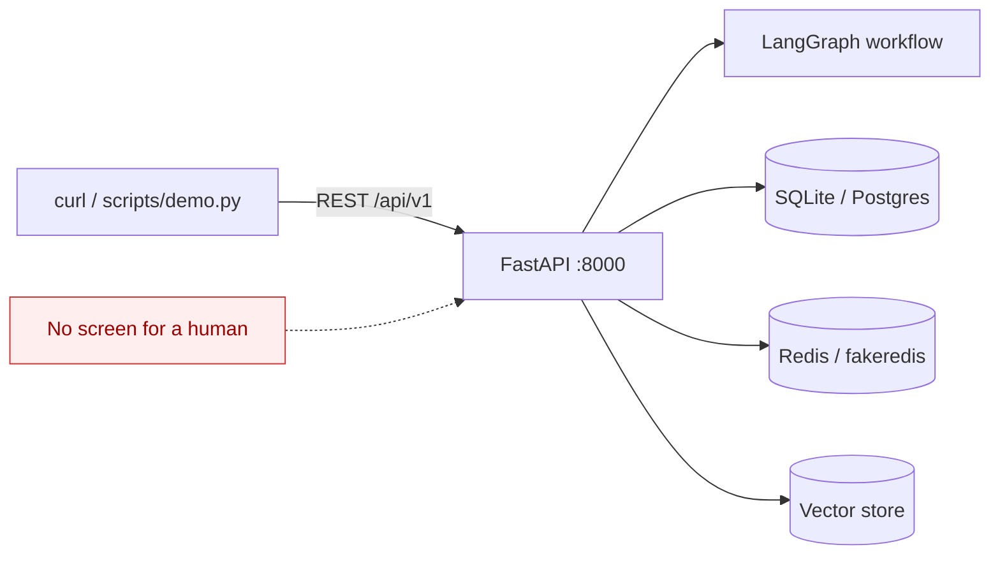
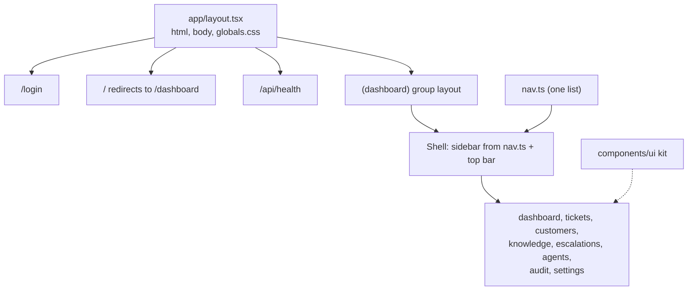
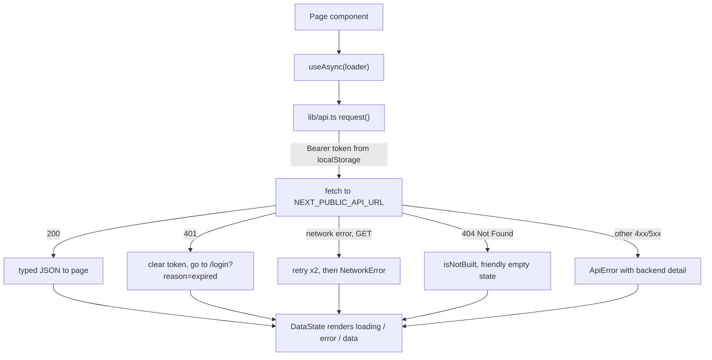
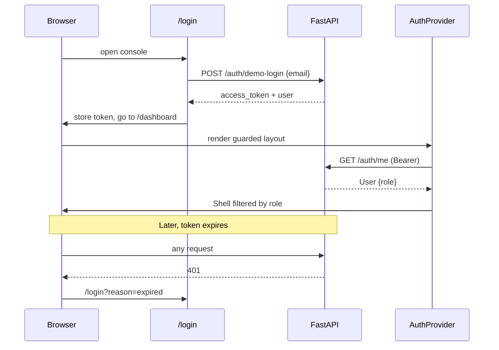
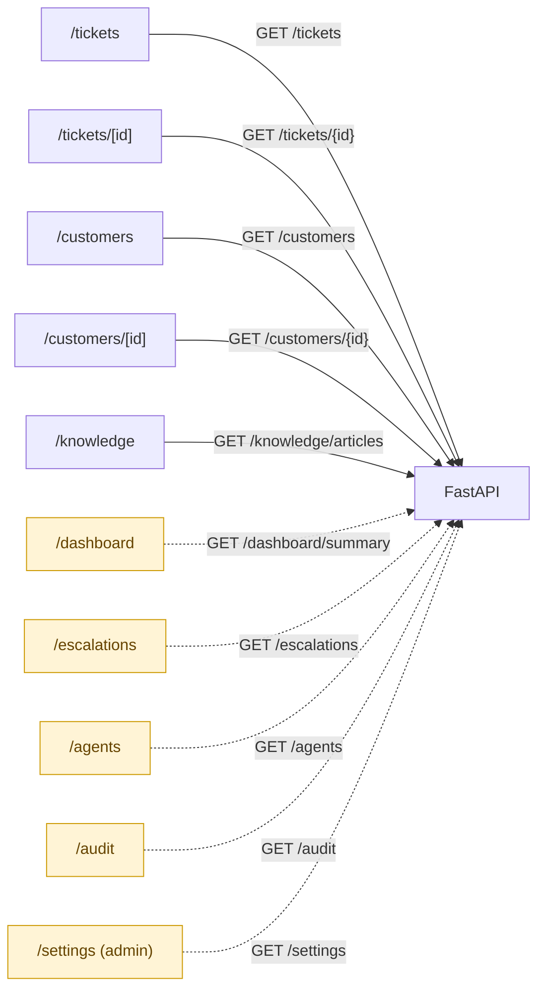
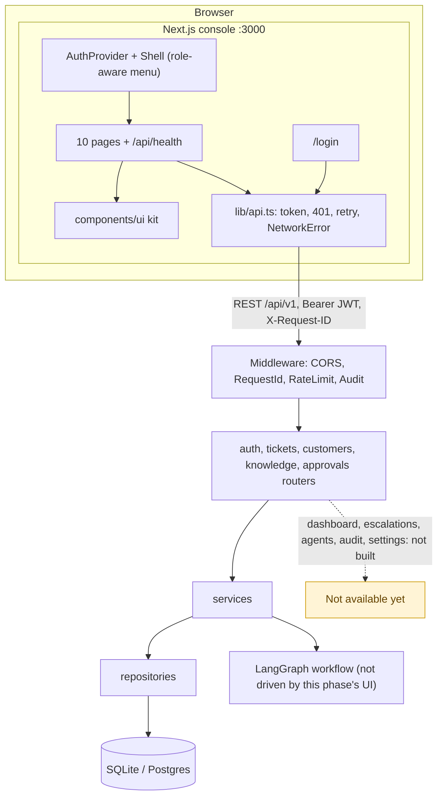

# Phase 12: System Design Evolution

*CloudDesk: Autonomous Customer Support & Resolution Platform*

**Phase 12: Console shell.** Until now the product was a backend with no face. This phase adds the **Next.js console**: app shell and navigation (P12-1), the typed API client (P12-2), login and role-aware layout (P12-3) and the read-only list pages (P12-4). It follows `TASKS.md`: P12-1 and P12-2 in parallel, P12-3 after both, P12-4 after P12-3.

> Scope note: the three-column ticket workflow screen (run, poll the twelve steps, approve, reply) is **Phase 13**. The ticket page here is a read-only stub so list pages have a link target.

---

## Step 0: Starting point (end of Phase 11)

The backend is complete up to approval and escalation: FastAPI routes, LangGraph workflow, stores. The only clients are curl and `scripts/demo.py`. The browser is allowed by CORS (`http://localhost:3000`) but nothing is there.

---

## Step 1 (P12-1): App shell and navigation

**Added:** `frontend/` project (Next.js 15 App Router, TypeScript, Tailwind 3, `output: "standalone"`), root layout, `components/layout/nav.ts` (the single navigation list), `Shell` (sidebar + top bar), a hand-written UI kit in `components/ui/` (`Button`, `Card`, `Table`, `StatusPill`, `EmptyState`, `DataState`), `/api/health` route.

Design choices:
- **Navigation is data**, declared once. The sidebar and the tests read the same array.
- **Route groups:** `/login` sits outside `(dashboard)`, so it has no sidebar and no auth guard. Everything else shares one guarded layout.
- **No UI library, no gradients** (CLAUDE.md section 11).

---

## Step 2 (P12-2): Typed API client

**Added:** `lib/api.ts`, `lib/types.ts`, `lib/hooks.ts`, `lib/format.ts`, `lib/cn.ts`.

- **One door:** pages never call `fetch`. They call `api.tickets(...)`, `api.customer(id)` and so on.
- **`types.ts` mirrors** `docs/API_CONTRACT.md` and the backend schemas.
- **Token** in `localStorage`, sent as `Authorization: Bearer`.
- **401 -> clear token -> `/login?reason=expired`.** Login itself (`auth: false`) does not redirect on a wrong credential.
- **Network failure:** GET retries twice with a growing delay, then throws `NetworkError`. POST/PATCH are never retried (could act twice).
- **`isNotBuilt(err)`:** 404 with `detail: "Not Found"` means the route is missing, not that a record is missing.

---

## Step 3 (P12-3): Login and role-aware layout

**Added:** `app/login/page.tsx`, `AuthProvider` (guard + `useAuth`), role helpers `hasRole` / `canAct`, Settings gated to admin.

- Login calls `POST /auth/demo-login` with the demo email, stores the token, goes to `/dashboard`.
- `AuthProvider`: no token -> `/login?reason=signin`. Token -> `GET /auth/me`; a rejected token takes the 401 path above.
- The sidebar filters by `hasRole(user.role, item.minRole)`. **Hiding is UX only.** The backend `require_role` is the control: a viewer who types a URL still gets 403.

---

## Step 4 (P12-4): Read-only list pages

**Added:** `/tickets` (search, status and severity filters, paging, debounced search), `/tickets/[id]` (read-only), `/customers`, `/customers/[id]`, `/knowledge`, plus `/dashboard`, `/escalations`, `/agents`, `/audit`, `/settings`.

- Tickets, customers and knowledge call **routes that exist today**.
- The other five pages are written against the contract. Their routes are not in the backend yet, so they show "Not available yet" via `isNotBuilt`. This keeps the screens ready without faking data.
- Ticket list and customer page read the **same ticket records**, so status agrees across screens.

---

## Final design at the end of Phase 12

### What Phase 12 does not change
- No backend code, schema, migration or contract change.
- No new secret. The browser holds only the demo JWT; the service-role key is nowhere in `frontend/`.
- The workflow cannot be started from the UI yet (Phase 13).

### Status
Validated locally: 15 vitest tests, `tsc`, `next lint`, `next build`. Not done: a live browser pass against the running backend.
