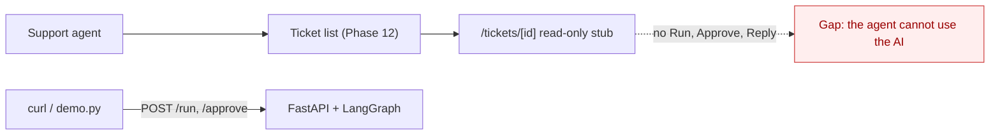
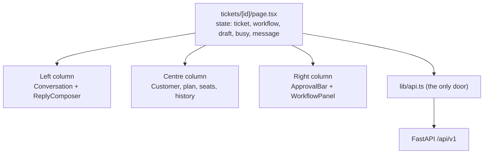
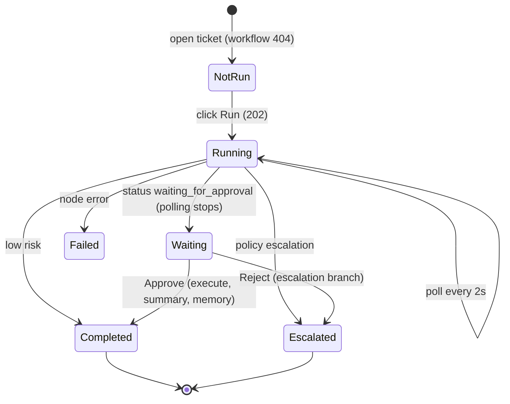
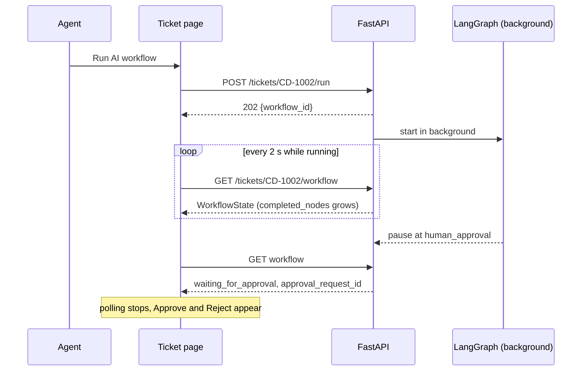
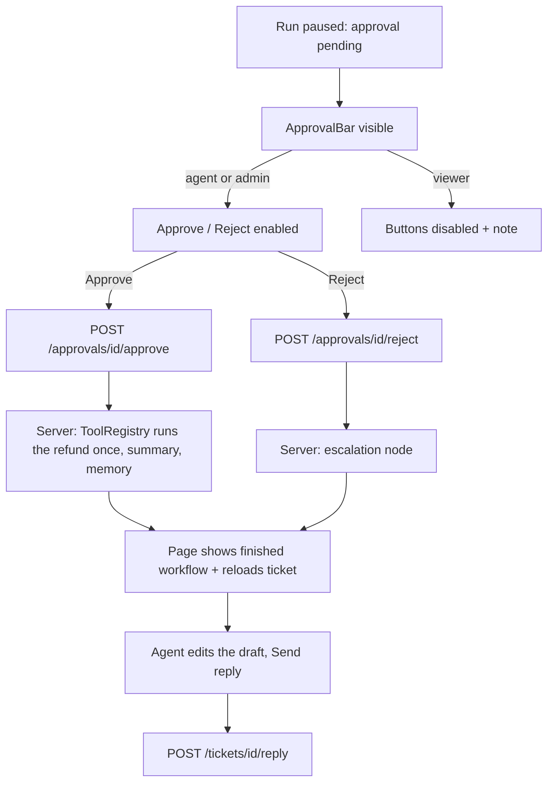
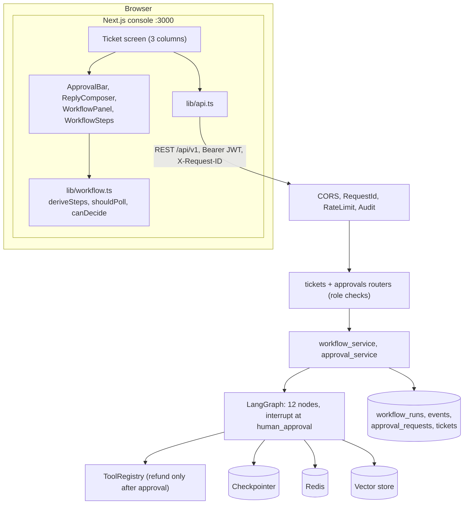

# Phase 13: System Design Evolution

*CloudDesk: Autonomous Customer Support & Resolution Platform*

**Phase 13: Ticket workflow screen.** Phase 12 gave the product a front door with read-only pages. This phase builds the screen the agent really works in: **one ticket page** to run the AI, watch the twelve steps, approve or reject a refund, edit the draft and send the reply. It follows `TASKS.md`: P13-1 layout first, P13-2 and P13-3 in parallel after it, P13-4 tests last.

> Scope note: no backend code, schema or contract changed. Phase 13 is a **pure frontend phase** that consumes routes built in Phases 4, 10 and 11. (`PLAN_PHASE.md` numbers evaluation and delivery as 13; `TASKS.md`, which this build follows, calls that Phase 14.)

---

## Step 0: Starting point (end of Phase 12)

The backend can run the whole pipeline and pause for approval, but the only way to drive it is curl or `scripts/demo.py`. The ticket page is a read-only stub.

---

## Step 1 (P13-1): Ticket detail layout and the contract types

**Added:** the three-column page in `app/(dashboard)/tickets/[id]/page.tsx`; workflow and approval types in `lib/types.ts` (`WorkflowState`, `ApprovalRequest`, `PlannedAction`, `Evidence`); the new calls in `lib/api.ts` (`runWorkflow`, `workflow`, `approve`, `reject`, `reply`, `requestInfo`, `escalate`).

- **Left:** conversation and reply composer. **Centre:** customer, plan, seats, previous tickets, escalation banner. **Right:** workflow panel.
- Every write is a `POST`, so the existing client rule applies: **never auto-retried**.
- `types.ts` mirrors `docs/API_CONTRACT.md` ("Workflow state", "Approvals"). No contract change.

---

## Step 2 (P13-2): Workflow steps and 2-second polling

**Added:** `lib/workflow.ts` (pure logic), `components/ticket/WorkflowSteps.tsx`, `components/ticket/WorkflowPanel.tsx`.

- **`deriveSteps(workflow)`** turns `completed_nodes`, `current_node` and `status` into twelve states: `done`, `current`, `waiting`, `pending`, `skipped`, `failed`. Branch nodes that did not run (for example `escalation` on an approved refund) show **skipped** once the run is over.
- **`shouldPoll`**: poll `GET /tickets/{id}/workflow` every 2 s **only while `status = running`**. A run paused for approval does not change by itself, so polling stops. It resumes only when the agent acts.
- When a run leaves `running`, the page **reloads the ticket** (status, messages, approval).
- The panel shows chips (status, category, severity, risk, approval), then evidence with scores, diagnosis, and planned actions.

---

## Step 3 (P13-3): Approve, reject, reply, escalate

**Added:** `components/ticket/ApprovalBar.tsx`, `components/ticket/ReplyComposer.tsx`, and the action handlers in the page.

- **Approve and Reject render only when `canDecide(workflow)`**: approval status `pending` and an approval id present. They are **disabled for a viewer** (`canAct`). The backend still enforces `403`.
- **Approve** calls `POST /approvals/{id}/approve`. The response contains the **finished workflow**, so the screen updates at once. A second click returns **409**, which is shown as the server's message.
- **Reject** resumes the graph on the rejection branch, which **escalates**.
- **The reply box is a suggestion.** It is prefilled from `final_response` (or the plan's customer response) until the agent types. The agent edits and sends. Output validation (N5) already ran on the server before the draft was shown.
- **Request info** (one question per line) and **Escalate** (text is the reason) reuse the same box.
- A message area shows success or the server's error text (`409`, `403`, `404`).

---

## Step 4 (P13-4): Frontend unit tests

**Added:** `__tests__/workflow.test.tsx` (17 tests; with the earlier suites the total is 32).

| Area | What is proved |
|---|---|
| `deriveSteps` | twelve steps in order; all pending before a run; done and current; **waiting** while paused; **skipped** branches; **failed** node |
| `WorkflowSteps` | renders twelve rows with `data-state` |
| Polling rule | poll while running or just started; not when paused or finished |
| `ApprovalBar` | Approve and Reject **only when pending**; **disabled for a viewer**; handlers called |
| `ReplyComposer` | every control disabled for a viewer; empty draft cannot send; edited draft sends |
| API calls | run is a POST and **never retried**; approve sends the bearer token; **409** detail surfaced |

---

## Final design at the end of Phase 13

### What Phase 13 does not change
- No backend code, schema, migration or API contract change.
- No new secret; the browser still holds only the demo JWT.
- No new dependency (polling uses the existing `usePolling` hook).

### Known gaps (honest status)
- **Not done:** a live click-through in a real browser against the running backend. Validated by unit tests, type check, lint and production build only.
- The reply, request-info and escalate actions share one text box (a pragmatic v1; separate fields would be clearer).
- The `/events` timeline is not drawn on the screen yet; the panel uses workflow state.
- Dashboard, escalations, agents, audit and settings pages still await their backend routes.

### Status
Validated locally: 32 vitest tests, `tsc`, `next lint`, `next build`; backend 408 tests pass. Not deployed; no cloud credentials used.
