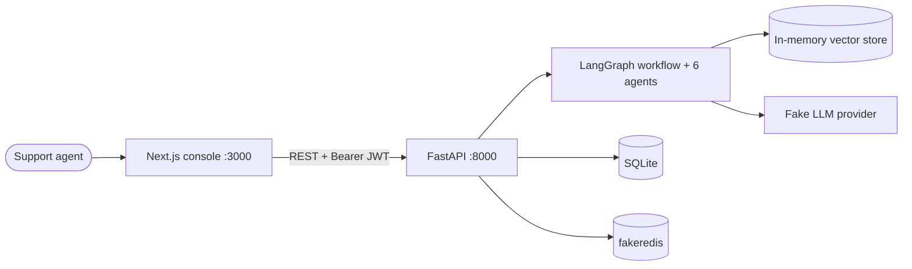
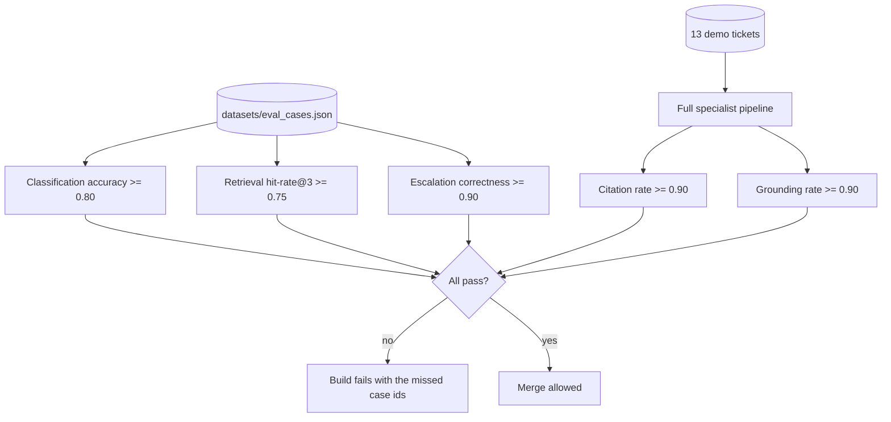
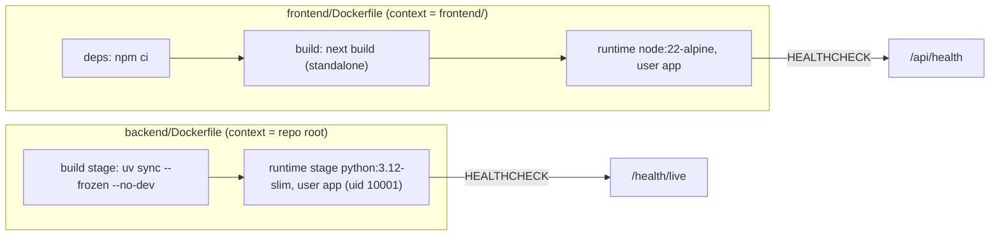
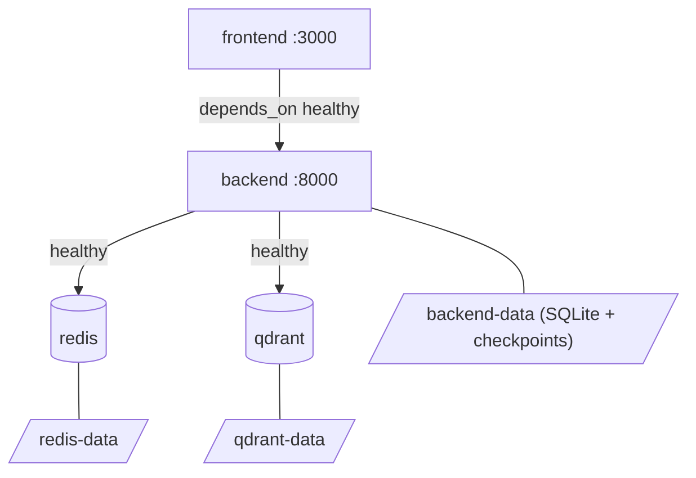
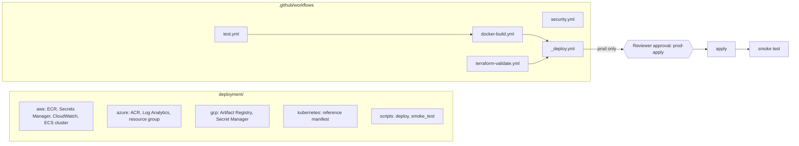
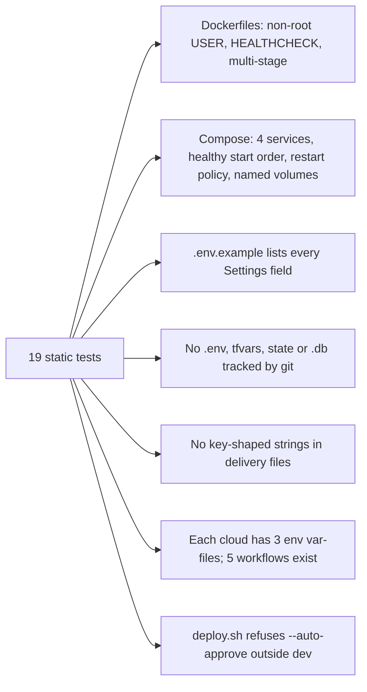
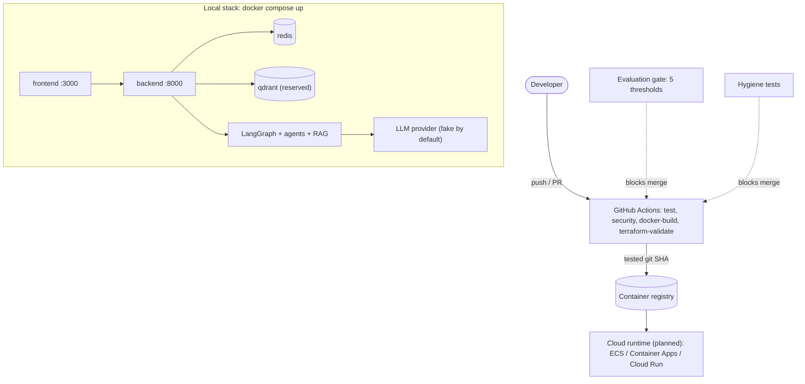

# Phase 14: System Design Evolution

*CloudDesk: Autonomous Customer Support & Resolution Platform*

**Phase 14: Evaluation and delivery.** No product behaviour changes. The phase adds a **quality gate** around the system (evaluation thresholds) and a **delivery layer** (images, Compose, Terraform, CI, hygiene tests). `PLAN_PHASE.md` numbers this "Phase 13"; `TASKS.md`, which this build follows, calls it Phase 14.

---

## Step 0: Starting point (end of Phase 13)

A complete application that runs only as two local processes.

Quality was checked by scattered tests: classification and escalation had early bars (Phase 9), retrieval hit-rate lived under `tests/rag`. Nothing enforced citation or grounding, and nothing could be shipped.

---

## Step 1 (P14-1): Evaluation thresholds

One suite, `tests/evaluation/test_thresholds.py`, scores **all five** CLAUDE.md metrics over `datasets/eval_cases.json` (27 cases, all 13 demo tickets included). `tests/evaluation/conftest.py` re-exports the specialist harness so the exact pipeline the graph runs is scored.

| Metric | Source of truth for "correct" |
|---|---|
| Classification | `expected_category` |
| Retrieval@3 | `expected_articles` titles, among the top 3 hits |
| Escalation | `expected_escalation` and `expected_team` must both match |
| Citation | every plan has citations and each starts with `kb://` |
| Grounding | every troubleshooting step text appears in the customer reply |

Failure messages list the **missed case ids**, so a regression is traceable in one read.

---

## Step 2 (P14-2): Backend and frontend images

Design choices: multi-stage so build tools never ship; non-root user; health checks use routes that do **no I/O** (`/health/live`); the frontend uses `output: "standalone"` and receives `NEXT_PUBLIC_API_URL` as a **build argument** because Next.js inlines it at build time.

---

## Step 3 (P14-3): Compose stack

Start order is enforced by health, not by timing. The backend reads Redis at `redis://redis:6379/0` (service name inside the network). Qdrant is provisioned, but `VECTOR_STORE` stays `memory`; the app does not yet depend on it.

---

## Step 4 (P14-4): Terraform and CI scaffolds

Environments are **var-files**, not copies of code. Only `*.tfvars.example` is committed; real `terraform.tfvars`, `backend.hcl`, state and plans are git-ignored. Image tag = git SHA.

---

## Step 5 (P14-5): Deployment hygiene tests

`tests/deployment/test_deployment_hygiene.py` (19 tests) checks, with no Docker and no network:

The first run **failed** because the frontend Compose service lacked a health check. It was added, and the test now guards it.

---

## Final design at the end of Phase 14

### What Phase 14 does not change
No route, schema, migration, agent, rule or UI changed. The workflow still runs in-process.

### Known gaps (honest status)
| Item | State |
|---|---|
| Quality thresholds | Implemented, validated locally (432 tests pass) |
| `docker compose config -q` | Passes locally |
| Image builds, `docker compose up` | **Not run**: the Docker daemon was not running on the build machine |
| `terraform validate` | **Not run**: Terraform not installed; scaffolds are partial (no compute service, load balancer or Redis resources yet) |
| GitHub workflows | **Never executed** (not pushed with secrets) |
| Cloud deployment | **None**; no credentials used |
| Qdrant | Container defined; app code and the Qdrant client dependency are not wired |
| SQLite in a container | Single replica only until `DATABASE_URL` points at Postgres |
