# Phase 1: System Design Evolution

*CloudDesk: Autonomous Customer Support & Resolution Platform*

**Phase 1: Runtime skeleton.** The goal is a server that starts with no internet connection or paid accounts, writes structured logs carrying a tracking number, and answers health checks.

This document shows how the system design grew during Phase 1. It starts from an empty foundation and adds one subtask at a time, ending with the finished Phase 1 architecture. Each step has a diagram and a short plain-English explanation.

| Step | Subtask | What it added |
|---|---|---|
| 0 | Starting point | The target vision and an empty foundation |
| 1 | **P1-1** Settings and JSON logging | A central settings panel and a structured logbook |
| 2 | **P1-2** Health routes and request-id middleware | A running web server, tracking numbers and health checks |
| 3 | **P1-3** Offline test harness | Automated tests that run with no internet |
| 4 | **P1-4** Makefile and `.env.example` | One-command developer workflow and a settings template |
| 5 | End of Phase 1 | The complete foundation, and where Phase 2 and 3 plug in |

**Diagram key:** solid boxes are built in that step. Dashed grey boxes are planned for later phases and appear only to show where they will attach.

---

## Step 0: The starting point

### Where we are headed

This is the full system planned across all phases. A support agent uses a web screen (the frontend). The screen talks to the backend server. The backend runs an AI workflow and uses four supporting stores.

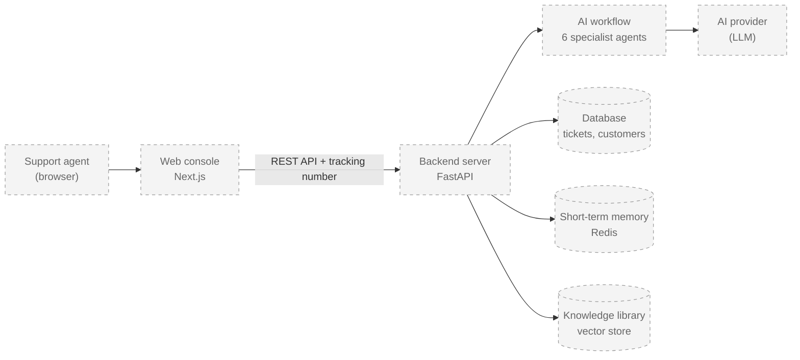

### What existed at the start of Phase 1

Only planning documents existed: the requirements, the architecture notes and the API contract. There was no running code.

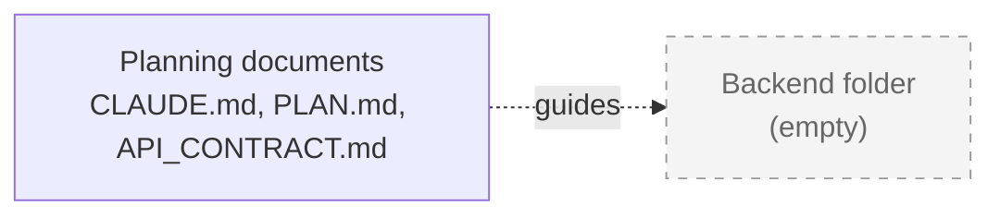

**Design decision:** build the foundation before any AI. Every later feature depends on settings, logging, health checks and tests, and safety features are much harder to add afterwards.

---

## Step 1: P1-1, settings and JSON logging

### What was added

Two core building blocks that every other part of the system will use:

1. **Settings panel** (`core/config.py`). Reads every setting once, at start-up, from the computer's environment or from a local `.env` file. If nothing is set, it falls back to **offline demo defaults**: pretend AI, in-memory library, a local SQLite database and pretend Redis.
2. **Logbook** (`core/logging.py`). Writes every log line as one structured JSON record with a fixed set of fields, including a `request_id` and a `workflow_id`.

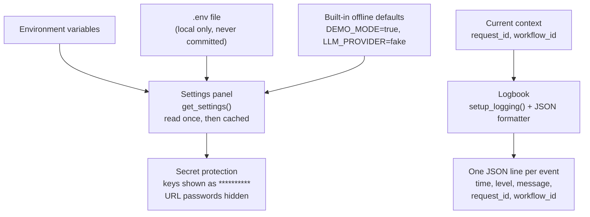

### How a log line gets its tracking IDs

The logbook does not need each piece of code to pass the IDs along by hand. A **context** holds the current IDs, and the logbook stamps them onto every line automatically. When a block of work finishes, the previous IDs are restored, so one request's ID can never leak into the next.

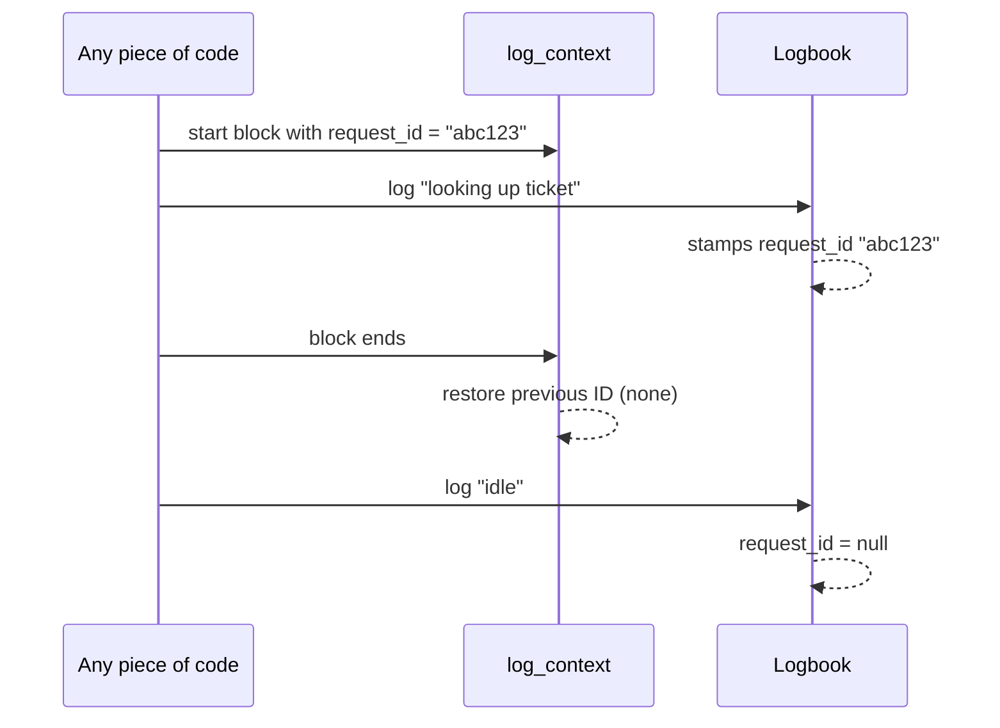

### Design decisions

- **Read once, cache forever.** Settings are loaded once per process, which is fast and consistent. Changing `.env` therefore needs a restart.
- **Secrets are a special type.** API keys and JWT secrets cannot be printed by accident. Database and Redis URLs have their passwords masked.
- **Fixed log fields.** Every line has the same shape, so cloud dashboards can filter by `request_id` without custom parsing.

---

## Step 2: P1-2, health routes and request-id middleware

### What was added

This step turns the building blocks into a **running web server**:

1. **The app** (`main.py`). Creates the FastAPI server, switches on logging and loads settings.
2. **Middleware**: checkpoints every request passes through before reaching its handler.
   - **CORS**: only accepts browser calls from the approved website (the console on port 3000).
   - **Request ID** (`middleware/request_id.py`): gives each request a tracking number and stamps it on the reply.
3. **Health routes** (`api/health.py`, `core/readiness.py`, `schemas/health.py`): three probes that cloud platforms use to check the service.

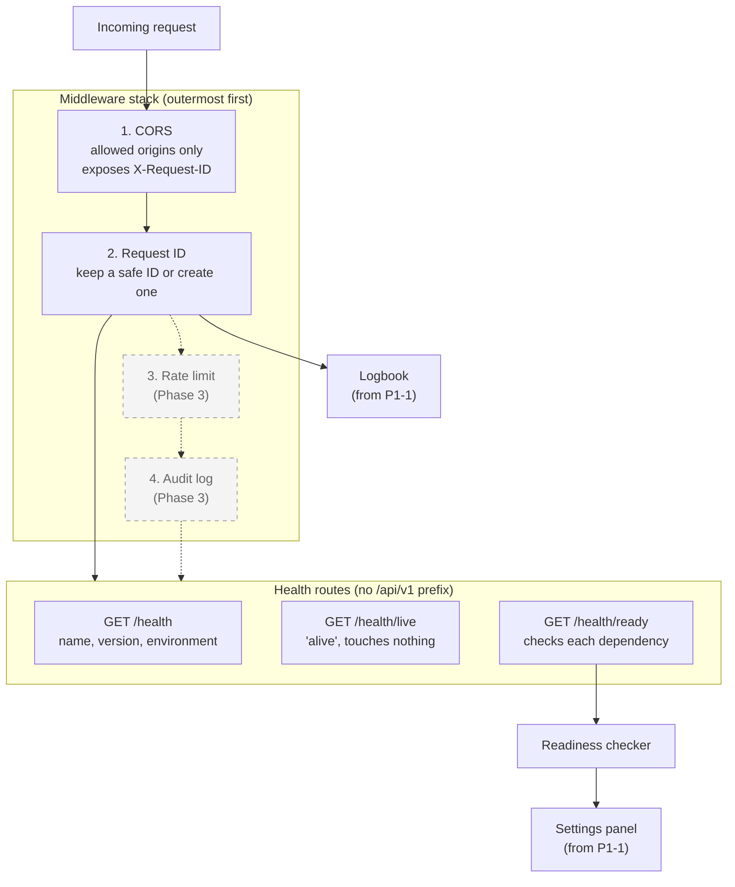

### The life of one request

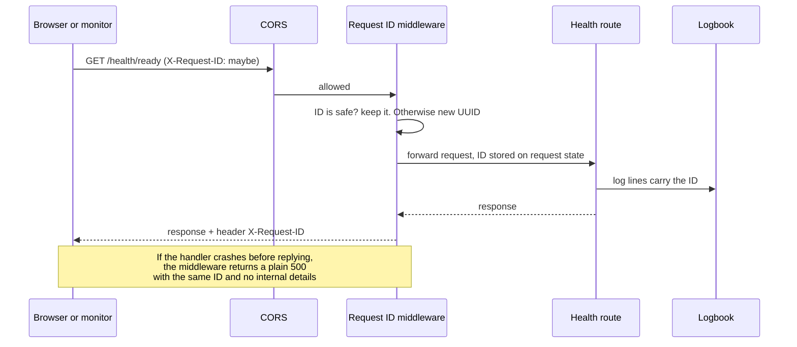

### How the readiness check decides

`/health/ready` checks four dependencies **without opening any network connection**. In Phase 1 it confirms that each one is configured for an offline backend. Real connection checks arrive when those clients exist in later phases.

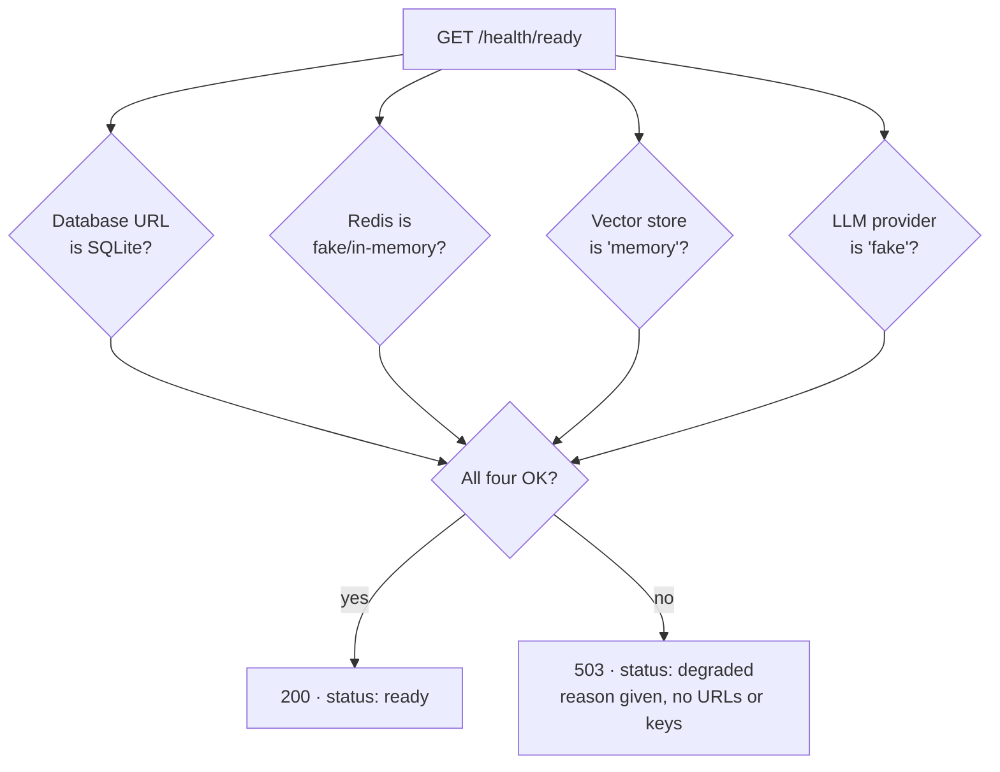

### Design decisions

- **Live never depends on anything else.** If the database has a short outage, the container is not restarted for no reason. Only *Ready* reports the problem.
- **Untrusted IDs are replaced.** A caller-supplied `X-Request-ID` is kept only if it matches a strict safe pattern. This blocks log forgery.
- **Plain ASGI middleware** rather than the simpler helper class. The tracking number then stays visible to route handlers and background tasks.
- **Middleware order is fixed now.** Rate limit and audit slot in later between Request ID and the routes, without reshuffling anything.
- **Errors never leak internals.** Users see `{"detail": "Internal Server Error"}`. The full error goes to the logbook under the same tracking number.

---

## Step 3: P1-3, offline test harness

### What was added

An automated test setup (`tests/conftest.py`) that **forces the whole system into offline mode before the app loads**. This means tests can never accidentally reach a real AI service or database.

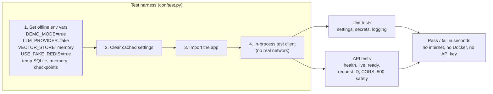

### Design decisions

- **Order matters.** Environment variables are set *before* the app is imported, because settings are cached on first read.
- **A temporary database for every test run.** The developer's real demo data is never touched.
- **Tests map to requirements.** F14 (works offline) and N3 (request ID on every response) each have dedicated tests.

---

## Step 4: P1-4, Makefile and `.env.example`

### What was added

The developer workflow around the code:

- **`.env.example`**: a committed template that lists **every** setting the system will ever use, with placeholder values only. New developers copy it to `.env`.
- **`Makefile`**: short commands so nobody has to remember long ones.

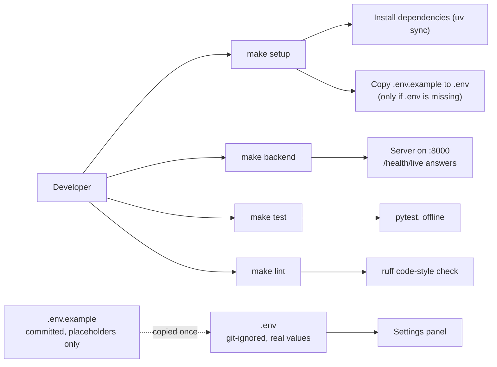

### Design decisions

- **The template is the contract.** If a setting is not in `.env.example`, it does not exist. A Phase 13 test will enforce this automatically.
- **Real secrets never enter git.** `.env`, `data/` and database files are git-ignored.

---

## Step 5: End of Phase 1, the complete foundation

### The finished Phase 1 architecture

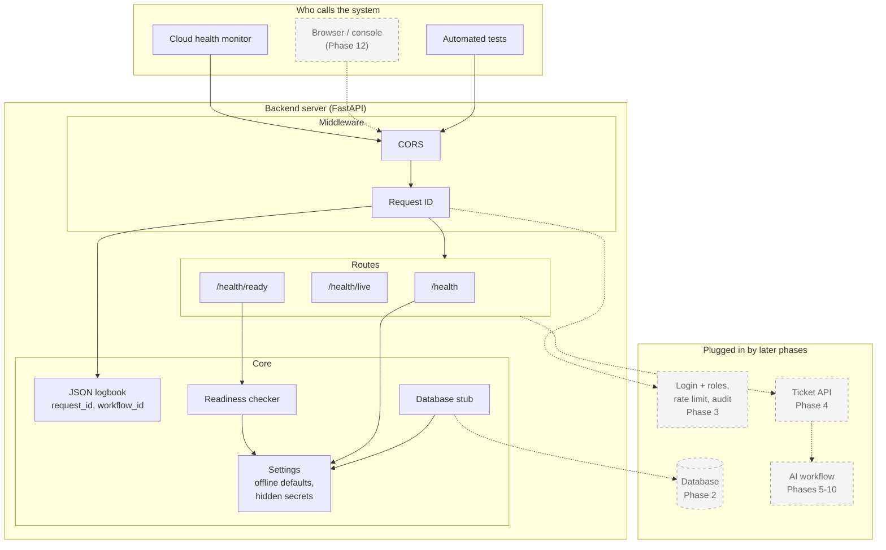

### Layering at the end of Phase 1

The project rules split the code into layers, and each layer has one job. Phase 1 filled the **API**, **middleware** and **core** layers. The other layers are named and waiting.

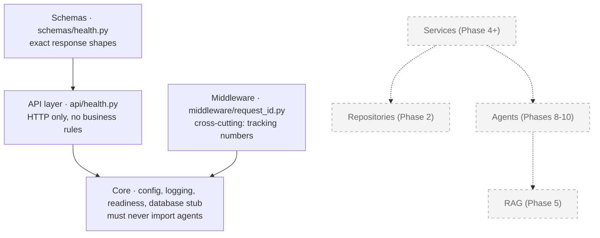

### What changed from start to end

| Concern | Start of Phase 1 | End of Phase 1 |
|---|---|---|
| Running code | None | A server that starts offline |
| Settings | None | One cached panel covering every setting in the contract, with protected secrets |
| Logging | None | Structured JSON lines with `request_id` and `workflow_id` |
| Traceability | None | Every response carries `X-Request-ID` (N3) |
| Health | None | Health, Live and Ready probes, with 503 when degraded |
| Error safety | None | Generic 500 to users, full detail in logs |
| Testing | None | Offline harness with unit and API tests (F14, N3) |
| Developer workflow | None | `make setup / backend / test / lint` and a `.env.example` template |
| AI, data, logins | Planned | Still planned. Attachment points are ready |

### Requirements covered

| ID | Requirement | How Phase 1 covers it |
|---|---|---|
| **F14** | Runs offline in demo mode with no API key | Offline defaults in settings, plus a test harness that enforces them |
| **N3** | `X-Request-ID` on every response | Request ID middleware, exposed through CORS, plus tests |

### Honest status

- **Implemented:** subtasks P1-1 to P1-4 (see `TASKS.md`).
- **Validated locally:** the test suite passed on each subtask branch before merging. `make` is not installed on the Windows development machine, so the Makefile targets were run as direct commands.
- **Known issue:** the merge commit `2f297f5` combined two versions of `backend/app/main.py` and `backend/app/middleware/request_id.py` without resolving them. Neither file compiles at the moment, so the merged branch needs that merge fixed before the server starts again. The diagrams above show the intended design that both versions implement.
- **Cloud:** no cloud credentials used; nothing deployed.
