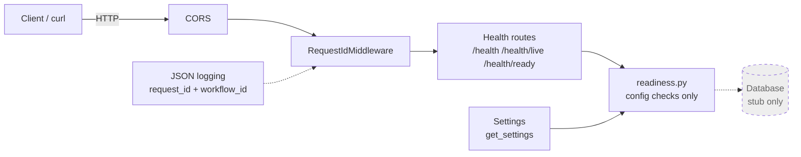
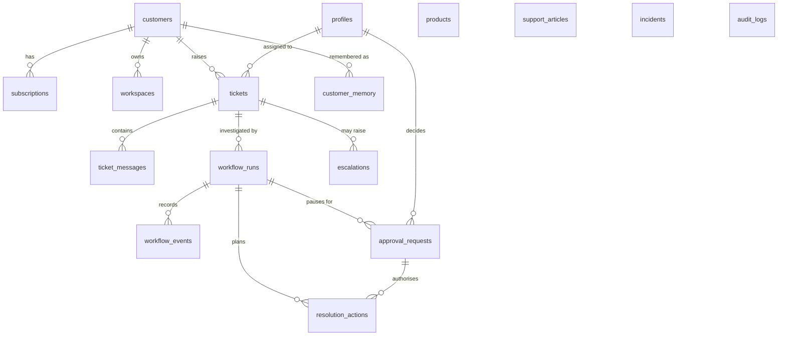
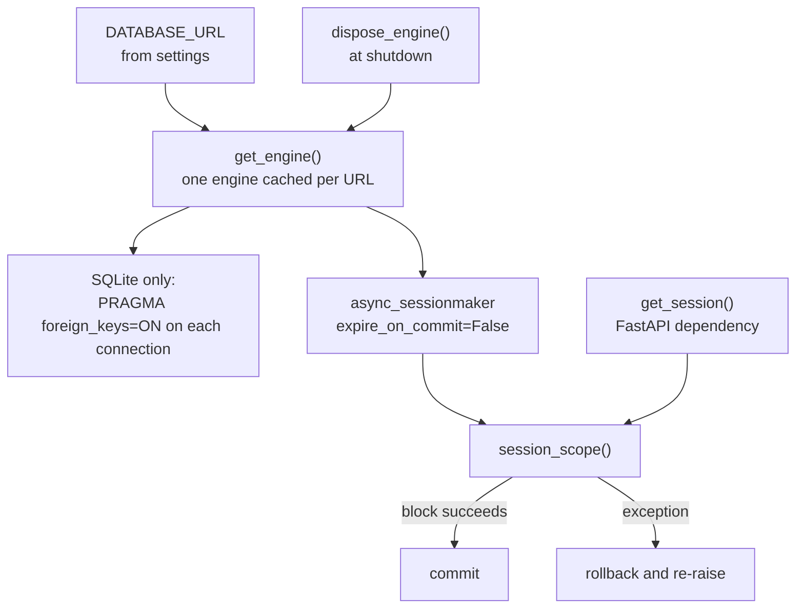
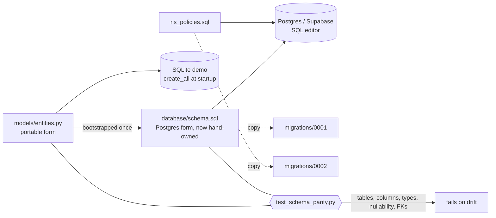
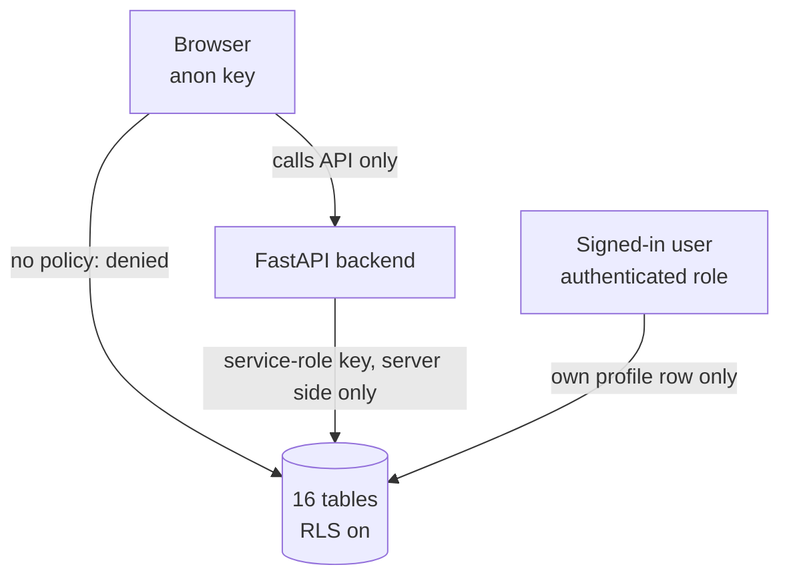
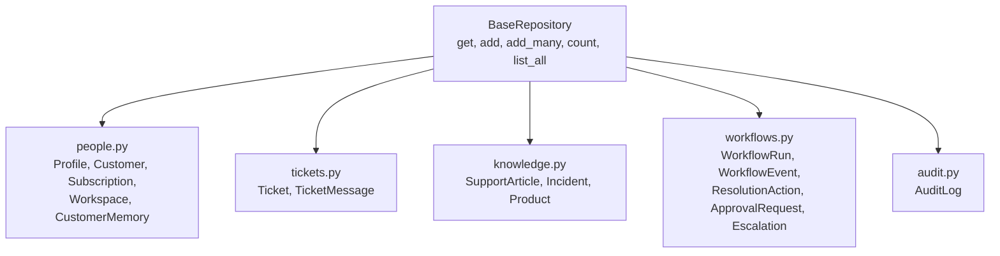
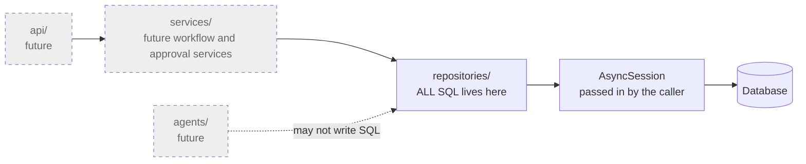
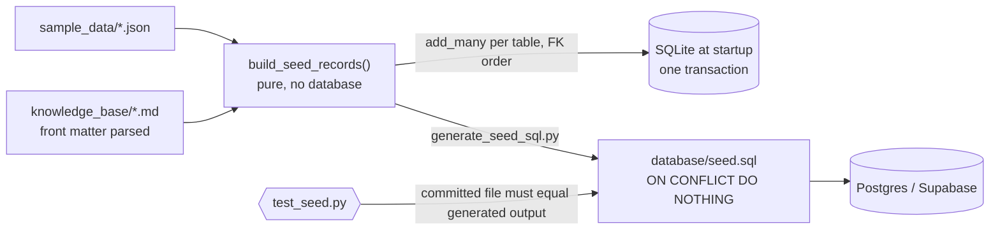
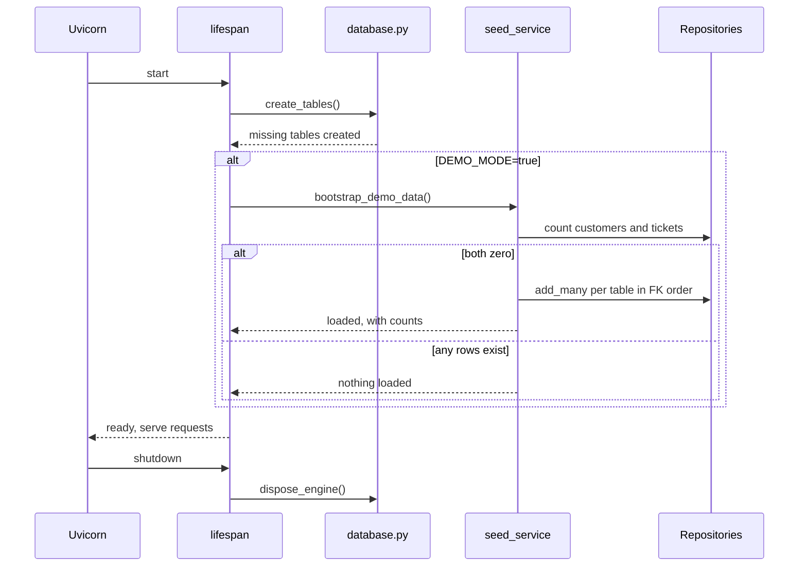
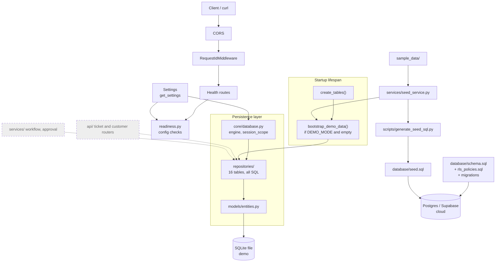

# Phase 2: System Design Evolution

*CloudDesk: Autonomous Customer Support & Resolution Platform*

**Phase 2: Persistence and demo data.** One portable data model, a Postgres form of it with row-level security, a repository layer, and a demo database that loads itself when empty.

Each step below starts from the design left by the previous step and shows what was added. Diagrams: solid boxes exist at that step; dashed boxes are planned for later phases.

| Step | Sub-task | Branch (planned convention) |
|---|---|---|
| 0 | Starting point (end of Phase 1) | n/a |
| 1 | P2-1 SQLAlchemy entities and category enum | `feature/sqlalchemy-entities` |
| 2 | P2-2 Postgres schema, RLS and migrations | `feature/postgres-schema-rls` |
| 3 | P2-3 Repository layer | `feature/repository-layer` |
| 4 | P2-4 Sample data and demo bootstrap | `feature/sample-data-bootstrap` |
| 5 | End of Phase 2 | n/a |

---

## Step 0: The starting point

### What existed at the start of Phase 2

Phase 1 left a running server with no storage. `core/database.py` held a stub whose only function was `database_configured()`, and `/health/ready` judged the database by configuration alone.

### Repair before building

The Phase 1 merge had left `main.py`, `health.py`, `request_id.py`, `pyproject.toml`, `uv.lock` and the health test file as two spliced versions, so nothing could be collected. They were repaired to the richer design in `docs/API_CONTRACT.md` (health `ready` returns 200 or 503 with per-component checks) and `uv.lock` was regenerated. Phase 2 starts from a green suite.

---

## Step 1: P2-1, SQLAlchemy entities and category enum

### What was added

| Piece | File | Role |
|---|---|---|
| Domain vocabulary | `schemas/common.py` | `Category` (exactly 10), `TicketStatus` (7), `Severity`, `Channel`, `Role`, `Plan` and the workflow enums. A new category is added here first. |
| Declarative base | `models/base.py` | `Base`, `IdMixin` (`String(36)` UUID), `TimestampMixin` (`created_at`, `updated_at`), constraint naming convention |
| 16 models | `models/entities.py` | The tables from `CLAUDE.md` section 6 |
| Engine and sessions | `core/database.py` | Cached async engine per URL, `session_scope`, `get_session`, `create_tables`, `dispose_engine` |

### The data model

`products`, `support_articles`, `incidents` and `audit_logs` stand alone: they are looked up by value, not linked by key.

### Engine and session lifecycle

### Design decisions

| Decision | Reason |
|---|---|
| `JSON`, not `JSONB`; `String(36)` ids | The same models run on SQLite (demo) and Postgres (cloud) |
| Status and category as strings with `CHECK` constraints built from the enums | The vocabulary has one home; bad values are rejected by the database itself |
| `updated_at` via `onupdate` in Python | Postgres has a trigger (Step 2); SQLite has no triggers in this setup, so the model keeps it right |
| Engine cached per URL, disposed at shutdown | Each test app start has its own event loop; a stale pooled connection from another loop must not survive |
| `PRAGMA foreign_keys=ON` on SQLite | SQLite ignores foreign keys by default; this makes demo errors match Postgres |
| Sessions commit in `session_scope`, not in repositories | The caller owns the transaction, which makes the seed load all-or-nothing |

---

## Step 2: P2-2, Postgres schema, RLS and migrations

### What was added

| File | Content |
|---|---|
| `database/schema.sql` | 16 tables, `set_updated_at()` function, one trigger per table. **The authority for the table list.** |
| `database/rls_policies.sql` | RLS enabled on all 16 tables, a `service_role` full-access policy per table, and `authenticated` may read only its own `profiles` row. No policy for `anon`. |
| `database/migrations/0001_initial_schema.sql` | The schema as the first migration |
| `database/migrations/0002_row_level_security.sql` | The RLS policies as the second |
| `tests/unit/test_schema_parity.py` | Fails if models and DDL disagree |

### Two forms of one design

`schema.sql` was generated from the models once, then finished by hand (UUID default, `JSONB`, triggers). From then on it is owned by hand and kept honest by the test.

### Who can read what

### Design decisions

| Decision | Reason |
|---|---|
| Ids are `varchar(36)` in Postgres, not `uuid` | A `String` bound parameter against a `uuid` column fails on asyncpg; matching types keep one codebase working on both |
| RLS on all 16 tables, no anon policy | Default deny; the browser holds only the anon key and never queries tables |
| Never edit an applied migration | Add `0003_...` instead; additive changes only |
| `gen_random_uuid()::text` default for ids | Rows inserted directly in SQL get valid ids too |

---

## Step 3: P2-3, repository layer

### What was added

Notable behaviour:

| Repository method | Behaviour |
|---|---|
| `TicketRepository.get_by_number` | Trims and upper-cases, so `" cd-1001 "` finds `CD-1001` |
| `TicketRepository.next_number` | Highest `CD-####` plus one (`CD-1014` after the demo set); the unique constraint backstops a race |
| `TicketRepository.set_status` | Stamps `resolved_at` once, on first resolve or close |
| `CustomerMemoryRepository.add_note` | Hashes whitespace- and case-normalised text; an identical note returns `None`. The caller scrubs secrets first (Phase 11). |
| `CustomerMemoryRepository.recall` | Newest first, hard-capped at 10 |
| `IncidentRepository.active(service)` | Only `active` incidents, optionally for one service |
| `ApprovalRepository.decide` | Sets status, decider, note and `decided_at` together |

### Layering after this step

### Design decisions

| Decision | Reason |
|---|---|
| Repositories receive a session; they never create one | The service layer owns the transaction boundary |
| Repositories never call an LLM | Layering rule in `CLAUDE.md` section 4.2 |
| `flush()` after each write, never `commit()` | Ids and constraint errors appear immediately; the caller still decides when to commit |
| One generic `add_many(records)` | The seed loader inserts plain dictionaries without a per-table loader |

---

## Step 4: P2-4, sample data and demo bootstrap

### What was added

| Piece | File |
|---|---|
| Sample files | `sample_data/{customers,subscriptions,workspaces,products,incidents,tickets,previous_resolutions}.json`, `sample_data/knowledge_base/*.md` (15 articles) |
| Pure record builder | `services/seed_service.py::build_seed_records` |
| DB loader | `services/seed_service.py::bootstrap_demo_data` |
| Startup hook | `main.py` lifespan |
| Command line | `scripts/seed.py` (and the `make seed` target) |
| Cloud demo data | `scripts/generate_seed_sql.py` writing `database/seed.sql` |

### One set of records, two destinations

Because both destinations come from the same function, the two cannot disagree on data.

### Startup sequence

### The demo scenario as data

Eight customers cover all four plans. Each of the 13 tickets starts `new`, with **no category and no severity**, because classifying them is the workflow's job in later phases.

| Ticket | Customer plan | Built to exercise |
|---|---|---|
| CD-1001 | enterprise | Login issue with an active `sso` incident |
| CD-1002 | business (8 seats bought, 5 used) | Refund and approval gate |
| CD-1003 | pro | API rate limit (300 per minute) |
| CD-1004 | pro (1019 of 1024 GB used) | Storage quota |
| CD-1005 | business | Security escalation |
| CD-1006 | business | Data-loss escalation |
| CD-1007 | free | External sharing blocked by plan |
| CD-1008 | pro | Slack integration |
| CD-1009 | business (workspace "Legacy Reports 2021") | Erasure request escalation |
| CD-1010 | free | Low severity by policy |
| CD-1011 | business | Payment dispute escalation |
| CD-1012 | free | MFA recovery article |
| CD-1013 | free | Prompt injection kept as data |

### Design decisions

| Decision | Reason |
|---|---|
| Ids are `uuid5(namespace, kind:key)` | Deterministic, so reseeding cannot duplicate and `seed.sql` stays stable |
| Load only if customers **and** tickets are both empty | A populated database is never touched; a second start is a no-op |
| Whole load in one `session_scope` | Failure leaves the database empty, and the next start retries |
| Tickets start with no category or severity | The workflow must earn those fields; seeding them would hide bugs |
| `previous_resolutions.json` is **not** loaded | None of the 16 tables fits it, and extra resolved tickets would break "13 tickets". The Knowledge Agent reads the file in Phase 8. |
| Front-matter parsed with a small function, not PyYAML | The articles use only `key: value` and `[a, b]`; no new dependency. Phase 5 may swap in a YAML parser. |
| `resolve_data_dir` tries the working directory, then the repo root | The seed works from any directory, including a test's temporary one |

---

## Step 5: End of Phase 2, the complete design

### The finished Phase 2 architecture

### Layering at the end of Phase 2

| Layer | Status | Notes |
|---|---|---|
| API | Health only | Ticket and customer routers arrive in Phase 4 |
| Services | `seed_service` | The first service; it orchestrates repositories |
| Repositories | **Complete for all 16 tables** | The only place SQL exists |
| Core | `config`, `logging`, `database`, `readiness` | Does not import `agents/` |
| Models and schemas | Entities and enums | Single home for the vocabulary |

### What changed from start to end

| Aspect | Start of Phase 2 | End of Phase 2 |
|---|---|---|
| Storage | A stub function | 16 tables on SQLite, same design as Postgres DDL |
| Data | None | 3 users, 8 customers, 13 tickets, 15 articles, 4 incidents |
| Startup | Build the app | Create tables, then seed when demo mode and empty |
| Trust in the design | n/a | A parity test locks models to DDL; a freshness test locks `seed.sql` to the sample data |
| Test count | Not runnable | 68 passing, offline |

### Requirements covered

| Requirement | How |
|---|---|
| F1 (create ticket, read side) | Ticket and message tables and repositories; the route comes in Phase 4 |
| F4 (customer context) | Subscriptions, workspaces, ticket history and memory repositories |
| N6 (audit, storage side) | `audit_logs` table and repository; the middleware comes in Phase 3 |
| F14 (runs offline) | SQLite plus seed, no keys |
| §20 table-count question | Closed: `schema.sql` defines 16 tables, RLS on 16 |

### Honest status

| Item | State |
|---|---|
| Implemented | Models, enums, engine, schema, RLS, migrations, repositories, sample data, bootstrap, seed script, generated seed SQL |
| Validated locally | 68 tests pass offline; `ruff` clean; `scripts/seed.py` run directly and idempotent |
| `make seed` | Target added; `make` is not installed on this Windows machine, so it was not run |
| Real Postgres or Supabase | **Never run.** DDL, RLS and `seed.sql` are checked against the models by tests only |
| `/health/ready` | Still judges the database by configuration, not by opening a connection |
| Not merged | Work is on `feat/Phase2_Persistence_and_demo_data`, uncommitted |
