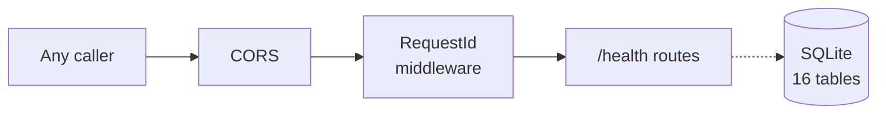
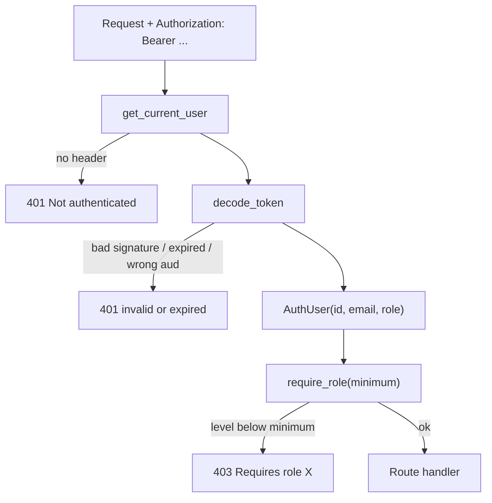
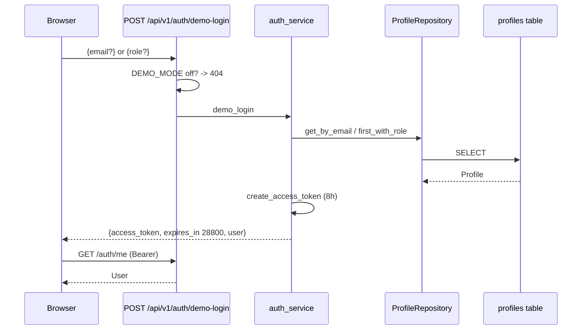
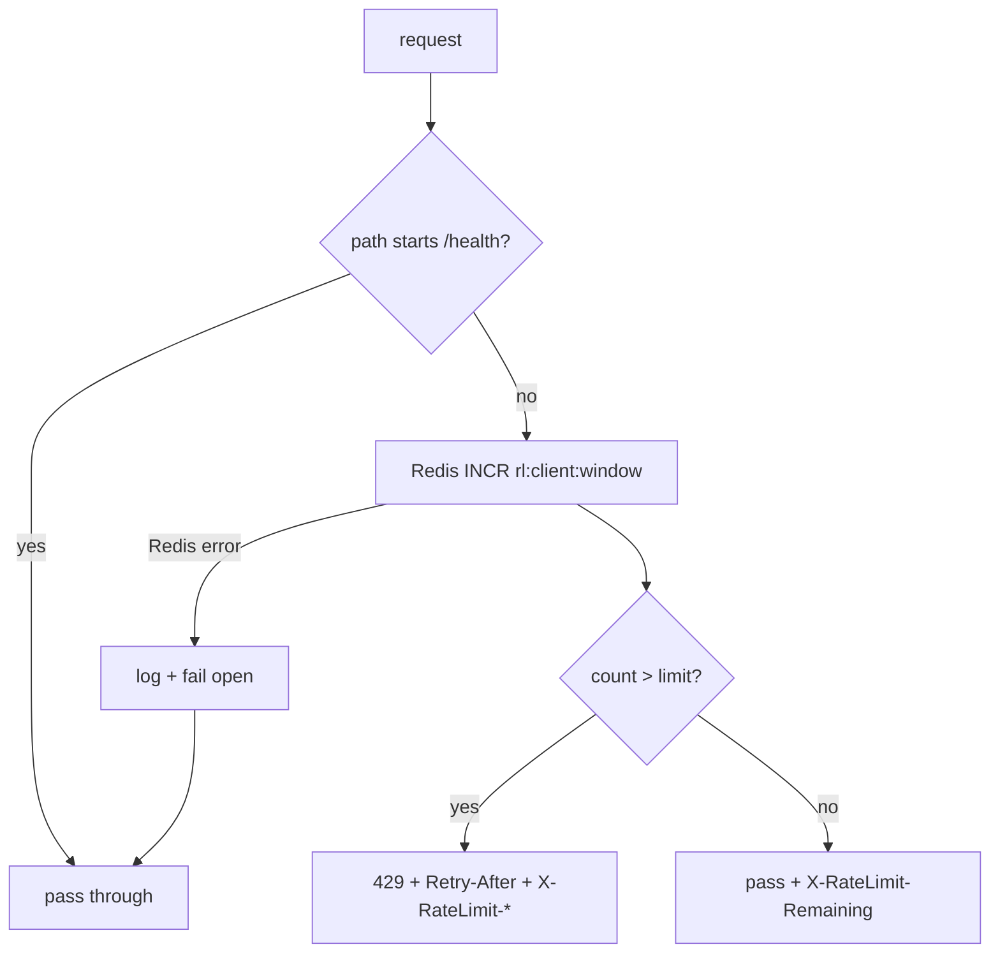
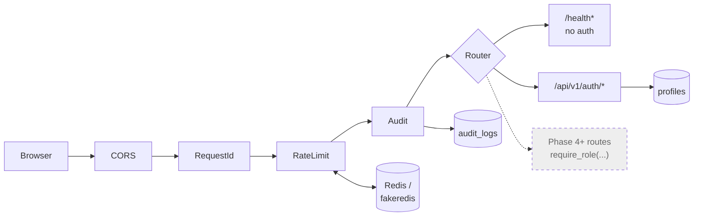

# Phase 3: System Design Evolution

*CloudDesk: Autonomous Customer Support & Resolution Platform*

**Phase 3: Identity and request guards.** Requirements N1 (JWT auth), N2 (rate limiting), N6 (audit), and the §18.1 rule that a viewer can never approve, reply or run a workflow.

Diagram key: solid = built in this phase. Dashed grey = planned for a later phase.

---

## Step 0: Starting point (end of Phase 2)

Open routes, one middleware, a database nobody guards.

Only health routes existed, so nothing sensitive was exposed yet. But every route added in Phase 4 would have been public.

---

## Step 1 (P3-1): Identity: JWT and `require_role`

**File:** `backend/app/core/security.py`

A token is HS256-signed with `effective_jwt_secret` (Supabase secret if set, else `JWT_SECRET`). Claims: `sub, email, role, aud, iat, exp`. Verification checks signature, audience (`authenticated`, the Supabase value) and expiry.

Role ladder: `viewer 1 < agent 2 < admin 3`. Unknown or missing role claims degrade to `viewer` (least privilege), which also lets a plain Supabase token (`role: "authenticated"`) work safely.

Design choices:
- **Stateless**: no DB lookup per request; the token is the proof.
- **`require_role` is a dependency factory**, so the policy is visible at the route signature.
- Core never imports `agents/` (layering rule preserved).

---

## Step 2 (P3-2): Demo login

**Files:** `api/auth.py` → `services/auth_service.py` → `repositories/people.py` (`ProfileRepository`), `schemas/auth.py`

Resolution rule: email wins over role; neither → demo agent; unknown email → 404. Layers respected: the route handles HTTP, the service holds the logic, the repository holds the SQL.

---

## Step 3 (P3-3): Rate limit

**Files:** `middleware/rate_limit.py`, `core/redis.py`

Fixed window per client: key `rl:{client}:{minute}`, `INCR`, first hit sets `EXPIRE`. Client = first `X-Forwarded-For` hop (behind a load balancer) or the socket IP.

`get_redis()` returns **fakeredis** when `REDIS_URL` is empty (offline demo/tests) and a real `redis.asyncio` client otherwise. The limiter takes the client factory and clock as arguments, so tests are deterministic.

---

## Step 4 (P3-4): Audit and middleware order

**File:** `middleware/audit.py`; wiring in `main.py`.

For every non-`GET/HEAD/OPTIONS` request, after the route finishes, insert an `audit_logs` row: `actor_id, actor_email, method, path, status_code, request_id, detail{actor_role}`. The actor comes from the bearer token if it verifies, else null (a 401 attempt is still logged). No bodies, query strings or tokens are stored. A failed write is logged and swallowed.

---

## Step 5: End state of Phase 3

**Order rationale** (request path CORS → RequestId → RateLimit → Audit → router):

| Position | Why |
|---|---|
| CORS outermost | Browser pre-flights are answered before anything else |
| RequestId before the rest | Every later layer, including 429s and audit rows, can use the id |
| RateLimit before Audit | A flood is stopped before it can flood the database with audit rows |
| Audit innermost | It sees the route's real final status code |

Note: a request rejected by the limiter (429) is *not* audited by design.

---

## What changed vs. Phase 2

| Area | Phase 2 | Phase 3 |
|---|---|---|
| Middleware | CORS, RequestId | + RateLimit, Audit |
| Routes | health | + `/api/v1/auth/demo-login`, `/auth/me` |
| Dependencies | none for auth | + `pyjwt`, `redis`, `fakeredis` |
| Tables written | seed only | + `audit_logs` on every change |
| Tests | 68 | 91 |

## Status (honest)

| Item | State |
|---|---|
| JWT, roles, demo login, limiter, audit | Implemented and validated locally (offline) |
| Real Redis server | Code path written; **not tested against a real Redis** |
| Supabase-issued tokens | Format handled in unit tests; **not tried with a real Supabase project** |
| Protecting real support routes | Phase 4 |
| Deployed | No |
