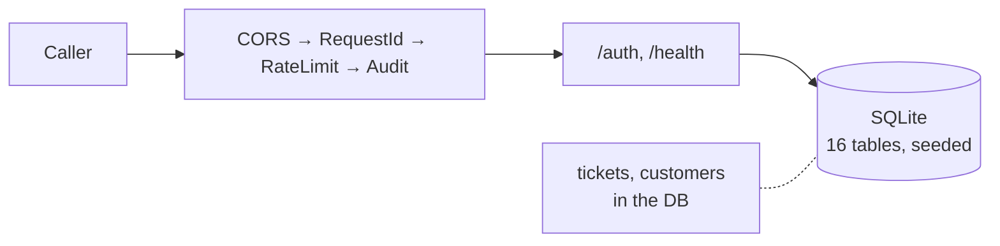
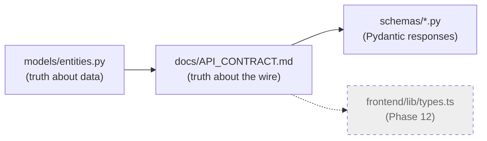
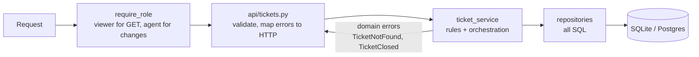
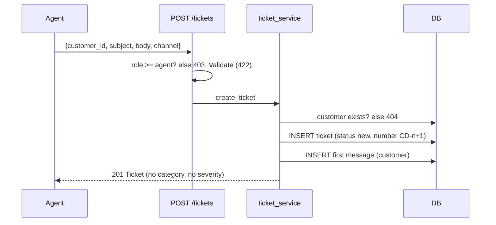
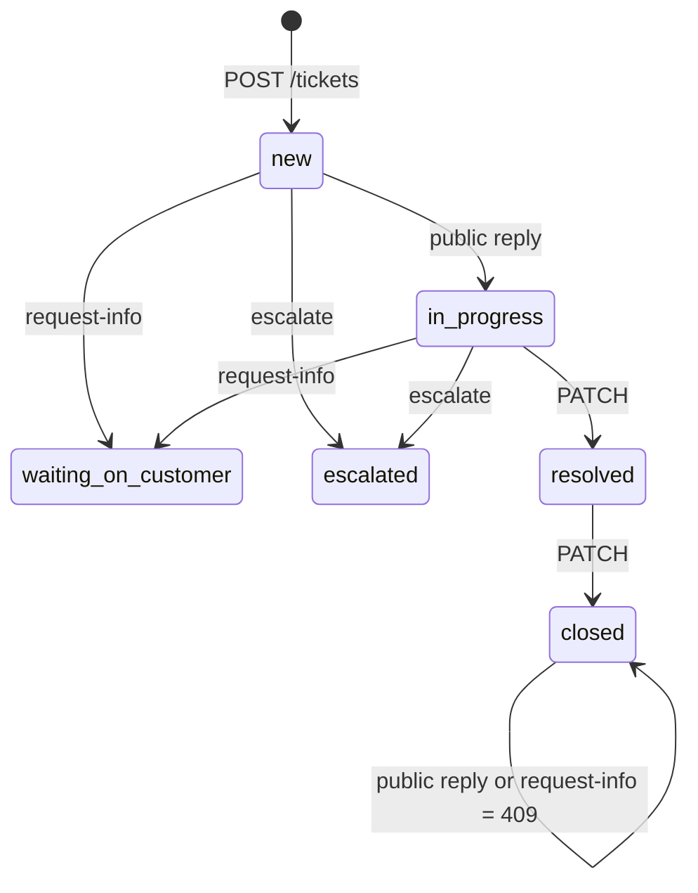
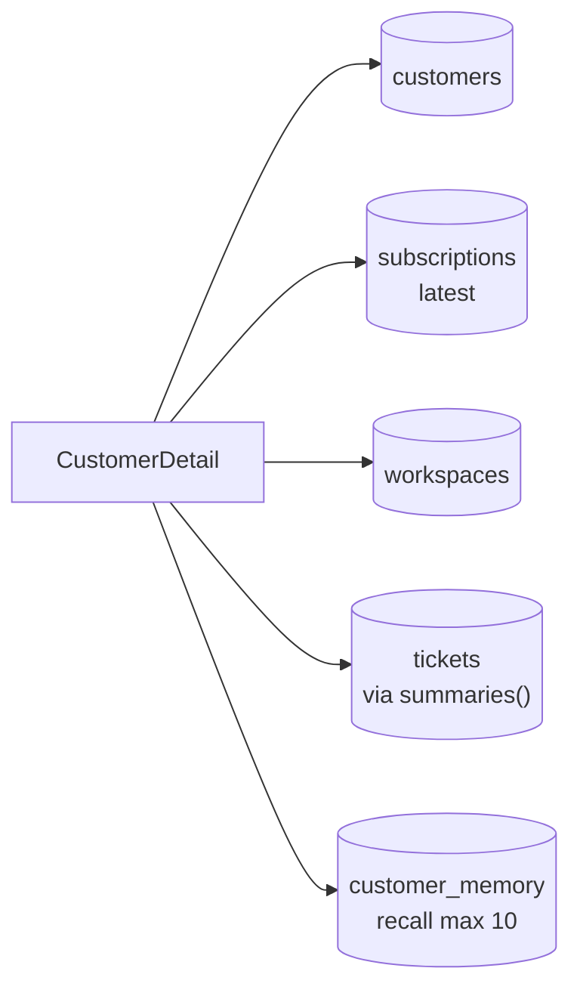
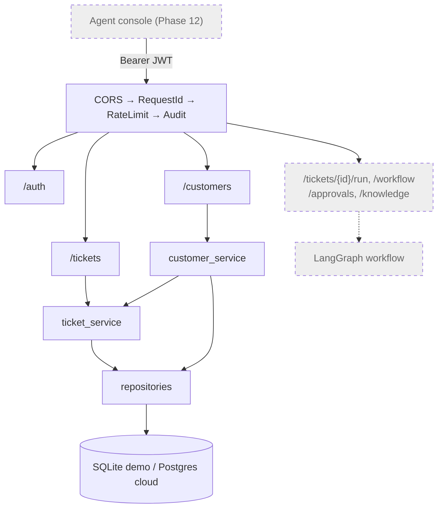

# Phase 4: System Design Evolution

*CloudDesk: Autonomous Customer Support & Resolution Platform*

**Phase 4: Support API.** Requirements F1 (create a ticket from email/chat/web/API), the read side of F4 (customer, subscription, workspace, previous tickets), and the contract rule in CLAUDE.md §12: contract, schemas and types are written together.

Diagram key: solid = built in this phase. Dashed grey = planned for a later phase.

---

## Step 0: Starting point (end of Phase 3)

Guards and data exist, but the only business routes are health and demo login.

The 13 demo tickets and 8 customers were in the database, but nothing could reach them.

---

## Step 1 (P4-1): Write the contract first

**File:** `docs/API_CONTRACT.md`

The first draft described fields the database does not have (`plan_name`, `lifetime_value`, an `ai` message role, escalation `priority`). Rather than invent columns, the contract was **reshaped to match the model** and every Phase 4 route got its status codes written down.

Why first: Phase 12 (the console) can start from the contract alone, in parallel with the agents.

---

## Step 2 (P4-2): Ticket API

**Files:** `api/tickets.py` → `services/ticket_service.py` → `repositories/{tickets,people,workflows}.py`; `schemas/tickets.py`, `schemas/records.py`

Routes: `GET/POST /tickets`, `GET/PATCH /tickets/{id}`, `GET /tickets/{id}/events`, `POST /reply`, `/request-info`, `/escalate`.

### Create a ticket

The workflow is **not** started. Category and severity stay empty until the Supervisor agent sets them (Phase 9).

### Read one ticket: the "case file"

`GET /tickets/{id}` accepts the UUID or `CD-1001`. It assembles messages, customer, latest subscription, workspaces, the customer's other tickets (max 10), resolution actions and the latest escalation. `workflow` is `null` until Phase 10.

### Efficient lists

`summaries()` builds a page of ticket summaries with **three batch queries** (customers, latest approval per ticket, escalated ticket ids) instead of three per row. No N+1.

### Status effects of the write routes

`PATCH` can set any status (the agent is the authority); moving to `resolved`/`closed` stamps `resolved_at`. `waiting_on_approval` will be owned by the workflow in Phase 10.

---

## Step 3 (P4-3): Customer API

**Files:** `api/customers.py` → `services/customer_service.py`; `schemas/customers.py`

| Route | Returns |
|---|---|
| `GET /customers?search=&page=&page_size=` | page of customers sorted by name; search matches name, company, email |
| `GET /customers/{id}` | customer + subscription + workspaces + tickets (max 50) + memory notes (max 10) |

This is exactly what the `customer_context` node will read in Phase 9, so the agent and the console use the same code path.

`customer_service` reuses `ticket_service.summaries`, so a ticket looks identical in the ticket list and the customer page.

---

## End of phase: full picture

## Design decisions to remember

| Decision | Reason |
|---|---|
| Contract follows the DB model, not the other way round | No phantom fields; one source of truth for data |
| `POST /tickets` never starts the workflow | Capturing a problem must not depend on the AI being healthy |
| Services raise domain errors, routes map them to HTTP | Services stay HTTP-free (layering rule) |
| Accept ticket number or UUID | Humans use `CD-1001`; machines use ids |
| Batch queries for summaries | Avoid N+1 on list pages |
| Role dependencies hoisted to module constants | Satisfies ruff B008, policy still visible on each signature |
| Manual escalate uses team `support_leads` | A named team (F10) without waiting for the policy rules in Phase 7 |

## Status (honest)

| Item | State |
|---|---|
| Ticket and customer routes | Implemented, validated locally (127 tests, ruff clean) |
| `/run`, `/workflow`, approvals, knowledge, dashboard | Not built (Phases 5, 10, 11) |
| Output validation on replies (N5) | Not built (Phase 7); replies are stored, never sent |
| Postgres | Same code path, never run against real Postgres |
| Cloud | Nothing deployed |
