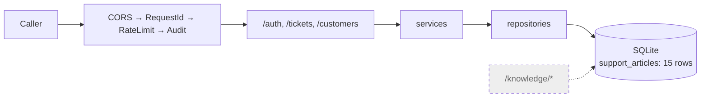
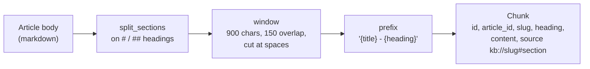
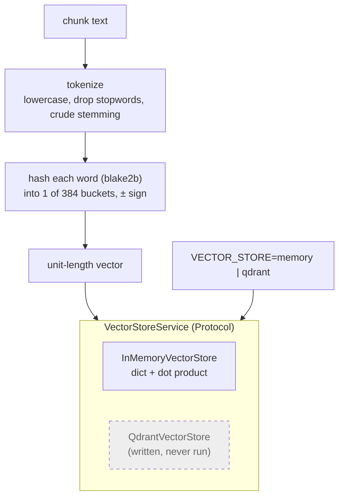
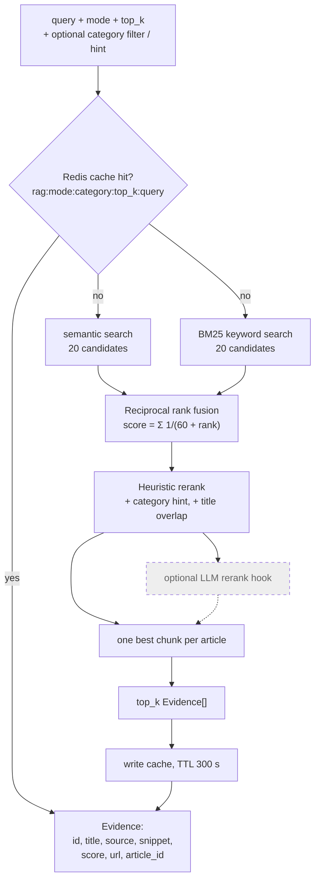
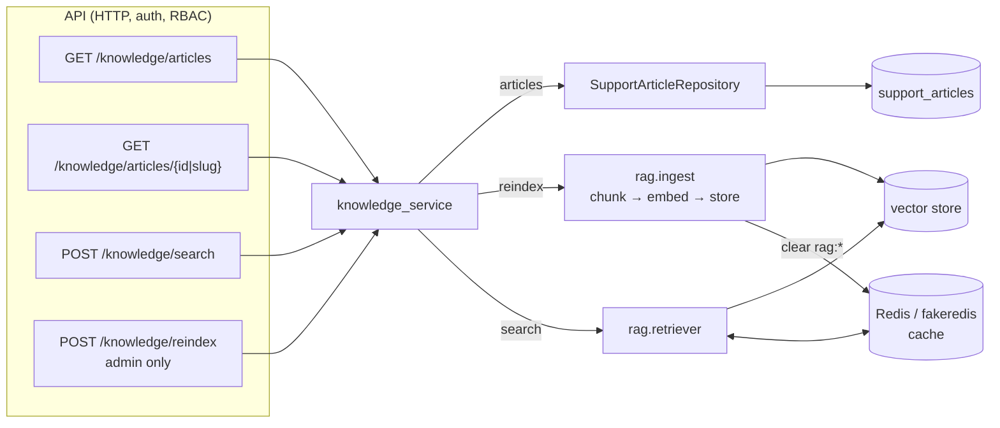
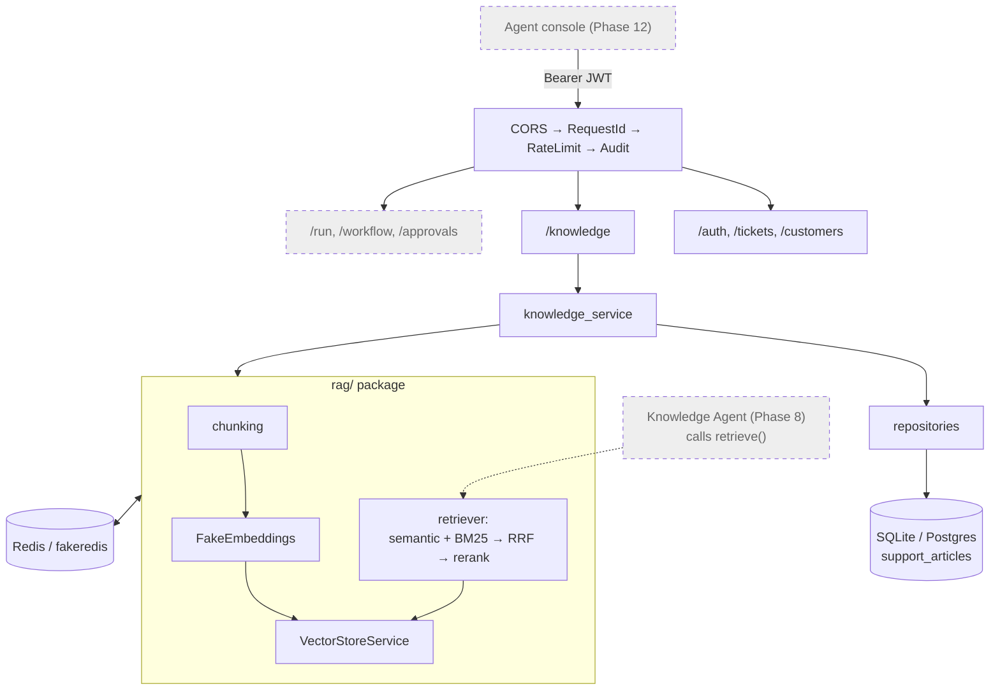

# Phase 5: System Design Evolution

*CloudDesk: Autonomous Customer Support & Resolution Platform*

**Phase 5: Knowledge pipeline.** Requirements F5 (cited evidence from the knowledge base: semantic + keyword, reranked) and the retrieval half of F6. Goal: fifteen articles are chunked, indexed and retrievable offline.

Diagram key: solid = built in this phase. Dashed grey = planned for a later phase.

---

## Step 0: Starting point (end of Phase 4)

The 15 articles are already rows in `support_articles` (loaded by the Phase 2 bootstrap), but they are just text in a table. Nothing can search them.



---

## Step 1 (P5-1): Chunking

**File:** `rag/chunking.py`

A whole article is too coarse to cite and too long to embed well. Chunking cuts it into pieces that each answer one question.



| Rule | Why |
|---|---|
| Split on headings first | A heading is the author's own topic boundary |
| Skip a heading with no text | The `# Title` line has nothing under it |
| 900-char windows, 150 overlap | A sentence cut at a boundary still appears whole in the next window |
| Prefix every chunk with title and heading | "Wait 30 minutes" alone is unfindable; with its prefix it is clearly MFA lockout |
| `source` = `kb://slug#section` | A stable citation the UI and customer reply can show |

Result: **15 articles → 46 chunks.**

---

## Step 2 (P5-2): Fake embeddings and the vector store

**File:** `rag/vector_store.py`, `rag/text.py`



- **One interface, two implementations.** Nothing outside this file knows which store is running. The six methods: `add_documents`, `search`, `delete`, `count`, `health`, plus `list_chunks` (keyword search needs the corpus).
- **Deterministic embeddings.** `blake2b` is used instead of Python's `hash()`, which changes between processes.
- `delete(None)` recreates the whole collection; this is what reindex uses.

---

## Step 3 (P5-3): The hybrid retriever

**File:** `rag/retriever.py`



| Mode | Runs |
|---|---|
| `hybrid` (default) | semantic and keyword, fused |
| `semantic` | vector search only |
| `keyword` | BM25 only |

**Filter vs hint.** `category` is a hard filter (only that category is searched). `category_hint` only nudges the rerank; the future Knowledge Agent will pass the ticket's classified category as a hint so a wrong classification cannot hide the right article.

**The cache is advisory.** Any Redis error falls through to a live search. A reindex clears every `rag:*` key.

---

## Step 4 (P5-4): Ingest and the Knowledge API

**Files:** `rag/ingest.py`, `scripts/ingest.py`, `backend/app/services/knowledge_service.py`, `backend/app/api/knowledge.py`, `backend/app/schemas/knowledge.py`



The service is the **bridge**: articles come from the database, chunks go to the index. `rag/` never touches the database and the repositories never touch the index.

**Startup:** the lifespan hook builds the index after the demo data loads. If indexing fails the API still boots, and the first search retries.

**`make ingest`** loads the data if needed, rebuilds the index, and replays CD-1012:

```text
indexed 15 articles into 46 chunks
  1. kb://mfa-recovery#why-accounts-lock
CD-1012 -> mfa-recovery in top 3: yes
```

| Route | Role | Errors |
|---|---|---|
| `GET /articles` | viewer+ | 422 unknown category |
| `GET /articles/{id}` | viewer+ | 404 `Article not found` |
| `POST /search` | viewer+ | 422 blank query, bad mode, `top_k` outside 1-20 |
| `POST /reindex` | **admin** | 403 for agent and viewer |

---

## End of phase: full picture



## Design decisions to remember

| Decision | Reason |
|---|---|
| Hybrid search with rank fusion | Meaning and exact words each fail where the other succeeds |
| Reciprocal rank fusion, not score addition | Semantic and BM25 scores live on different scales; ranks are comparable |
| Own small BM25 (no `rank_bm25`) | Avoids a dependency; the corpus is tiny. Revisit if the corpus grows |
| `VectorStoreService` Protocol | Offline demo and Qdrant cloud differ by one setting |
| One hit per article | Five chunks of one article crowd out other sources |
| `category` filter vs `category_hint` | A wrong classification must not be able to hide the right article |
| Cache is advisory and cleared on reindex | Redis trouble degrades speed, never correctness; stale answers are not served |
| Service bridges DB and index | `rag/` stays ignorant of tickets and SQL (layering rule) |
| Reindex is admin-only | It replaces the whole library every answer cites |
| Chunks carry `kb://slug#section` | Customer-facing policy claims must be citable (CLAUDE.md §8) |

## Status (honest)

| Item | State |
|---|---|
| Chunking, fake embeddings, in-memory store, hybrid retriever, ingest, 4 routes | Implemented, validated locally (164 tests, ruff clean) |
| Hit-rate@3 | Measured: 12/12 hybrid on the 12 demo tickets with an article (11/12 at top-1). The set is small and was written beside the articles, so it is optimistic |
| `QdrantVectorStore` | Written, never run (`qdrant-client` is not a dependency) |
| Real embedding model | Not built; only `EMBEDDING_PROVIDER=fake` |
| LLM rerank | Hook only; no caller until Phase 8 |
| Knowledge Agent and similar cases | Not built (Phase 8) |
