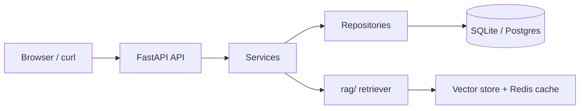
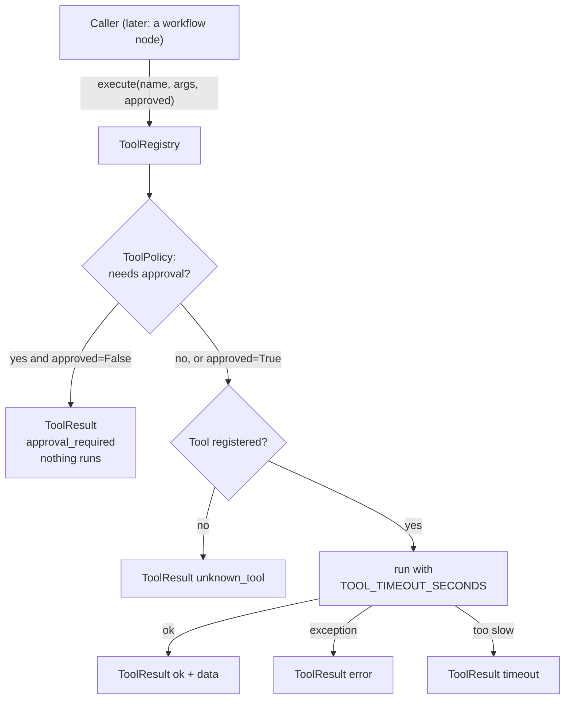
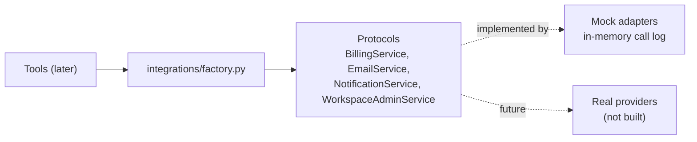
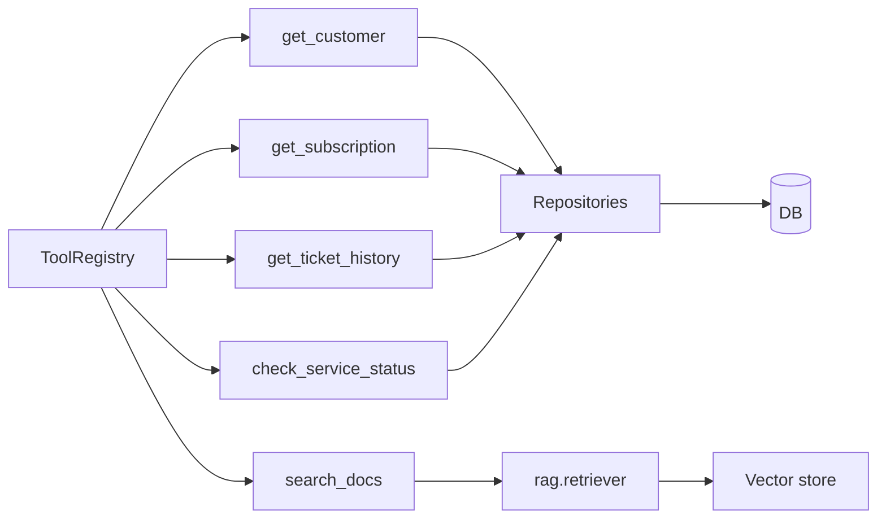
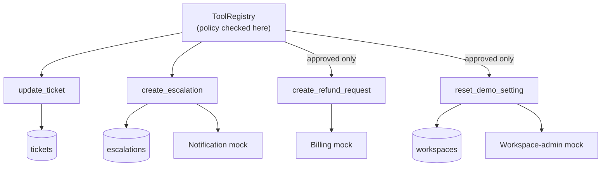
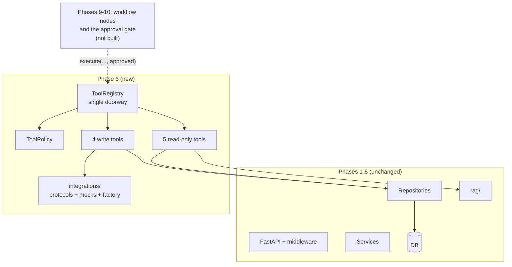

# Phase 6: System Design Evolution

*CloudDesk: Autonomous Customer Support & Resolution Platform*

**Phase 6: Tools and policy.** Every side effect the agents can take becomes a registered tool with an explicit approval bit. This file shows the design growing step by step, from a bare policy function to the full tool layer.

---

## Step 0: Starting point (end of Phase 5)

The backend can store and read data (Phase 2), authenticate (Phase 3), serve tickets and customers (Phase 4) and search knowledge (Phase 5). **Nothing can act.** There is no controlled way for an agent to change a ticket, escalate, or request money.

---

## Step 1 (P6-1): Tool policy and registry

**Added:** `app/tools/policy.py`, `registry.py`, `base.py`.

- `ToolPolicy.requires_approval(name, args)` is a pure function. Two sets decide it: tools that never need approval, tools that always do. Anything else, **unknown**, needs approval.
- `create_refund_request` is special: it also reads settings (`APPROVAL_REQUIRED_FOR_REFUNDS`, `MAX_REFUND_WITHOUT_APPROVAL`). By default every refund is gated.
- `ToolRegistry.execute(name, args, approved=False)` is the single doorway. It returns a `ToolResult`, never raises.

---

## Step 2 (P6-4): Mock integrations

**Added:** `integrations/protocols.py`, `integrations/mock/services.py`, `integrations/factory.py`.

Built before the write tools because the write tools need something to call. Four `Protocol` interfaces (billing, email, notifications, workspace admin). Four mock adapters that **record** their calls in a list and return deterministic ids (`re_mock_0001`). A factory returns the mock for each; it is the one file to change when a real provider arrives.

---

## Step 3 (P6-2): Read-only tools

**Added:** `app/tools/read_only.py`. Five `@tool` functions: `get_customer`, `get_subscription`, `get_ticket_history`, `search_docs`, `check_service_status`.

They reuse existing code: repositories for SQL, `rag.retriever.retrieve` for search. No new SQL, no new retrieval logic. Each opens its session through one seam, `tool_session()`, so tests can point at a private database.

---

## Step 4 (P6-3): Approval-gated write tools

**Added:** `app/tools/write.py`. Four tools:

| Tool | Writes to | Gate |
|---|---|---|
| `update_ticket` | `tickets` (values validated against the enums) | none |
| `create_escalation` | `escalations`, plus a team notification | none (the safe path) |
| `create_refund_request` | billing integration | **approval** |
| `reset_demo_setting` | workspace row plus workspace-admin integration; only three whitelisted settings | **approval** |

---

## End of phase: full picture

Nothing in the HTTP API changed. The tool layer sits **beside** the API, waiting for the workflow.

---

## Design decisions to remember

1. **One doorway.** `ToolRegistry.execute` is the only way to run a tool, so policy cannot be bypassed.
2. **Policy is code, not a prompt.** The model never decides what is allowed.
3. **Failures are data.** `ToolResult(ok=False)` for errors, timeouts, unknown tools and blocked calls, so the graph never crashes on a tool.
4. **Deny by default.** Unknown tool names need approval.
5. **Protocols over concrete services.** Mocks today, real providers later, no tool edits.
6. **Layering respected.** Tools call repositories (SQL) and `rag/`; they never contain SQL or call a model. `core` does not import integrations.

---

## Status (honest)

| Item | State |
|---|---|
| Policy, registry, 9 tools, 4 mock integrations | Implemented |
| 28 new unit tests; full suite 192 passed, offline | Validated locally |
| Tools called by any agent or workflow node | **Not yet** (Phases 8-10) |
| `resolution_actions` rows written after an approved action | **Not yet** (Phase 10) |
| `/mcp/tools` endpoint exposing tool specs | **Not yet** (`registry.specs()` is ready for it) |
| Real billing, email, chat providers | Not planned for v1 |
