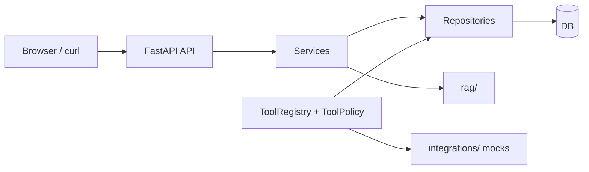
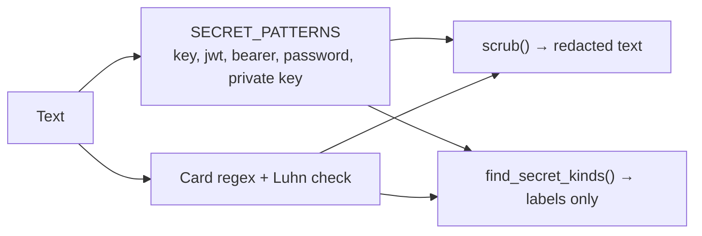
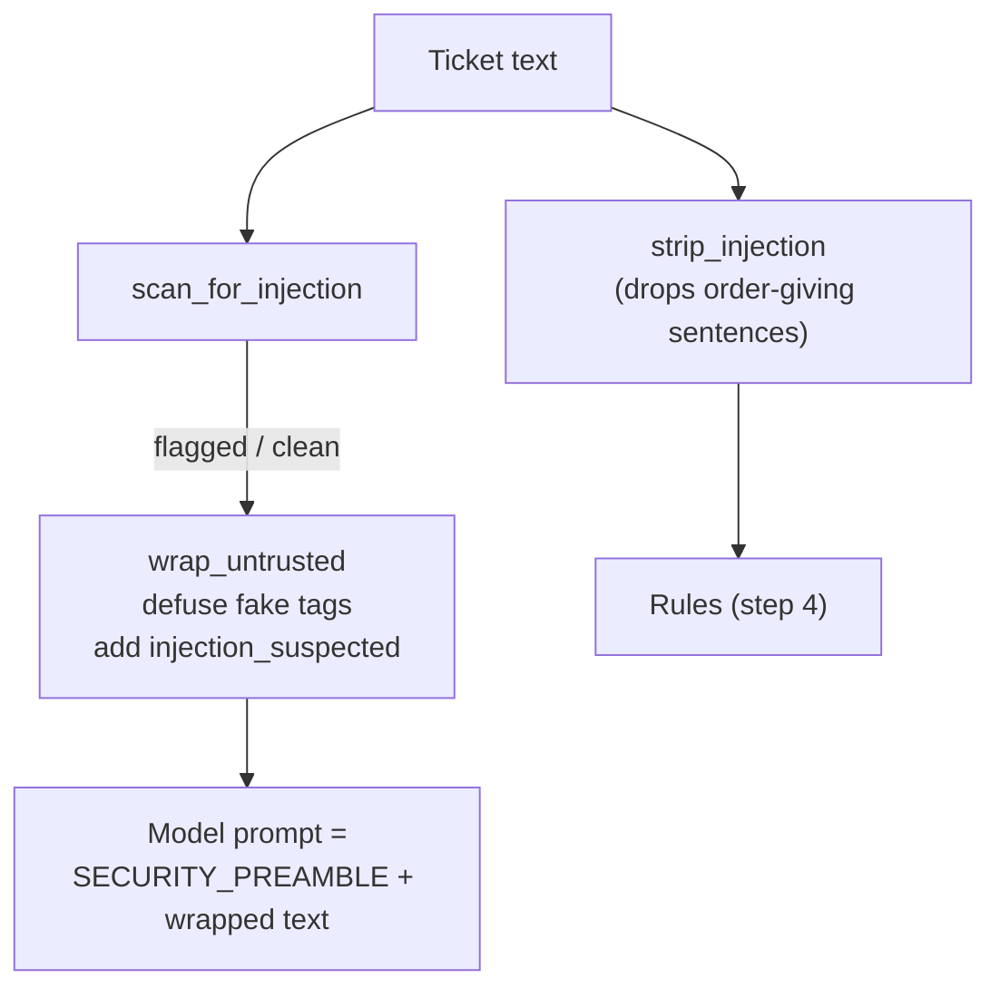
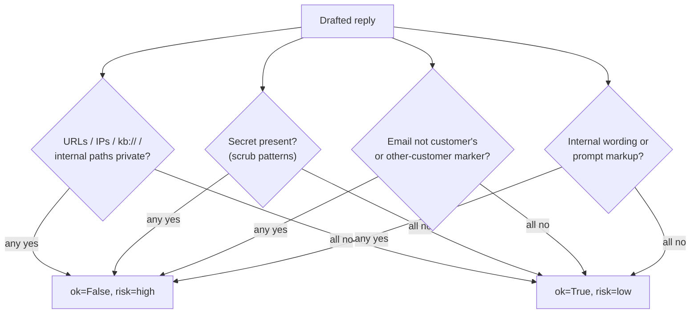
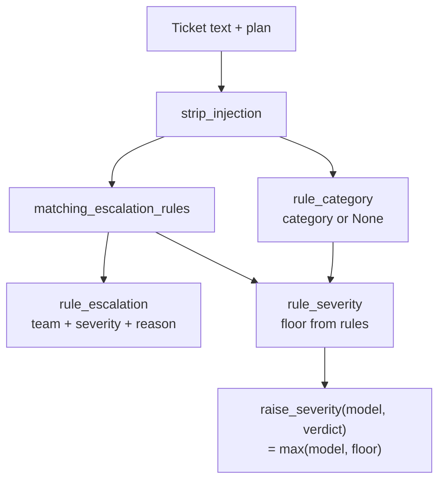
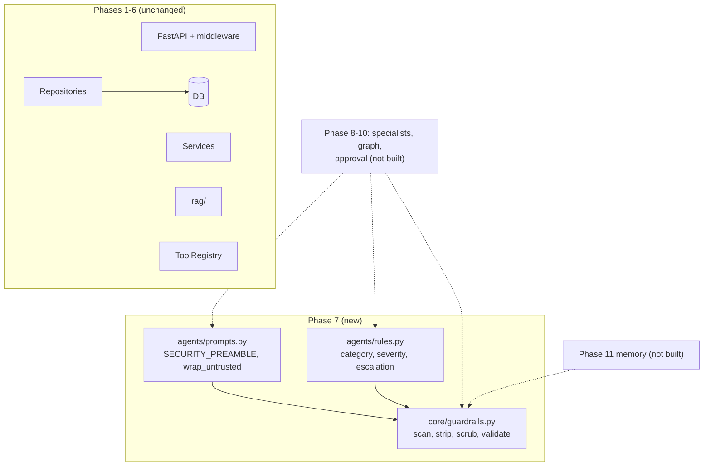

# Phase 7: System Design Evolution

*CloudDesk: Autonomous Customer Support & Resolution Platform*

**Phase 7: Rules and guardrails.** Policy and safety become deterministic code that runs before any specialist calls a model. This file shows the design growing one task at a time.

---

## Step 0: Starting point (end of Phase 6)

The backend stores data, authenticates, serves tickets, searches knowledge and has a gated tool layer. **Nothing yet decides policy** (what must escalate), and **ticket text is not defended** against injection.

---

## Step 1 (P7-4): Secret scrub

**Added:** `backend/app/core/guardrails.py` (first half): `SECRET_PATTERNS`, `scrub`, `find_secret_kinds`, `contains_secret`.

Built first because both memory (N7, Phase 11) and output validation depend on it. Card numbers are found by regex **plus a Luhn checksum**, so order numbers survive. `scrub` replaces matches with `[REDACTED:<kind>]` and is idempotent.

---

## Step 2 (P7-2): Injection scan, wrapper, preamble

**Added:** `scan_for_injection`, `strip_injection` in `core/guardrails.py`; `agents/prompts.py` with `SECURITY_PREAMBLE` and `wrap_untrusted`.

- Scan normalises text (Unicode NFKC, zero-width removal, lowercase) then checks seven pattern families.
- `wrap_untrusted` defuses forged `<untrusted_content>` tags, then wraps with `injection_suspected` true/false.
- `strip_injection` drops flagged **sentences** so rules never read attacker instructions.
- Layering: `agents/` imports `core`; `core` never imports `agents/`.

---

## Step 3 (P7-3): Customer output validation

**Added:** `validate_customer_output` returning `OutputValidation(ok, violations, risk)`.

Four violation kinds: `internal_url`, `secret`, `other_customer_data`, `internal_marker`. A failure has `risk == "high"` (`OUTPUT_FAILURE_RISK`). `detail` is a label, never the leaked value. The caller supplies the customer's own email and other customers' markers, since this module knows nothing about tickets.

---

## Step 4 (P7-1): Escalation, severity and category rules

**Added:** `agents/rules.py`.

- `ESCALATION_RULES`: six rules (security, data loss, legal, account deletion, payment dispute, enterprise outage), each with a named team, a severity and, for outage, a plan restriction.
- `rule_escalation(text, plan)` → `PolicyEscalation` or `None`.
- `rule_severity` → a **floor**; `raise_severity(model, verdict)` can only raise.
- `rule_category` → category or `None` (no opinion). Weighted keywords, ties go to the higher-priority category.
- Every function first calls `strip_injection`.

---

## End of phase: full picture

Nothing in the HTTP API changed. The guardrails sit **beside** the API, waiting for the specialists.

---

## Design decisions to remember

1. **Policy is code, not a prompt.** Escalation never depends on model probability.
2. **Rules raise, never lower.** `raise_severity` is `max(model, floor)`.
3. **"No opinion" is a valid answer.** `rule_category` returns `None`; unmatched severity is `matched=False`.
4. **Injected sentences are removed from rule input**, so an attacker cannot steer rules.
5. **Flag, do not block.** A flagged ticket is still handled; risk goes up instead.
6. **Reports never echo secrets.** Violations carry labels only.
7. **Layering.** `core` has no import of `agents/`; shared helpers live in `core`.
8. **Pure functions.** No I/O, so tests need no database, Redis or model.

---

## Status (honest)

| Item | State |
|---|---|
| Rules, injection scan, wrapper, preamble, output validation, scrub | Implemented |
| 102 new unit tests; full suite 294 passed offline; ruff clean | Validated locally |
| Called by any specialist, node or API route | **Not yet** (Phases 8-10) |
| Regex-based: can miss unusual phrasing | Known limit; model judgement is the backup |
