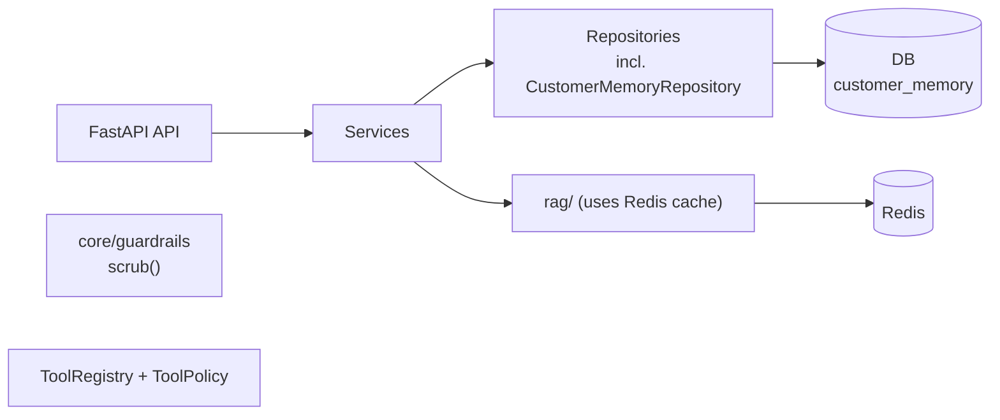
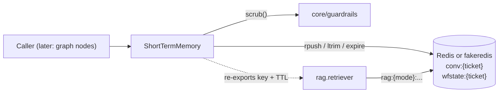
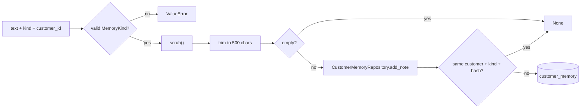
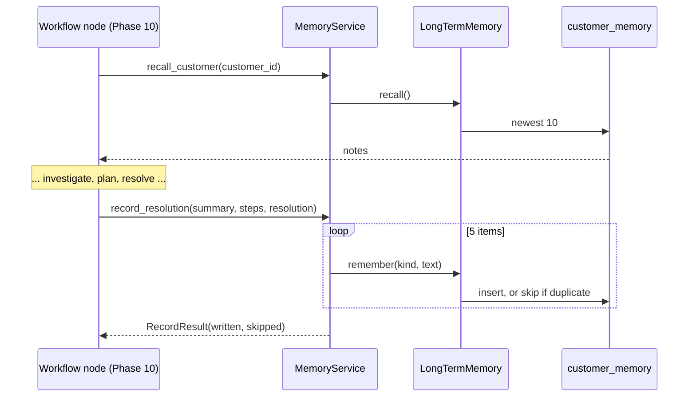
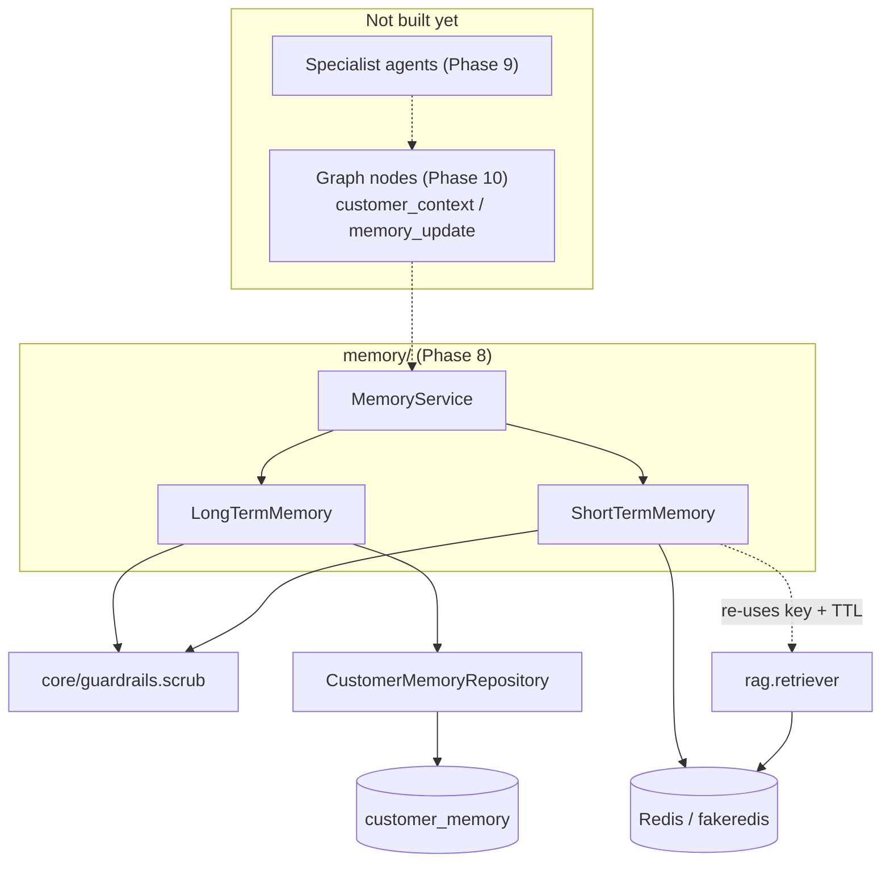

# Phase 8: System Design Evolution

*CloudDesk: Autonomous Customer Support & Resolution Platform*

**Phase 8: Memory.** The system gains a short-term store (Redis) and a long-term store (`customer_memory`), fronted by one service. This file shows the design growing one task at a time.

---

## Step 0: Starting point (end of Phase 7)

Data, auth, API, knowledge search, tools and guardrails exist. The `customer_memory` table and a repository (`add_note`, `recall`) exist from Phase 2, and `scrub()` from Phase 7. **No component decides what to remember**, and nothing uses Redis except the retrieval cache.

---

## Step 1 (P8-1): Short-term Redis facade

**Added:** `memory/short_term.py` with `ShortTermMemory`.

- Per-ticket conversation: Redis list `conv:{ticket_id}`, newest 50, 24 h TTL, each message scrubbed and trimmed to 2,000 characters.
- Workflow state: `wfstate:{ticket_id}` JSON, 24 h TTL, scrubbed.
- Re-exports the Phase 5 retrieval cache key `rag:{mode}:{category}:{top_k}:{query}` and its 300 s TTL, so there is one place listing what lives in Redis.
- **Fails soft**: any Redis error is logged and returns `False`, `[]` or `None`.

---

## Step 2 (P8-2): Long-term customer memory

**Added:** `memory/long_term.py` with `LongTermMemory` and the frozen `MemoryNote`.

`remember()` pipeline: validate kind against `MemoryKind` (`ValueError` otherwise) → `scrub()` → collapse whitespace → cap at 500 characters → skip if empty → repository `add_note` (hash-based exact-duplicate check, plus a database unique constraint as the backstop). `recall()` returns at most 10 newest.

---

## Step 3 (P8-3): Recall and record service

**Added:** `memory/memory_service.py` with `MemoryService`, `RecordResult`.

- `recall_customer(customer_id)` → up to 10 `MemoryNote`.
- `record_resolution(...)` → writes **five** notes: one `past_issue`, the first three `troubleshooting` steps, one `note` ("Resolution: ..."). Returns `RecordResult(written, skipped_duplicates)`.
- Callers pass summaries, never the raw ticket body.

---

## End of phase: full picture

Layering holds: `memory/` imports downward (`core`, `repositories`, `rag`); `core` never imports `memory/`.

---

## Design decisions to remember

| Decision | Reason |
|---|---|
| Two stores, one service | Different lifetimes and speeds: temporary and fast vs permanent and queryable |
| `LongTermMemory` is the only writer of `customer_memory` | Scrub, trim and de-duplicate live in one place |
| Scrub before every write, including short-term | Cheap, and secrets then never exist at rest anywhere |
| Dedupe on (customer, kind, content hash) in both code and a unique constraint | Code gives a clean skip; the constraint stops a race |
| Short-term fails soft; long-term raises | Scratchpad is advisory; a permanent-write failure should be visible |
| Callers pass summaries, not ticket bodies | Raw bodies may hold secrets or private detail (N7) |
| Recall capped at 10 | Bounded prompt size; matches the repository cap |
| Retrieval cache stays in `rag/`, re-exported | One owner of the key format; no duplication |

---

## Status (honest)

| Item | State |
|---|---|
| Short-term, long-term, service | Implemented |
| Tests | 10 new; full suite 304 passing, offline, ruff clean |
| Called by graph nodes | **Not yet** (Phases 9-10) |
| Real Redis | Not exercised; fakeredis only |
| Semantic (not exact) duplicate detection | Not built |
| Delete-customer-memory / right to erasure | Not built |
| Deployed anywhere | No |
