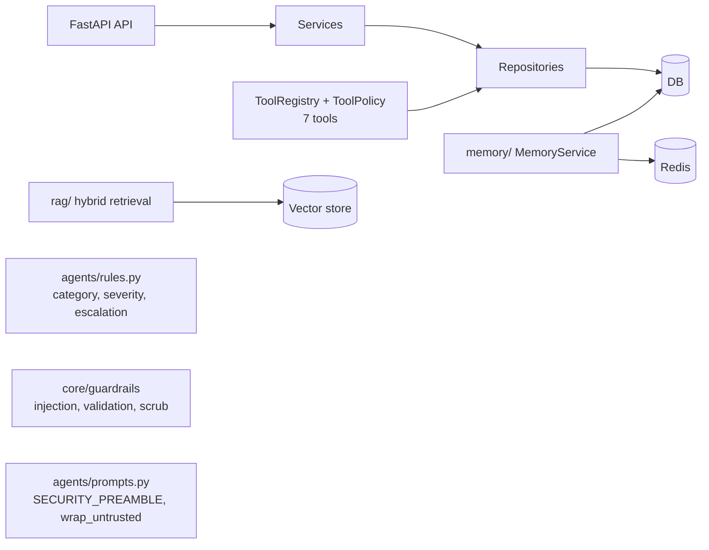
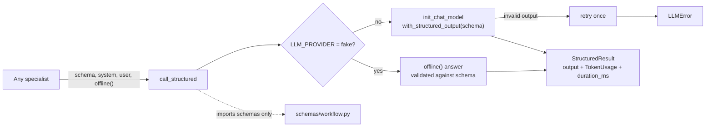
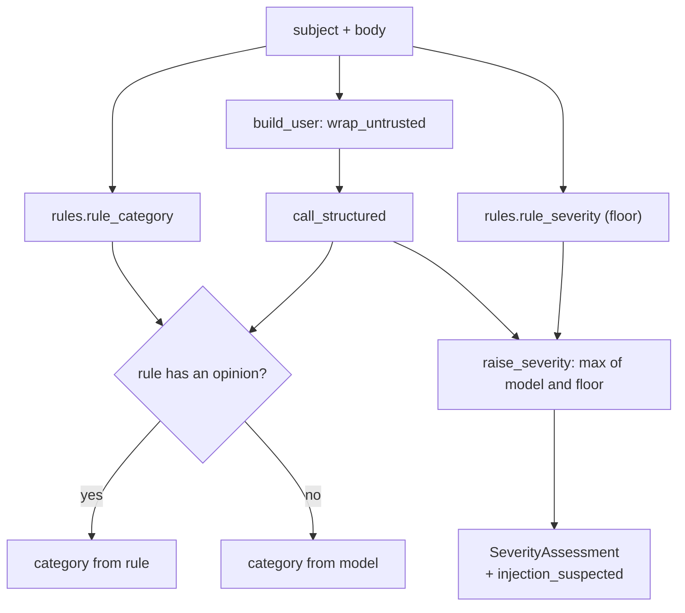
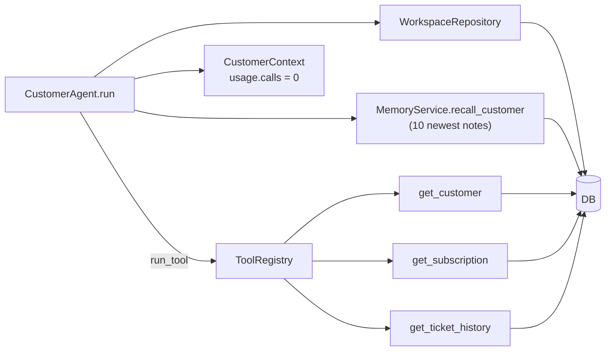
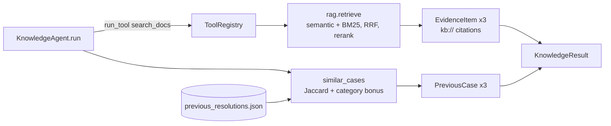
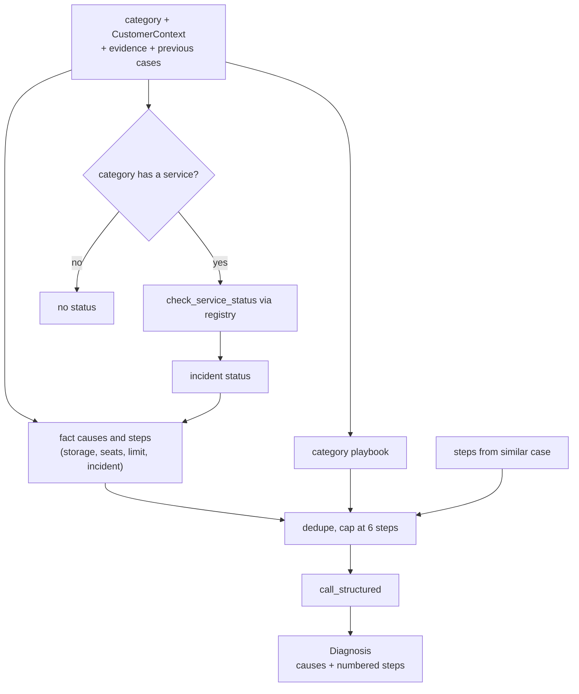
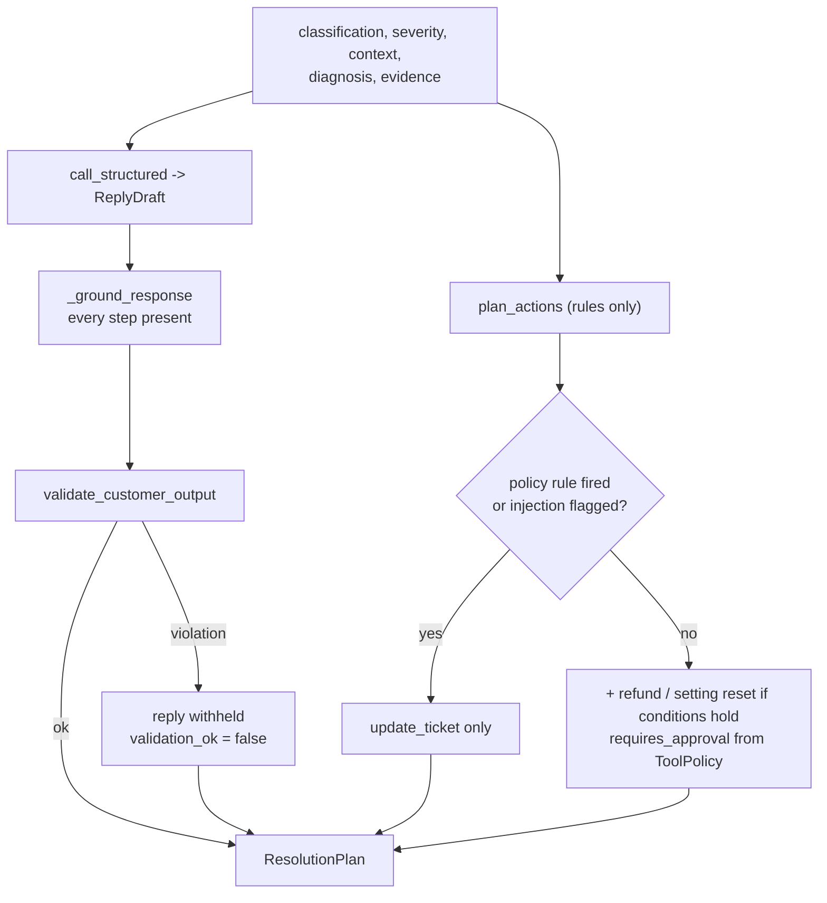
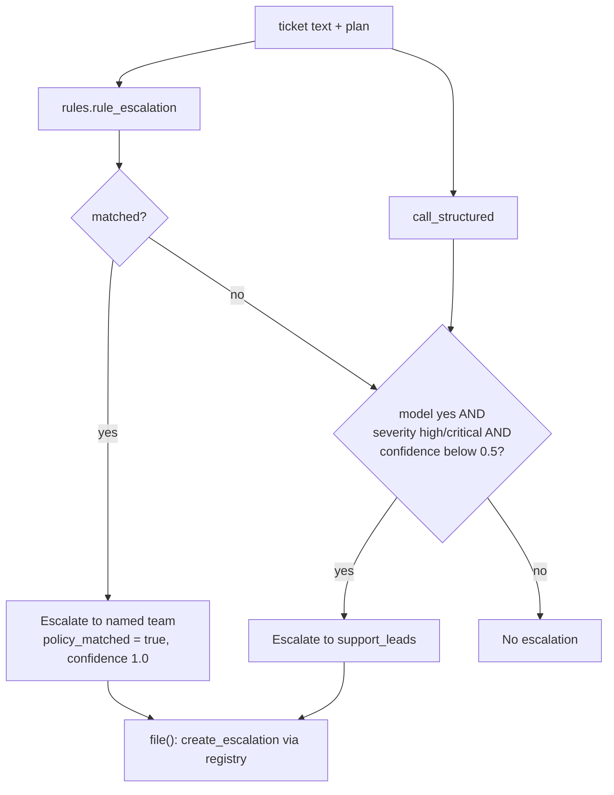
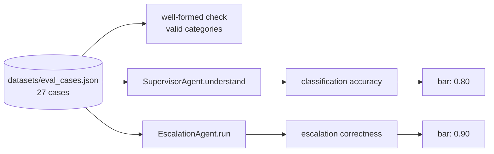
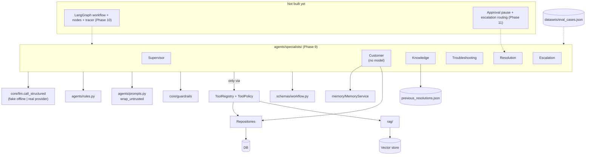

# Phase 9: System Design Evolution

*CloudDesk: Autonomous Customer Support & Resolution Platform*

**Phase 9: Specialist agents.** The system gains an LLM access layer, typed output schemas, six specialist agents and an evaluation dataset. This file shows the design growing one task at a time (P9-1 to P9-8).

---

## Step 0: Starting point (end of Phase 8)

Data, auth, API, knowledge search, tools, guardrails and memory all exist as **independent, tested components**. Nothing decides *how to use them for a ticket*, and there is no model access at all (`backend/app/core/llm.py` does not exist).



---

## Step 1 (P9-1): Workflow schemas and the fake-capable LLM

**Added:** `backend/app/schemas/workflow.py` and `backend/app/core/llm.py`.

- **Schemas** are the "forms" every specialist fills in: `Classification`, `SeverityAssessment`, `TicketSummary`, `CustomerContext`, `EvidenceItem`, `PreviousCase`, `KnowledgeResult`, `Diagnosis`, `PlannedAction`, `ReplyDraft`, `ResolutionPlan`, `EscalationDecision`, plus `TokenUsage` and `ToolCallRecord`. `Category` is the existing 10-value enum, so a wrong category fails validation.
- **`call_structured(schema, system, user, offline=..., agent=...)`** is the single door to any model. With `LLM_PROVIDER=fake` it validates the answer from the caller's `offline()` function and returns `StructuredResult(output, usage, duration_ms)` with cost `0.0`. With a real provider it uses LangChain `init_chat_model(...).with_structured_output(schema)`, retries once on invalid output, then raises `LLMError`.
- `core` stays clean: it never imports `agents/`. The offline answer is passed **in** by the specialist.



---

## Step 2 (P9-2): Supervisor agent

**Added:** `agents/specialists/supervisor.py` with `SupervisorAgent` (`understand`, `assess_severity`, `summarize`), the shared `AgentResult` envelope and `run_tool` helper in `base.py`, and specialist prompts in `agents/prompts.py` (`build_system`, `build_user`).

- `understand`: the rule category wins when a rule has an opinion (`source="rules"`); otherwise the model's category is used. The summary is one line and scrubbed.
- `assess_severity`: `rules.raise_severity(model, verdict)`. Rules raise, never lower. `injection_suspected` comes from `scan_for_injection`.
- `summarize`: built only from our own outputs, then scrubbed (the `ticket_summary` node, F11).
- Ticket text always passes through `wrap_untrusted` inside `build_user`.



---

## Step 3 (P9-3): Customer agent

**Added:** `agents/specialists/customer.py`. **No model call.**

It calls `get_customer`, `get_subscription` and `get_ticket_history` **through `ToolRegistry`** (via `run_tool`), then reads workspaces through `WorkspaceRepository` and recalls memory through `MemoryService`, in one session. A missing customer raises `LookupError`; a failed subscription or history lookup degrades to empty.



---

## Step 4 (P9-4): Knowledge agent

**Added:** `agents/specialists/knowledge.py`.

- Evidence: `search_docs` through the registry, top 3, passing the classified category as a **hint** (not a hard filter). Results become cited `EvidenceItem`s (`source = kb://slug#section`).
- Similar cases (F6): Jaccard word overlap between the ticket and each entry in `sample_data/previous_resolutions.json` (read as a file, there is no table). Same category gets +0.1; a different category needs overlap of at least 0.1. Top 3.



---

## Step 5 (P9-5): Troubleshooting agent

**Added:** `agents/specialists/troubleshooting.py`.

1. Map category to a service (`login_issue`→`sso`, `api_failure`→`api`, `storage_quota`→`storage`, `integration`→`integrations`) and call `check_service_status` via the registry.
2. Build **fact-based causes** (active incident, storage at least 90% used, seats billed above seats used, plan API limit) from `CustomerContext` and the status result.
3. Add the category **playbook**, plus steps from the closest previous case; de-duplicate; keep at most 6.
4. Model call with `offline=` returning that deterministic diagnosis.



---

## Step 6 (P9-6): Resolution agent

**Added:** `agents/specialists/resolution.py`. The most guarded specialist.

- **`plan_actions` (pure rules):** always `update_ticket`. If a policy escalation rule fires **or** injection is flagged, it stops there. Otherwise: `create_refund_request` when billing + "refund" + seats purchased > seats used (amount = unused seats x seat price); `reset_demo_setting` when workspace-permission + sharing/external text + paid plan + a workspace with sharing off. `requires_approval` comes from `ToolPolicy`.
- **Reply:** the model writes only `ReplyDraft` (summary, reply, internal notes). `_ground_response` appends any step missing from the reply. `validate_customer_output` then checks internal URLs, secrets and other customers' data. On failure, the reply becomes `WITHHELD_REPLY` and `validation_ok=False` with issue **kinds** only.
- Citations are kept as internal `kb://` sources; the customer reply cites by **title** (a `kb://` link in a reply would itself fail validation).



---

## Step 7 (P9-7): Escalation agent

**Added:** `agents/specialists/escalation.py` with `run` (decide) and `file` (record).

```text
policy = rules.rule_escalation(text, plan)      # policy
model  = call_structured(EscalationDecision)    # judgement
if policy:                                         -> escalate, named team, policy_matched
elif model says yes AND severity high/critical AND confidence < 0.5:
                                                   -> escalate to support_leads
else:                                              -> no escalation (vague model view distrusted)
```

`file()` calls `create_escalation` through `ToolRegistry` and does nothing when no escalation is required.



---

## Step 8 (P9-8): Eval case dataset

**Added:** `datasets/eval_cases.json` (27 cases: the 13 demo tickets and 14 more) and `tests/evaluation/test_eval_cases.py`. Each case has `expected_category`, `expected_escalation`, `expected_team` and `expected_articles`. The tests check the dataset is well formed and measure classification accuracy and escalation correctness through the specialists (measured 27/27 and 27/27; optimistic, see below). Retrieval, citation and grounding metrics are not scored yet.



---

## End of phase: full picture



Layering holds: specialists write **no SQL** (a test scans their source) and run **no tool except through `ToolRegistry`**; `core/llm.py` imports only schemas and config.

---

## Design decisions to remember

| Decision | Reason |
|---|---|
| Rules first, model second, in every specialist | Policy must be deterministic and testable (CLAUDE.md 7.2) |
| Rules may raise severity, never lower it | A model's optimism cannot hide a security issue |
| Actions come from `plan_actions`, the model writes only wording | A model or an injected sentence cannot invent a refund |
| No money/account action on escalated or injection-flagged tickets | Those tickets go to a person, not a tool |
| Fake provider = caller-supplied `offline()` through the same `call_structured` | Same validation, counters and shape offline and online; `core` never imports `agents` |
| Customer agent makes no model call | It only gathers facts; nothing to guess |
| Every reply is grounded then validated; failure withholds the reply | Output validation failure must never reach a customer (N5) |
| Replies cite by article title; `kb://` sources stay internal | Internal URLs are blocked by validation |
| Vague model escalations are distrusted | Precision of escalations; humans are not flooded |
| `AgentResult` carries usage, duration and tool-call records | Phase 10 tracer can log them without the specialists knowing about tracing |
| Similar cases read from a JSON file | There is no table for them (Phase 2 decision) |

---

## Status (honest)

| Item | State |
|---|---|
| Schemas, `call_structured`, 6 specialists, 27-case dataset | Implemented |
| Tests | 51 new; full suite 355 passing, offline, ruff clean |
| Classification and escalation on the dataset | 27/27 each, but cases were written beside the rules, so optimistic |
| Retrieval hit-rate, citation rate, grounding rate | Not scored yet (Phase 14 thresholds) |
| Real LLM provider | **Never called**; `get_llm` untested; `langchain-openai` / `langchain-anthropic` not installed |
| Real token pricing | Not tracked (cost is always 0.0) |
| Specialists called by a graph | **Not yet** (Phase 10) |
| Approval pause for planned refunds | **Not yet** (Phase 11); plans only mark `requires_approval` |
| Deployed anywhere | No |
